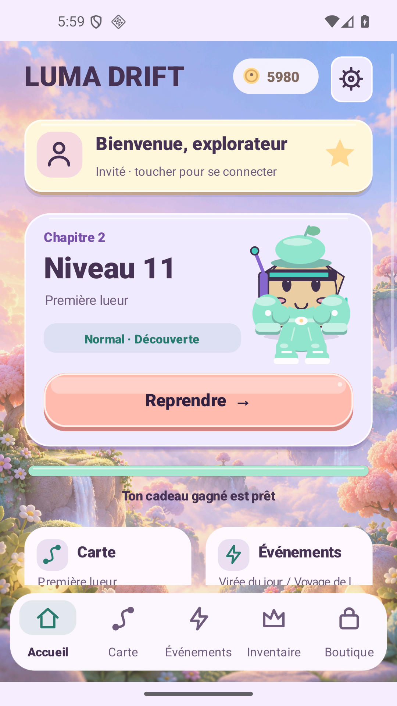
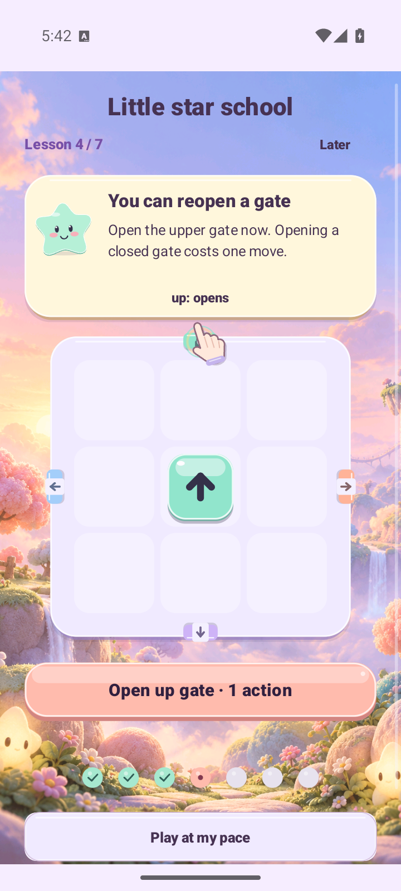
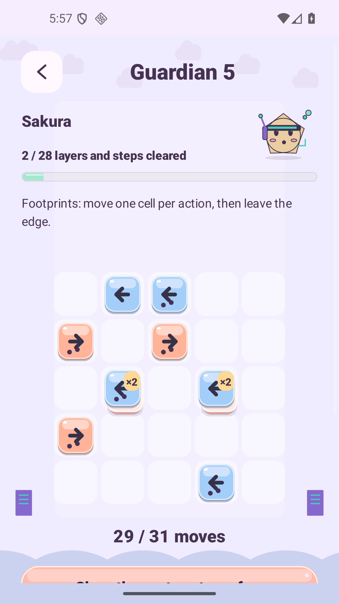
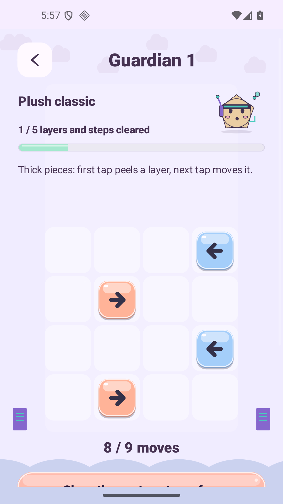
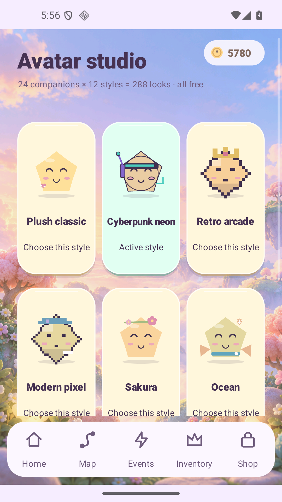

<h1 align="center">Luma Drift</h1>
<p align="center"><strong>A soft little world. Every move matters.</strong><br>Learn the gates. Restore the Prism. Dress your little companion.</p>
<p align="center"><a href="https://raw.githubusercontent.com/nabz0r/AndroidHit/main/releases/luma-drift-1.9.0-rc1.apk"><strong>Download signed Android APK · 1.9.0-rc1</strong></a><br><a href="https://luma-drift-production.web.app/">Website</a> · <a href="docs/RELEASE_1_9.md">Release & evidence</a> · <a href="docs/README.md">Documentation</a> · <a href="docs/ROADMAP.md">Roadmap</a></p>
<p align="center">1,000 Journey boards · 240 Remix · 100 optional guardians<br>7 playable lessons · 24 companions × 12 free visual treatments · 6 powers · 6 languages</p>

<p align="center"></p>

Unedited **Lab 1.9** Android SDK captures: a completed test route and a separate genuine first installation. These are guest states; they do not establish Google login or real purchases. [Exact APKs, actions and limitations](docs/validation/v1.9/README.md).

## Understand a move, then choose it

A piece follows its arrow. Pieces, numbered seals and closed exits can block it. A matching key removes a seal; an exiting switch changes gates. A closed gate can also be opened manually for one action. Exact minimum productive actions plus a fixed margin determine each board's allowance.

- **Readable consequences.** Gate and switch previews show their immediate changes. Confirm costs one action; cancel costs none. In 1.9 both controls stay inside compact windows.
- **Free recovery.** Undo restores the last productive action and refunds its move, including at zero. Restart is free. Every reachable state of the current L/M route remains recoverable.
- **Useful powers.** Spark highlights a next move; Focus, Trail and Flow also understand gate openings. One confirmed charge has one durable effect. Each of the six powers now has an explicit free one-unit sample at its existing unlock level.
- **Honest stars and gifts.** Briefings show the exact three-star action threshold. Victory shows actual coins/XP, the next five-clear gift and available power samples. The promised gift stays stable until claimed, including a storage retry.

[Gameplay](docs/GAMEPLAY.md) · [Exact route audit](docs/PROGRESSION_V4.md) · [Six powers](docs/MOVE_BUDGET_POWERUPS.md) · [1.9 UX contract](docs/UX_1_9.md).

## A little star school that works

Seven small, optional boards teach arrows, blockers, keys, gates, switches, refunded Undo and Spark. A glowing target and illustrated fingertip demonstrate the action. **Tap or drag along the arrow; skip, resume at the same step, or replay from Help.**

This release reproduces and fixes the lesson-4 touch/scroll conflict, makes its confirmation visible, and takes completed learners straight to the first adventure briefing. Finishing all lessons grants **100 LumaCoins + 2 Sparks once**. Practice consumes no inventory and grants no campaign wins.

[Tutorial](docs/TUTORIAL.md) · [Actual fresh-install native report](docs/validation/v1.9/ui-sdk-fresh-guest-d/host-report.json).

## Restore the Prism, one encounter at a time

Every ten distinct Journey clears unlock another optional Prism guardian: **100 encounters** across the thousand-board route. Restore Nova's fragments in separate puzzles, with one saved active guardian attempt. They do not block the main Journey.

**Thick slabs marked ×2 need two actions.** From guardian 5, footprint-marked pieces move **one cell per action** along their arrow. Layers, remaining work and used actions are explicit. Free guidance, refunded Undo and restart are available; these encounters consume no power stock or premium currency. A first solved encounter offers **100 earned LumaCoins**, once.

<p align="center"></p>

[Rules, story and compatibility](docs/GUARDIANS.md) · [All reachable productive guardian states](docs/validation/v1.9/journey/guardians/summary.json).

## Make the world yours

Avatar Studio offers twelve free treatments: plush, cyberpunk, retro arcade, modern pixel, sakura, ocean, space, steampunk, candy, Halloween, Valentine and ice. **24 existing companions × 12 treatments = 288 combinations**, with distinct geometry and five expression poses. Treatments change appearance; owning one does not unlock an unowned companion. They are original code-drawn variations, not 288 hand-painted sprites.

The companion reacts on home, in play and at victory. Restrained scenery follows actual cleared progress while controls stay fixed; reduced motion freezes the movement. Original synthesized music and separate effects/music controls remain. The map scrolls across ten hundred-level atmospheres.

The wardrobe keeps its 24 cosmetic pieces and explicit owned/equipped/unowned states. Older Head/Aura/Charm equipment keeps its documented bounded benefits. Daily visit gifts and daily/weekly quests remain separate; missed days lose nothing. Earned **LumaCoins** and premium account **LumaGold** have distinct shops and balances. Real checkout and premium draws remain closed in this candidate.

[Art and audio](docs/ART_AUDIO.md) · [Native art atlases](docs/validation/v1.9/avatar/README.md) · [Economy](docs/ECONOMY_1_7.md).

## Tested behaviour, with clear limits

The exact route audit passes again on all **1,240 L/M boards**, **13,254,058 reachable states** and **57,403,554 transitions**. The new independent guardian audit covers **100 unique encounters**, **6,197,718 states** and **34,045,573 productive transitions**. Native SDK gestures finish the first 100 Journey levels; a separate fresh Android installation exercises the seven lessons. Signatures, official bundletool, 16KB ZIP/native alignment and both release lint checks pass.

The [final-byte native suite](docs/validation/v1.9/ui-sdk-final5-full100/host-report.json) passes **2,277 checks**, including 300 individual clear/grade/budget assertions across the first 100 Journey levels. A separate genuine first install passes **85 checks** on 4KB-page Android; production startup and actual audio lifecycle pass **7 checks** on 16KB-page Android. Earlier candidate and harness failures remain in the [validation history](docs/validation/v1.9/README.md), with their original results and different APK hashes. These are emulator observations, not physical-device acceptance.

The [new-player audit](docs/PLAYER_AUDIT_2026.md) uses six declared behaviour profiles, 16,000 independent trials and 72 sequential journeys per version. A separate 720-encounter guardian simulation checks layered movement, interruptions and receipts. [Public primary research published in 2026](docs/research/2026-new-player/README.md) anchors design priorities, including adult Gen Z and 50+ contexts. Error rates and timing are **hypotheses**, not survey-derived Luma behaviour. No individual records are scraped. These results do not predict human appeal, D1/D7 retention or revenue. Physical phones and real player comprehension still need testing.

[Complete evidence and earlier failures](docs/validation/v1.9/README.md) · [Roadmap](docs/ROADMAP.md).

| Artifact | Download | SHA-256 |
| --- | --- | --- |
| Production APK · 7.74 MB | [1.9.0-rc1](releases/luma-drift-1.9.0-rc1.apk) | `b02225c0464bf35cc1c04f64f0a4c8b1db610bde36b293bae9790f1a9e2c2b05` |
| Production AAB | [1.9.0-rc1](releases/luma-drift-1.9.0-rc1.aab) | [Manifest](releases/manifest-1.9.0-rc1.json) |
| Separate Lab APK/AAB | [Lab APK](releases/luma-drift-1.9.0-sandbox.apk) · [AAB](releases/luma-drift-1.9.0-sandbox.aab) | [Manifest](releases/manifest-1.9.0-sandbox.json) |

[Published source 6fbb1649](https://github.com/nabz0r/AndroidHit/commit/6fbb1649432c9a86b7de6c5ed9a8e3af33a049ba) · [Independent public download verification](docs/validation/v1.9/publication.json). All four selected APK/AAB downloads match the frozen manifests. [Firebase website delivery](docs/validation/site-v1.9/deployment.json) is confirmed from the same source revision.

Android 8+ / API 26; version code **10**; production package `com.androidhit.lumadrift`. Install over the existing app to retain saves. Signing identity is unchanged. [Installation](docs/RELEASE.md) · [All checksums](releases/SHA256SUMS.txt) · [Historical 1.8](docs/RELEASE_1_8.md).

## Compatibility and service status

Published L/M/T boards and older C/R/B/Q/G/H/J/K/P/E layouts, allowances and codes remain unchanged. Guardian saves and style/claim receipts are separate. Existing balances, possessions and completed-level rewards remain. Three-star grading for new victories is now based on the displayed action threshold; existing saved stars are retained.

Google remains optional and does not synchronize local gameplay saves. Friend/account services are prepared for real two-account qualification; this release fabricates no friendships or transactions. **Test advertising is forced, real checkout is gated and paid cosmetic draws are disabled.** No server code or remote gameplay analytics SDK changed. The owner reports the Play developer account approved; creating the app and qualifying its internal release is the next step after this delivery, not an achieved store publication.

[Privacy](docs/PRIVACY.md) · [Production setup](docs/DEPLOIEMENT_PAS_A_PAS.md) · [Social qualification](docs/QUALIFICATION_SOCIALE.md) · [Server](server/README.md).

## Build and explore

Use JDK 21, the Android SDK and the Gradle wrapper; Java source compatibility remains 17. Private signing files are ignored and never published.

```sh
./gradlew assembleProductionRelease bundleProductionRelease lintProductionRelease
./gradlew assembleLabRelease bundleLabRelease lintLabRelease
bash scripts/test-strategy-v4.sh
bash scripts/test-new-player-v19.sh candidate
bash scripts/test-guardian-v19.sh
bash scripts/test-guardian-profiles-v19.sh
```

[Development and additional regressions](docs/DEVELOPMENT.md) · [Native SDK QA runner](scripts/v19-ui-test/README.md). Original game source and repository assets: **AGPL-3.0**. [Notices](docs/THIRD_PARTY_NOTICES.md). No Candy Crush or Crash Fever artwork, characters, audio or code is included.
