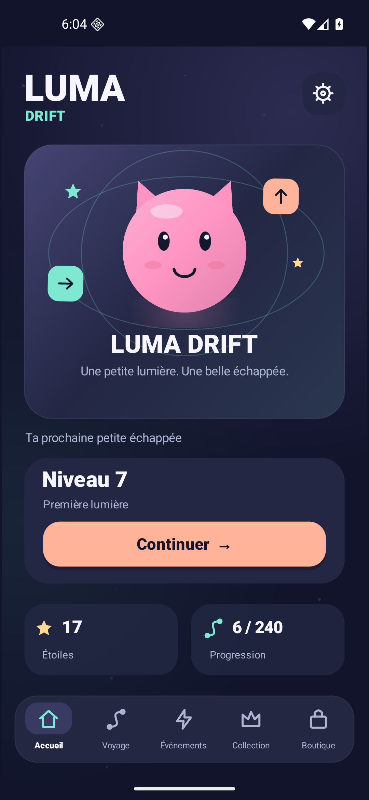
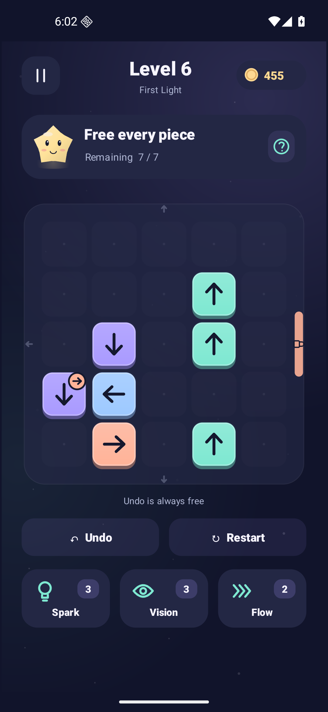
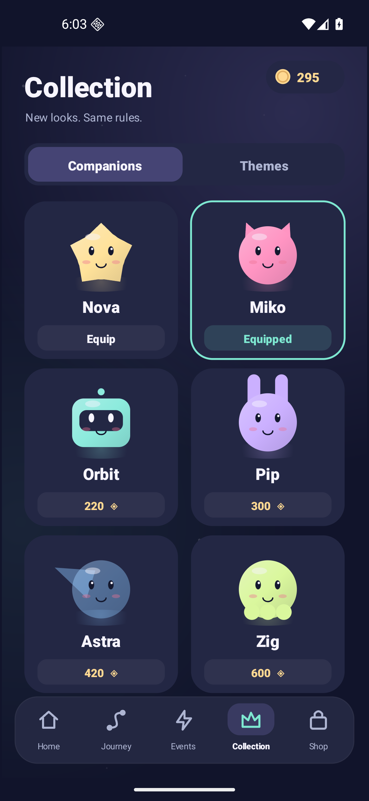

# Luma Drift

A complete offline Android puzzle game about small lights finding their way out. Built for [AndroidHit](https://github.com/nabz0r/AndroidHit).

**[Download the signed APK](releases/luma-drift-1.0.0.apk)** · [Install and release notes](docs/RELEASE.md) · [Gameplay](docs/GAMEPLAY.md) · [Validation](docs/VALIDATION.md)

<p>



</p>

## Play

Tap a light to send it along its arrow. Its path and exit gate must be clear. Some lights toggle a gate after leaving: choose the order, empty the board, and collect stars. Undo and restart are free. Blocked taps do not cost lives or currency. There is no timer.

- **240 deterministic, solvable campaign boards**, across eight chapters, from 5×5 to 6×6.
- **Six original animated vector companions** and six color themes, purchased with earned coins.
- **Three items:** Spark reveals a safe move, Vision highlights currently free pieces, Flow plays three safe moves.
- **Local daily and weekly events:** three daily puzzles, seven weekly stages, completion bonuses. These follow the device date and work offline.
- **Six languages:** French, English, German, Spanish, Portuguese and Italian; automatic system selection with English fallback.
- **Original synthesized audio:** eleven effects, a soft looping soundtrack, separate music and sound switches, optional haptics and reduced motion.
- Local progression and interrupted-game restoration; virtual accessibility controls, directional descriptions, keyboard navigation and safe system-bar insets.

The shop uses **earned in-game currency only**. This version contains no advertising, analytics, real-money payments, account system, online leaderboard or backend. Events are local challenges, not remotely operated live events. All levels can be completed without spending items.

## Build

Requires JDK 17, Android SDK platform 36, build-tools 36 and the Gradle wrapper. The first build may download the Gradle distribution and Android build dependencies.

```sh
export JAVA_HOME=/path/to/jdk-17
export ANDROID_HOME=/path/to/android-sdk
./gradlew assembleDebug
```

For release signing, create a private keystore and a local `signing.properties` file as described in [DEVELOPMENT.md](docs/DEVELOPMENT.md). Private signing files are excluded from Git. Never commit a keystore or its password.

```sh
scripts/test-engine.sh
scripts/test-data.sh
./gradlew assembleRelease bundleRelease lintRelease
```

The lightweight JVM tests do not require an emulator. The [interaction regression](scripts/smoke-emulator.py) requires an explicitly selected Android emulator; it refuses physical-device serials. See [validation evidence](docs/VALIDATION.md) for what was actually run and its limits.

## Documentation

| Document | Purpose |
|---|---|
| [GAMEPLAY.md](docs/GAMEPLAY.md) | Rules, progression, levels, items, stars and economy |
| [ART_AUDIO.md](docs/ART_AUDIO.md) | Original vector art, palettes, characters and sound design |
| [DEVELOPMENT.md](docs/DEVELOPMENT.md) | Architecture, building, signing and test commands |
| [RELEASE.md](docs/RELEASE.md) | APK/AAB, installation, signing and checksums |
| [VALIDATION.md](docs/VALIDATION.md) | Measured checks, emulator coverage and remaining limits |
| [PRIVACY.md](docs/PRIVACY.md) | Actual data behavior of this release |
| [Research archive](docs/RESEARCH.md) | Initial French market research and project recommendation |

The initial market research is retained as historical planning material. Its forecasts and proposed Godot stack do not describe this implementation: Luma Drift uses native Java and Android Canvas, with no third-party runtime libraries.

## License

[GNU Affero General Public License, version 3](LICENSE). Original source code, vector graphics and synthesized sounds are provided under this license. Android platform APIs and the Gradle build toolchain retain their own licenses. The wrapper JAR is part of Gradle, under [Apache 2.0](https://github.com/gradle/gradle/blob/master/LICENSE). Third-party game names in the research are references and are not licensed by this repository.

There is no claim of guaranteed commercial success, global trademark clearance, Google Play approval, or testing on every phone. The APK is a signed, playable first release; the validation document gives the precise evidence.
