<h1 align="center">Luma Drift</h1>
<p align="center"><strong>Small companions. Bigger adventures.</strong><br>1.22 candidate · a companion on the path, readable key links and a shared tactical reserve · Android acceptance passed; website delivery pending</p>

## Cognitive Lab — local synthetic player research

**[Open the FR/EN report](https://luma-drift-production.web.app/lab/cognitive/index.html)** · [1.22 method, results and limits](docs/validation/cognitive-lab-v122/README.md) · [Historical 1.21 research and delivery](docs/validation/cognitive-lab/README.md). The new local experiment covers 21,000 campaign trajectories, 84,000 assistance-free probes and 54,000 separate tactical runs, with 100 generated profiles and zero human participants. It compares visible feedback and actual companion actions, keeping manual and automated exits separate. Cognitive parameters and continuation measures are synthetic hypotheses; these results establish no human retention, enjoyment or clinical outcome.

[Workspace cleanup, 30 October 2026](docs/validation/cleanup-2026-10-30/README.md) removes 4.97 GB of ignored reproducible files and saves another 6.10 GB of allocated Git storage. Source, published releases, historical evidence and all Git objects remain. The reusable cleanup script defaults to a dry run.

## Current 1.22 — Android candidate accepted, website delivery pending

The exact **production `1.22.0-rc1` and separate Lab `1.22.0-sandbox-rc1`, code 30**, candidate C has passed its scoped Android acceptance. [Frozen C package metadata](docs/validation/v1.22/candidate-c/candidate.json) and the [canonical signed-artifact manifest](releases/manifest-1.22.0-rc1.json) bind the two collected APKs. [Production qualification](docs/validation/v1.22/README.md), [Lab upgrade preservation](docs/validation/v1.22/native-lab/candidate-c-upgrade-preservation/report.json) and [Lab FR/EN launch](docs/validation/v1.22/native-lab/candidate-c-launch-fr-en/report.json) retain separate receipts; all seven recorded production preference maps remain unchanged across Lab checks. Public delivery is still pending. The homepage retains the identified 1.21 APKs and native images until the new lab assets, exact C source and eight [accepted native frames](docs/validation/v1.22/native/candidate-c-canonical-media.json) are prepared and published together.

The journey now separates the companion's world position, the chosen destination and the camera. Accessible destinations animate along the route; dragging and minimap navigation move only the camera, and recentering finds the companion. Exploration does not clear puzzles. [Map contract](docs/JOURNEY_WORLD_1_22.md).

Keys and locks expose their actual association. A key exit opens linked barriers; Undo restores the authoritative board state. Immediate block feedback identifies a closed gate, blocking piece or missing key, while a legal exit can still be strategically wrong. Motion and reduced-motion rendering keep those state changes explicit.

The **Echo Observatory** adds twelve new manually solvable layouts in two episodes. A sortie chooses four boards through two forks, with loaned Nova, Hoot and Orbit. One shared reserve starts at six Charge and does not refill between boards or retries. GUIDE costs 2, one-step REWIND 2, and two-exit FLOW 3; each can be used once per sortie. Two used families enable one explicit Resonance. A first completion of each episode earns 120 Coins and its local souvenir marker; replaying the episode does not repeat that gift. Loans grant no companion ownership or copies. [Gameplay and persistence contract](docs/TACTICAL_CHAPTER_1_22.md).

The chapter has an isolated save, no elemental shells, no session-energy debit and no item powers. Its manual Undo costs no Coins and keeps the original productive action spent. **Ordinary eligible campaign attempts retain two free Undos, followed by an explicitly confirmed Coin price capped at 40**; the chapter's different rule must not be advertised for the campaign. The existing collection, evolution, rooms, gallery, audio, account routes and archived APKs remain preserved.

Host checks pass 8,020 assertions for content, actual effects and strict run restore, plus 1,874 for the real isolated session/GameStore on durable preference doubles, including failed writes and concurrent handles. The separate Android receipts establish their emulator scopes; physical-phone comfort, first-player comprehension and voluntary return remain unmeasured. The prepared [browser explanation source](public/lab/ui-1-22/index.html) is a schematic demo with fictional state, not a native gameplay capture or account session.

## Previous 1.21 — delivered for playtesting

**[Production APK](https://luma-drift-production.web.app/releases/luma-drift-1.21.0-rc1.apk)** · **[Separate Lab APK](https://luma-drift-production.web.app/releases/luma-drift-1.21.0-sandbox-rc1.apk)** · **[Playable simulation](https://luma-drift-production.web.app/lab/ui-1-21/index.html)** · [Website](https://luma-drift-production.web.app/)

**Production `1.21.0-rc1` and separate Lab `1.21.0-sandbox-rc1`, code 29, are delivered for playtesting with separately scoped native acceptance.** [Exact bytes, sizes and signer](releases/manifest-1.21.0-rc1.json) · [Release scope and evidence](docs/RELEASE_1_21.md) · [Frozen B source/package record](docs/validation/v1.21/candidate-b/candidate.json). Application source, native evidence and artifact metadata are published at [C1 `35bb8222`](https://github.com/nabz0r/AndroidHit/commit/35bb82229d8175968919b5979264e5094a1cc8dc). Website source and local QA are published at [C2 `71bba893`](https://github.com/nabz0r/AndroidHit/commit/71bba893a5fbfeb808e5c44840b6701862255453). [CI run 40976045727](https://github.com/nabz0r/AndroidHit/actions/runs/40976045727) passes both jobs and all 36 steps; [Firebase Hosting](docs/validation/site-v1.21/hosting/deployment.json) confirms C2 as DEPLOY/FINALIZED, version `d08a2aa131c05c4f`, released `2026-10-30T00:08:28.331Z`. The exact original remote receipt bytes are retained; the [delivery register](docs/validation/v1.21/publication/release-delivery.json) keeps source, native, local browser and Hosting scopes separate.

The home puts a large full-body avatar, its copies/forms and the actual player XP first. Appearance and puzzle skills have separate explanations. Play is followed by direct **Home / Living room / Kitchen / Garden** shortcuts; the kitchen is a real independently saved room, separate from the optional 440-Coin furnishing. The illustrated boutique retains real prices, ownership, previews and fixed odds before confirmation.

Ten map zones and animated puzzle worlds carry the adventure. Eligible new U11+ and expedition attempts add ice/fire/water shells cleared by free taps. Three distinct manual exits without correction earn one free Focus per attempt. Scene fades last 300 ms; balance and XP motion follows actual values and respects reduced motion.

The economy is explicit: first-clear campaign rewards grow from ×1 to ×2 by U1000; base boost prices grow up to ×1.4 before avatar discounts. New eligible attempts have two free Undos, followed by a confirmed earned-Coin price capped at 40. Energy capacity grows from 10 to 16 without filling the counter, with unchanged one-per-ten-minute regeneration. Account Gold remains separate; real purchases stay closed.

[Host/model evidence](docs/validation/v1.21/host/README.md) distinguishes the accepted A scopes, corrected historical transition-test expectation and unchanged B model dependencies. [Eight current B FR/EN native originals](docs/validation/v1.21/native/site-media-candidate-b-accepted/capture-map.json) bind the exact production APK. [Production B acceptance](docs/validation/v1.21/native/candidate-b-final-index.json) passes 13 exact-package phases: 574 native assertions, 149 touch actions, 52 original PNGs and two videos; 38 derived comparisons stay separate. [Isolated Lab acceptance](docs/validation/v1.21/native-lab/candidate-b-final-index.json) passes three phases: 99 assertions, 41 touches, nine PNGs and one video, plus 24 separate derived comparisons. Its actual 450→400 test-Gold debit and energy 0→10→9/cold 9 leave all six production preference maps [unchanged](docs/validation/v1.21/native/production-profile-preserved-after-lab.json). Hosted CI passes on exact C2; all physical Hosting payload hashes are verified in its clean deployment checkout. The prepared site binds 525 physical payloads and pins 507 files at the preparation checkpoint after the privacy update. Compared with 1.20, 506 files remain byte-identical, the homepage and privacy page change explicitly, 17 files are new and none are removed. [Source comparison](docs/validation/site-v1.21/hosting/previous-source-diff.json). The homepage bytes exactly match the already reviewed local preview. [Prepared source QA](docs/validation/site-v1.21/source-qa-prepared.json) passes 1,143 offline source/provenance checks and all 78 tests in the full hosted website command. Local browser simulation passes 32 responsive view/language/width checks and a complete teaching loop; it changes no Android save. [Simulation source](docs/validation/site-v1.21/staging/lab/ui-1-21/index.html) · [Local browser report](docs/validation/site-v1.21/browser-local/simulation/report.json) · [Website workflow](docs/validation/site-v1.21/README.md).

<p align="center">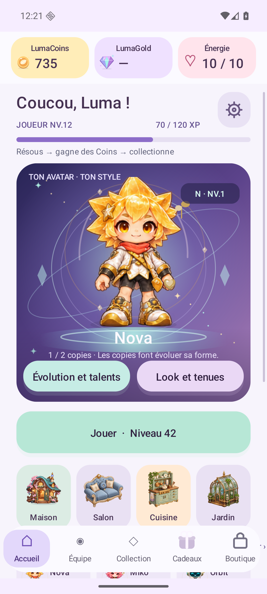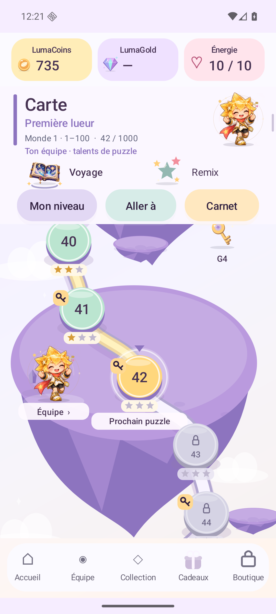</p>

Original unedited B frames. [Complete local homepage QA](docs/validation/site-v1.21/browser-local/homepage/report.json) covers eight responsive FR/EN states and 40 individually visible native image loads, plus the preserved gallery, deliberate audio switching, keyboard focus and updated privacy page. [Prepared public-directory browser review](docs/validation/site-v1.21/browser-local/prepared/report.json) separately passes four FR/EN mobile/desktop states and 20 actually visible native image loads, with zero observed console errors. This is local evidence. Public-origin response bytes and public rendering remain unverified under the saved permission refusal. Emulator/model/browser checks do not establish physical-phone comfort, human enjoyment, retention, Play publication or real-provider purchases. The previous 1.20 delivery and all earlier receipts remain preserved below.

## Preserved 1.20 — delivered for playtesting

**[Production APK](https://luma-drift-production.web.app/releases/luma-drift-1.20.0-rc1.apk)** · **[Separate Lab APK](https://luma-drift-production.web.app/releases/luma-drift-1.20.0-sandbox-rc1.apk)** · [Exact sizes, signer and SHA-256](releases/manifest-1.20.0-rc1.json) · [Delivery record](docs/validation/v1.20/publication/release-delivery.json).

The 1.20 Android release presents a lighter home, the equipped companion and owned squad, a clear **Play** button, actual ready-gift badge and a visible **Boutique**. Five persistent destinations replace the main menu's scattered routes; the room and workshop remain accessible. Menu LumaCoins, account LumaGold and session energy stay visible while content scrolls. Unknown Gold remains unknown.

Daily and weekly objectives now appear as gifts. A successful durable claim opens a reveal that waits for a tap; collected gifts have no claim action. The illustrated shop shows one featured item at a time, with real prices, ownership and previews. [Menu scope](docs/UX_1_20_MENUS.md) · [73,838 latest menu assertions /504 configurations](docs/validation/v1.20/menu/shop-e/README.md) · [1.20 release gates](docs/RELEASE_1_20.md).

**Production and Lab F are delivered for playtesting, with separately scoped native acceptance.** The exact `1.20.0-rc1`/code 28 APK passes [11 scoped reports](docs/validation/v1.20/native/README.md): 457 native assertions, 180 touchscreen actions, 76 original PNGs and one 60-second recording. Another 38 read-only comparisons are counted separately. Actual three/two/one-star first clears, result recovery, real gifts, zero-energy resume, expedition context, small-window wallet swipes, compact FR/EN and six-language menus are covered. Six exact-F home/shop/victory frames are [recorded](docs/validation/site-v1.20/native-capture-map.json). [Canonical package metadata](releases/manifest-1.20.0-rc1.json) and application proofs are published at [C2 `7ea28bc6`](https://github.com/nabz0r/AndroidHit/commit/7ea28bc6125e73d0543b264081266aeff510b071). The website/preparation/local-QA source is published at [C3 `eaae0fba`](https://github.com/nabz0r/AndroidHit/commit/eaae0fbad15b074409f608e5a2afe7913c3bee3b); Firebase confirms C3 as DEPLOY/FINALIZED, version `94f0979d7a02c3b2`, released `2026-10-29T22:29:43.998Z`. The separate [Lab purchase/cold scope](docs/validation/v1.20/native-lab/README.md) also passes: 48 native assertions/13 touches/6 PNGs, with 12 derived comparisons separate. Its 500 → 450 test-Gold debit and energy 0 → 10 → 9/cold 9 leave the production profile intact; this activates no real purchase.

[The local Hosting record](docs/validation/site-v1.20/hosting/deployment.json) transcribes the exact C3/release fields observed in Firebase management UI; it is a derived observation, not a byte-exact export of the original remote JSON receipts. [The delivery record](docs/validation/v1.20/publication/release-delivery.json) keeps application, native, packaging and Hosting scopes separate. The [prepared site](docs/validation/site-v1.20/preparation.json) passes 1,092 local source/provenance checks over 508 payloads; [local browser review](docs/validation/site-v1.20/browser-local/report.json) records FR/EN at measured 320/375/1280/2360 widths. Public-origin byte/render observation remains unverified under the saved permission boundary. [Hosted C3 checks pass](https://github.com/nabz0r/AndroidHit/actions/runs/40963457821): offline puzzle/UI/economy, website, pinned art and premium-transport contracts. APK installation/native acceptance remains the separately recorded scope above.

<p align="center">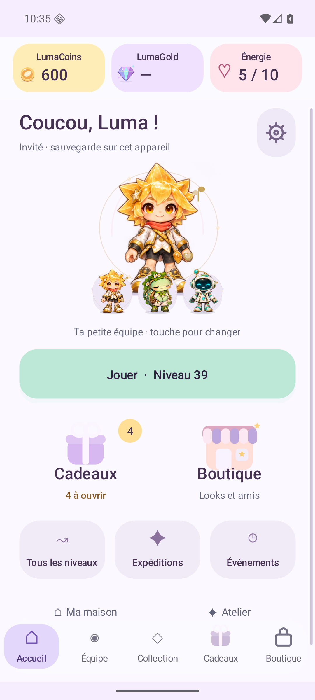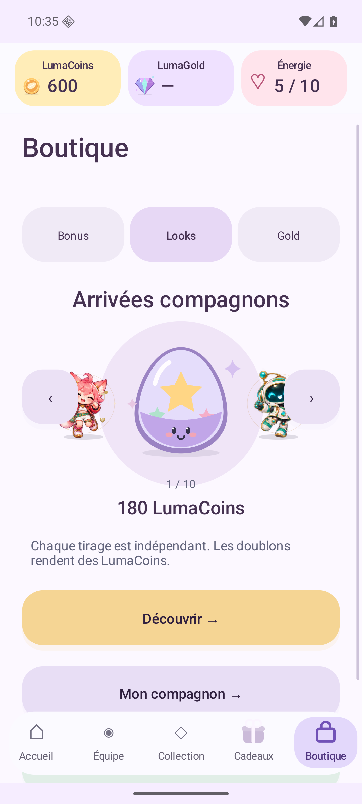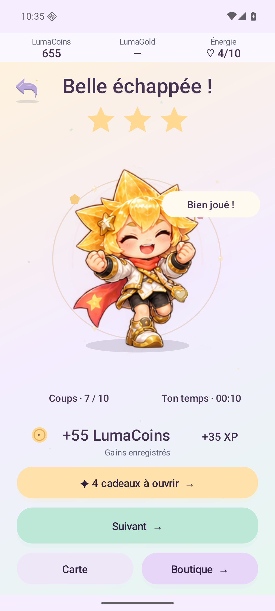</p>

Original unedited F frames, backed by the [exact capture map](docs/validation/site-v1.20/native-capture-map.json). The visible guest profile is earned play, separate from live Google or payment acceptance.

E's six-family skill traces remain **E evidence** (129 assertions/74 gestures), with six core model hashes unchanged in F. C's startup failure and failed observer attempts remain preserved. These checks do not establish human enjoyment, physical-phone performance or real-provider qualification. [Release and exact bytes](docs/RELEASE_1_20.md) · [Evidence index](docs/validation/v1.20/README.md) · [Website workflow and permission boundary](docs/validation/site-v1.20/README.md).

New relay attempts use policy 6: Undo is free but does not refund the earlier exit; the clock reports active play rather than grading stars. Session energy is a separate ten-unit counter, regenerating one per ten minutes. Companion **Charge** starts at 3 and caps at 6 within an attempt. A ten-unit refill for 50 LumaGold has a tested server/receipt protocol, while production gates remain closed and Lab uses isolated test Gold. Earned LumaCoins never pay this premium price. [Gameplay and UX](docs/UX_1_20.md) · [Premium protocol and limits](docs/ENERGY_PURCHASE_1_20.md).


## Preserved 1.19 — companions join the puzzle

The Android source now implements **one-to-three companion squads**, **six puzzle-skill families across 37 parameterized identity definitions**, and **reactions tied to actual play**. This is more than an avatar preview: GUIDE, VISION and TRAIL explain the board; PULSE and FLOW execute certified exits; REWIND restores real move history. Two used talents from different families charge one explicit **Resonance** action. Costumes remain presentation choices, separate from skill identity.

Each U attempt starts with **3 shared talent-charge units**, capped at **6** (called energy in 1.19; separate from 1.20 session energy). A new exited piece earns one unit of this talent charge, including automatic exits; undo/re-exit cannot farm it. Each team member uses its talent once. Team editing uses only owned companions and is saved for the next board; it spends no currency and does not replace the equipped appearance. The native dock, preview/activate pages, highlighted effects, emotional reactions and equipped portrait compose the new interaction; reduced motion remains supported.

**Published 1.19 delivery: C (`prototype2` / code27), with website source C3.** Its ten reports contain 419 executed assertions, 209 real gestures, 58 original PNGs and a 45-second recording. They cover all six skill families, team/combo state, compact FR/EN, six-language squad views, Expedition context and cold persistence on one isolated emulator. B’s reproduced compact navigation failure remains preserved. These checks do not establish physical-phone comfort or owner acceptance. [Native scope and original media](docs/validation/v1.19/native/README.md).

C3 source [`ccc3e025`](https://github.com/nabz0r/AndroidHit/commit/ccc3e025a088034d3b1f65d294e1e9cf68eb6e20) was deployed on **2026-10-29T20:29:13.810Z**, Firebase version `a64a7ef1faadf791`. Complete public-byte verification passes **500 responses /2,092,742,901 bytes**, including both signed APKs. A subsequent saved permission **blocked public browser observation**; no alternate browser or indirect renderer was used. Local responsive browser evidence remains a separate scope. [Hosting receipt](docs/validation/site-v1.19/hosting/deployment.json) · [Byte verification](docs/validation/site-v1.19/public-origin.json) · [Browser boundary](docs/validation/site-v1.19/browser-public/blocked.json) · [1.19 delivery record](docs/validation/v1.19/publication/release-delivery.json).

**Preserved 1.19 downloads:** [Production 1.19 APK](https://luma-drift-production.web.app/releases/luma-drift-1.19.0-prototype2.apk) · [Separate Lab 1.19 APK](https://luma-drift-production.web.app/releases/luma-drift-1.19.0-sandbox-prototype2.apk). These external files match their complete recorded hashes; no APK Git blob is required. [Exact sizes, signer and SHA-256](releases/manifest-1.19.0-prototype2.json) · [1.19 release](docs/RELEASE_1_19.md) · [Website scope](docs/validation/site-v1.19/README.md) · [Gameplay](docs/GAMEPLAY_1_19.md) · [Actual 1,000-board action-draft checks](docs/validation/v1.19/actions/README.md).

<p align="center">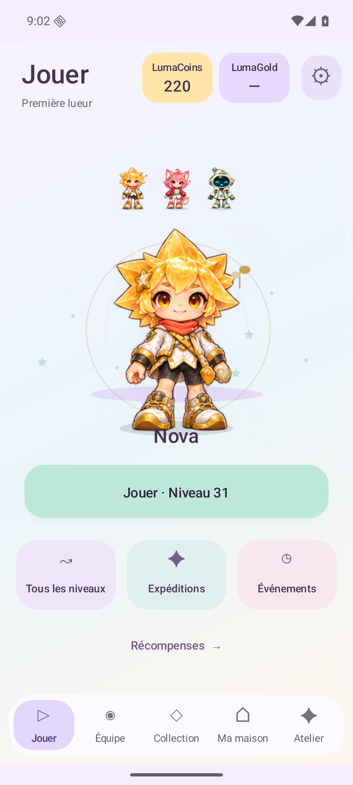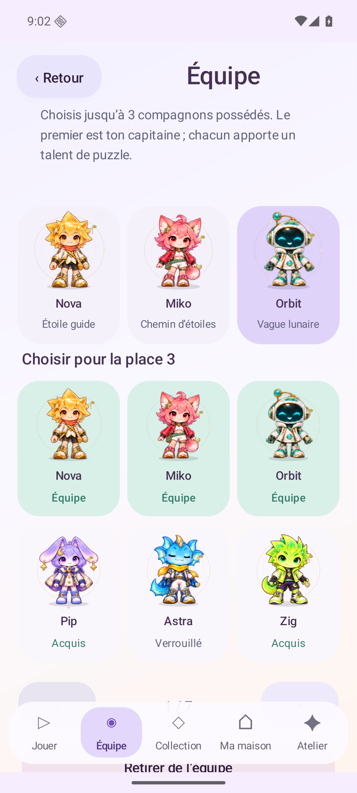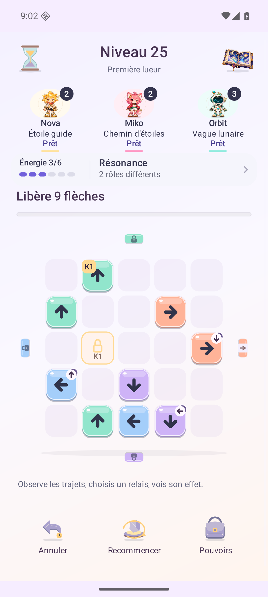</p>

Original C Android frames from an earned guest profile. Its first 30 victories and ownership were acquired on A and preserved through B/C upgrades; they are not 30 fresh C victories. [Exact capture provenance](docs/validation/site-v1.19/preparation.json).

## Preserved 1.18 H delivery

**1.18 H is published on Git and the existing Firebase site.** Frozen source/artifact metadata is at [C1 `4972565`](https://github.com/nabz0r/AndroidHit/commit/4972565151521c5910b2e5d90921491f00acb7eb). Historical 1.18 site source is [C3 `a2a0440`](https://github.com/nabz0r/AndroidHit/commit/a2a044047f9232b871bd2c035c27d3f24d8ad26c); Firebase confirms DEPLOY/FINALIZED, version `381fee5ff7548191`, released **2026-10-29T18:40:32.706Z**. C3 corrects only the standalone wardrobe prototype HTML; Android H remains unchanged. The complete C2 public-byte check passes489responses, including both exact APKs; main-site FR/EN browser checks also pass. C3 targeted public bytes and20 browser assertions pass at1280×720 and320×720, with their own scope. [1.18 deployment](docs/validation/site-v1.18/hosting/corrective-c3/deployment.json) · [Publication evidence](docs/validation/site-v1.18/README.md) · [Native validation](docs/validation/v1.18/README.md).

**Historical owner playtest of 1.18,29 October2026: selection clarity, interaction, navigation and perceived fluidity failed human acceptance.** The 1.19 implementation above follows that feedback; new owner and physical-phone acceptance remain pending, separately from the recorded emulator passes. [Try the1.19 interaction proposal](https://luma-drift-production.web.app/lab/ui-1-19/index.html?revision=a2a044047f9232b871bd2c035c27d3f24d8ad26c) · [Menu/gacha design proposal](docs/design/v1.19/UX_RETHINK_FR.md). This browser mockup uses a fictitious profile, makes no Android save changes and does not establish that the proposed UX is accepted.

Explore **37 companions:24 Luma originals and13 Mini LoL fan-art guests**. Each has four authored forms at levels1/3/6/10 and20 poses, including four directions, walking, jump/landing, hug/crouch, emotions and calm/ready/guard/proud stances. Fixed N/R/SR/SSR rarity stays separate from copy levels:1 copy at level 1,2 at level 2,8 at level 3, up to 10. Later thresholds remain provisional.

Four-puzzle Observatory expeditions connect actual puzzle boards, route forks and the Nova reveal, Miko reroute and Orbit project skills. Work toward a chosen copy or a home souvenir, then reveal a random discovery. The campaign puzzle session remains separate. Original costumes are the default without an earlier explicit garment choice; the wardrobe remembers original costume versus saved outfit while preserving ownership, selections and coins. Legacy clothing overlays remain approximate, and the studio toggle is an independent preview.

**Historical 1.18 downloads:** [Signed production APK](https://luma-drift-production.web.app/releases/luma-drift-1.18.0-prototype1.apk) · [Separate sandbox APK](https://luma-drift-production.web.app/releases/luma-drift-1.18.0-sandbox-prototype1.apk). These approximately369MB artifacts are external downloads, not APK Git blobs. [Exact expected sizes, signer and SHA-256](releases/manifest-1.18.0-prototype1.json). Their physical deployment copies were verified before upload; [independent public HTTPS verification](docs/validation/site-v1.18/public-origin.json) also matches both complete APKs and all other payloads. The H manifest preserves the historical package-creation record and is not rewritten as a current publication receipt.

<p align="center">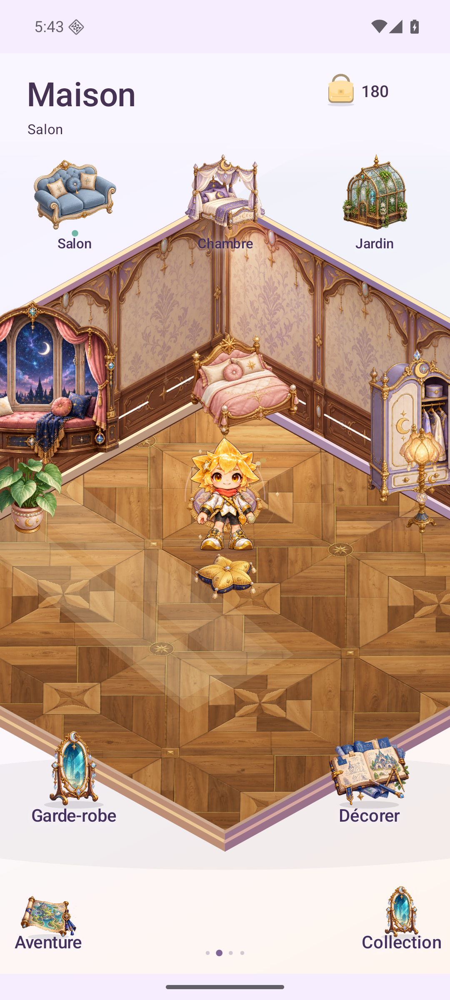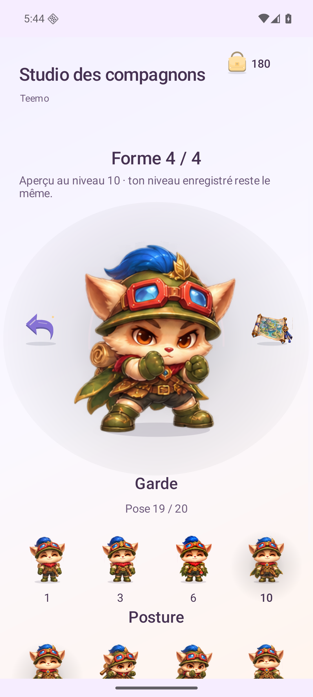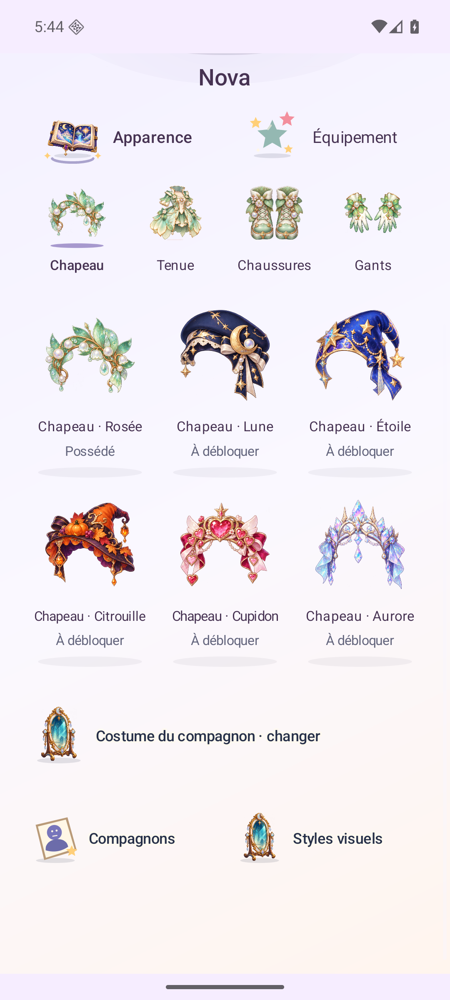</p>

Full unedited H native captures. [Source/hash provenance](docs/validation/site-v1.18/preparation.json). The site loads an atlas only after a gallery choice and retains at most four atlas references; it does not fetch all148sheets on first display. Existing account/privacy pages, audio previews and1.17 archives are preserved. **68 local publication/provenance checks and15 Node tests pass**; these retain a separate scope from the public-origin and browser receipts. [Website evidence and boundaries](docs/validation/site-v1.18/README.md).

H native evidence separately covers **12,093 Canvas checks/2,960 frames**, **118 retained-profile UI checks/73 real gestures**, and **588 fresh-production checks/170 real gestures**, including six languages, compact presentation and cold restoration. E's expedition gameplay evidence remains historical and is not relabeled as an H playthrough. All wearable attachment flags remain provisional; physical-phone comfort, outfit fit across every combination, economy balance and retention are not established.

The Mini LoL guests depict Riot Games characters. They are unofficial fan art, without Riot endorsement or sponsorship; no permission for this integration has been verified. [Official Riot policy](https://www.riotgames.com/en/legal) · [Third-party notices](docs/THIRD_PARTY_NOTICES.md). The repository's source-code license grants no rights in Riot intellectual property.

## Preserved 1.17 delivery

The following1.17 delivery and its public receipts are historical and unchanged.

<p align="center"><strong>1.17.0-rc6 · original sprites, places to touch and a living soundscape</strong><br><a href="docs/RELEASE_1_17.md">Release status</a> · <a href="docs/validation/v1.17/README.md">Executed evidence</a> · <a href="docs/design/v1.17/reference-research.md">Primary-source design research</a></p>

**Delivered: H (1.17.0-rc6 / code 24), four exact signed packages, documentation and source on Git main, and the existing Firebase website. Native acceptance, public download hashes, responsive FR/EN browser states and deliberate audio playback pass within their recorded scopes. Earlier candidates retain their original historical results.**

Four separate places—Adventure, Home, Collection and Workshop—use illustrated scenery and touchable objects in place of visible button rows, pills and a navigation bar. Optional swipes connect the places; named object targets keep navigation discoverable. Short scene fades respect reduced motion. Deeper menus retain clear costs, ownership, confirmations and accessible actions.

The bundled original art covers **24 companions, 24 garments and 42 furnishings**, with three scene illustrations and new room materials. Portraits compose the actual four clothing slots over each companion's anatomy. The three 10 × 10 rooms retain close-up, pan, pinch and whole-room views. A chosen nickname, flag and earned badges belong to the local player card.

Five sound contexts × ten biomes provide **50 synthesized arrangements**: the ten historical puzzle themes plus forty new place arrangements. Music and effects remain separate. [Actual synthesizer previews and measured host scope](docs/ART_AUDIO.md) distinguish generated PCM from recorded Android or physical-speaker output.

The U1–U1000 puzzle rules, earned-coin economy and existing save identities are retained. Companion arrivals still contain 23 possible companions for 180 earned coins; the outfit pool contains five complete looks for 260. Odds and duplicate returns are shown before spending. Test ads, closed real checkout and disabled paid premium draws remain. Google sign-in does not synchronize the local house, profile or game save.

The [release table](docs/RELEASE_1_17.md) records the audited H bytes and source freeze. H fixes a reproduced Guardian return loop, legacy puzzle gates covering their budget/help, and misnamed event previews. Shared geometry gives gates and captions separate space, keeps the board useful on short screens and scrolls complete object actions into view. The [source review](docs/validation/v1.17/review/source-candidate-h-preflight.json), native route/visual reports and [website publication register](docs/validation/site-v1.17/README.md) keep their distinct scopes. [Build and contracts](docs/DEVELOPMENT.md) · [Installation and activation boundaries](docs/PRODUCTION_RELEASE.md).

**U1–U1000 pass on this exact production APK: 49,688 native checks, 12,017 actual touch gestures and 10,974 certified piece exits.** This retained profile already owned all stars; replay adds zero coins, XP or mission credit. Complete game/meta and non-active-session state remain byte-identical. A separate genuine new install covers U1–U8 first wins, onboarding, actual Buzz/Aurora acquisition and cold persistence.

**[Signed 1.17 production APK](releases/luma-drift-1.17.0-rc6.apk)** · [AAB](releases/luma-drift-1.17.0-rc6.aab) · [Manifest](releases/manifest-1.17.0-rc6.json) · [Separate Lab APK](releases/luma-drift-1.17.0-sandbox-rc6.apk). Install production over the existing same-signed application and retain its data.

<p align="center">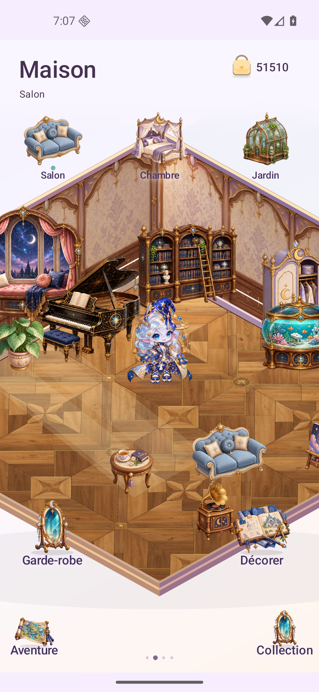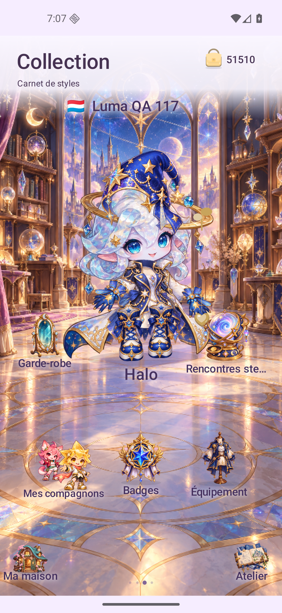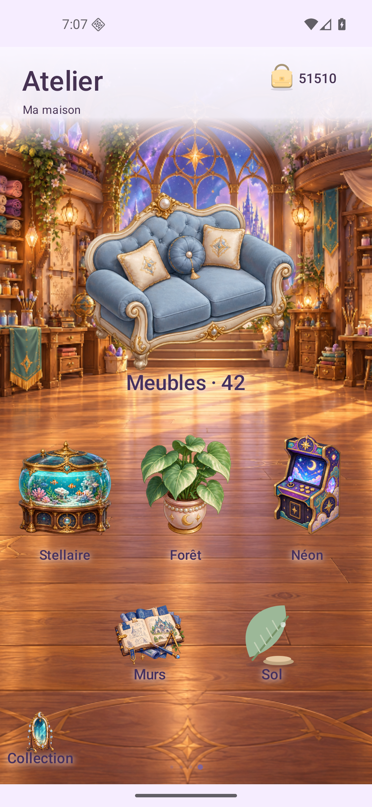</p>

**[See the new screens](https://luma-drift-production.web.app/#screens)** · **[Download the exact tested APK](https://luma-drift-production.web.app/releases/luma-drift-1.17.0-rc6.apk)** · **[Hear four scene previews](https://luma-drift-production.web.app/#sound)**.

The existing [FR/EN website](https://luma-drift-production.web.app/#screens) is delivered from clean source `fb341930fc7820dcb19326ee4c0c354f3101f610`, Hosting version `a8f7c1e30f14cd29`, finalized **2026-10-29T07:19:42.453Z**. All174 public payloads plus3 directory aliases independently match source bytes. Eight actual public FR/EN responsive states at 320/375/768/1280, gallery localization, keyboard focus and four deliberate audio playbacks pass. [Hosting, browser and hash receipts](docs/validation/site-v1.17/README.md). Four GitHub package downloads at immutable artifact source `48feddfa3758b535d84014c5397268fc4c79eb1c` match all canonical sizes and SHA-256. The [remote contract workflow](https://github.com/nabz0r/AndroidHit/actions/runs/40834726178) passes on the deployed source.

## Preserved 1.16 delivery

The home now fills its actual scene viewport, with a closer default camera, finger pan and an explicit whole-room view. Larger collection portraits, illustrated Atelier cards, accented pill actions and icon-medallion navigation give objects and characters more room.

Choose a local nickname, a flag and three badges from six earned milestones. Two separate arrivals banners use earned LumaCoins: 23 companions and five complete four-piece outfits. Exact odds and duplicate returns are shown before drawing; debit, outcome, ownership and the last result are saved together. Existing purchases, clothing capsules, 12 free avatar styles, furniture positions and puzzle rules are retained.

**[Signed 1.16 production APK](releases/luma-drift-1.16.0-rc1.apk)** · [AAB](releases/luma-drift-1.16.0-rc1.aab) · [Manifest](releases/manifest-1.16.0-rc1.json) · [Separate Lab APK](releases/luma-drift-1.16.0-sandbox-rc1.apk).

Candidate B uses code 18 and the existing signing certificate. Install production over the previous production app to preserve local data. Nickname, flag, badges, house and gameplay remain local; Google sign-in does not synchronize them. Test ads and disabled paid-provider gates are retained. The executed native, visual and publication scopes are recorded in the [current qualification register](docs/validation/v1.16/README.md); the 1.15 full 1,000-level route below remains historical evidence.

**[See the eight new screens](https://luma-drift-production.web.app/#screens)** · **[Download the exact tested Android APK](https://luma-drift-production.web.app/releases/luma-drift-1.16.0-rc1.apk)**. The FR/EN site serves sixteen unedited B captures and the signed production APK/AAB/manifest. All 151 public payloads and three directory aliases match the deployed source. [Hosting and browser evidence](docs/validation/site-v1.16/README.md).

<p align="center"></p>

## Preserved 1.15 delivery

<p align="center"><strong>1.15.0-rc1 · separated screens, relay puzzles and a larger home</strong><br><a href="docs/RELEASE_1_15.md">Release & evidence</a> · <a href="docs/GAMEPLAY_1_15.md">Gameplay and compatibility</a> · <a href="docs/validation/v1.15/README.md">Qualification</a></p>
<p align="center">1,000 versioned relay Journey boards · 30 staged opening boards · 6 languages<br>Four dedicated destinations · Three 10 × 10 rooms · 42 furniture designs</p>

**[See the redesigned website and native gallery](https://luma-drift-production.web.app/#screens)** · **[Download the signed 1.15 APK](https://luma-drift-production.web.app/releases/luma-drift-1.15.0-rc1.apk)**. The existing Firebase site now serves the exact delivered production APK/AAB and twelve unedited native frames. [Website source, browser and public-byte evidence](docs/validation/site-v1.15/README.md).

## Make your move, then make yourself at home — 1.15

Adventure, Home, Collection and Atelier now have dedicated screens. Adventure starts the next puzzle directly. Play keeps the board and its essential controls together; the wallet and global navigation return when you leave the puzzle. Illustrated item pages, a visual inventory grid, a larger wardrobe and concise reward panels give artwork and choices more space.

The new **U Journey** changes gates through piece exits and matching keys. There is no manual gate-opening action in U. Choose an order that keeps later exits possible; a wrong order can deadlock the position. Blocked tries cost nothing, every correction can be undone and refunded, and restart is free. Three stars acknowledge completion, rather than an unmeasured efficiency grade. Historical challenge codes and an active saved run retain their original boards and rules.

The home has a living room, bedroom and garden, each with a **10 × 10** floor, zoom and pan. **Forty-two furniture designs**, including an aquarium, grand piano, greenhouse, telescope, arcade cabinet and pond, have distinct original drawings and two orientations. Previewing, buying, placing, rotating and cancelling remain separate actions. Old furnishings, positions and earned balances are preserved.

[Download the signed 1.15 APK](releases/luma-drift-1.15.0-rc1.apk). The exact final production bytes complete **U1–U1000 on Android: 49,575 native checks, 12,016 actual touch gestures and 55,000 genuinely earned victory coins**, with no injected progression. Normal/320 dp screens, six languages, a real Lab 1.14 upgrade, charged powers, earned furniture purchases and cold restoration have separate passing records. The four signed binaries pass the independent [signature, manifest, bundle and static alignment audit](docs/validation/v1.15/binaries-e/binary-final-candidate.json). The [independent relay audit](docs/validation/v1.15/relay-engine/relay-host.json) passes **13,312,469 checks** across all 1,000 U boards; home transactions and projected geometry pass **2,074** and **6,494** checks. See the [qualification register](docs/validation/v1.15/README.md) for exact scopes and limits.

An active older puzzle keeps its original rules. To start the new U board at your current Journey level, tap its numbered node in Adventure; restarting the retained old attempt preserves that old board. Install the APK over the existing signed production app to keep local data.

<p align="center"></p>

Unedited final-E production frames from the passed native interface and U1–100 scopes. [Exact source/hash provenance](docs/screenshots/v1.15/gallery/provenance.json).

Portrait phones are the supported presentation. Gameplay and home saves remain local. Source/model checks, emulator execution, physical-phone experience and live commercial services are distinct scopes. The published1.17 release includes no external game characters, artwork, audio or code. The1.18 prototype adds the explicitly requested Mini LoL fan-art guests; their identities belong to Riot Games and are described in the third-party notices.

## Preserved 1.14 delivery

<p><strong>1.14.0-rc2 · source, signed artifacts and website delivered</strong><br><a href="docs/RELEASE_1_14.md">Release & evidence</a> · <a href="docs/GAMEPLAY_1_14.md">Historical gameplay rules</a> · <a href="docs/validation/v1.14/README.md">Qualification</a></p>

## Every action has a clear meaning — 1.14

The main puzzle now teaches its rules in the route itself. Straight exits lead to blockers, matching K keys, manual gate openings and switch order before those mechanics combine. A closed side is a real button with a visible one-action cost. The large arrow gives movement; small arrows name the gates changed after exit.

- **Make decisions within a real budget.** A successful exit or gate opening costs one action. A blocked try costs nothing. One Return per attempt restores the preceding position and refunds its action; its used quota survives a cold process restart. Inefficient productive choices can still lose an attempt. Restarting is free.
- **Learn through the first thirty boards.** The new N route starts with thirty authored teaching boards, then combines 970 existing piece layouts with a globally paced sequence and revised initial gate states where needed. Contextual rules and immediate causal feedback explain changes without a constant solution overlay.
- **Keep old puzzles identifiable.** N challenge codes have their own resolver. Existing L/M/T and earlier codes retain their boards. An in-progress save keeps its original geometry when its ledger is upgraded; the next new Journey attempt uses N.
- **Come home between puzzles.** Arrange twelve furnishings, dress and hug the companion, move it along a clear floor path, preview placements and work towards a chosen furnishing with existing earned LumaCoins.

[Release scope and current evidence](docs/RELEASE_1_14.md) · [The reported L15 diagnosis](docs/validation/v1.14/puzzle-ui-audit.md). The RC2 source contracts, independent curriculum review, signed-byte checks and scoped native acceptance pass. Installed-candidate acceptance, signed artifact hashes, public download verification and Firebase delivery remain separate recorded steps. Mathematical solvability is not a human difficulty or retention result.

The RC2 [content contracts](docs/validation/v1.14/audit-learning/audit-learning-contracts.json) pass 201,143 checks across 1,000 boards. A separate [curriculum review](docs/validation/v1.14/independent-pacing-review/README.md) recomputes every score and class: all 97 later episodes retain three starts with a free exit, and the longest Hard/Expert run is four. The median structural score rises over each 200-board stage. [Archived RC1 content](docs/validation/v1.14/audit-learning-rc1/README.md), intermediate installed runs and older release images do not certify the final RC2 APK. The final native images are original RC2 captures. Public artifact delivery has its own exact-byte receipt.

<p align="center"></p>

Unedited **1.14.0-sandbox-rc2** full frames from the globally passed/restored [716-check native first30/gallery route](docs/validation/v1.14/ui-bugs/ui-sdk-final30-gallery-rc2-a/host-report.json). [Exact image provenance](docs/validation/site-v1.14/screenshot-provenance.json). All 1,000 final N boards have recorded native three-star wins across ten complete passed batches: **55,423 checks, 19,920 productive actions and 142 indexed original PNGs**. This is coverage across two sessions, not a passed continuous marathon. C keeps its global FAIL/restored result: its eight complete batches cover N1–800; its failed ninth batch contributes nothing. The separate restored D session covers N801–1000 after the explicitly recorded synthetic prerequisite `unlocked=801`; no stars, coins, session, history or solution actions are injected by that setup. [Coverage receipt](docs/validation/v1.14/ui-bugs/ui-sdk-coverage801-1000-rc2-d/independent-coverage-check/coverage.json).

[Production APK](releases/luma-drift-1.14.0-rc2.apk) · [AAB](releases/luma-drift-1.14.0-rc2.aab) · [Production manifest](releases/manifest-1.14.0-rc2.json) · [Lab APK](releases/luma-drift-1.14.0-sandbox-rc2.apk) · [Lab manifest](releases/manifest-1.14.0-sandbox-rc2.json). The [RC2 four-artifact binary audit](docs/validation/v1.14/binaries-rc2/binary-final-candidate.json) passes. Source and signed artifacts are published on [main at `578661da`](https://github.com/nabz0r/AndroidHit/commit/578661daf81be8896668d427bef061f5f0fff700); [four independent public-download checks](docs/validation/v1.14/publication.json) return HTTP200 with exact sizes and SHA-256. The [puzzle-contract CI run](https://github.com/nabz0r/AndroidHit/actions/runs/40754557397) succeeds. The existing [Firebase site](https://luma-drift-production.web.app/) is deployed from clean website commit `4466cb4ab637da9c35f454e8aee552bce64e250e`, version `9cd94929689ee2f6`, finalized **2026-10-28T19:36:42.298Z**. Its 117 public payloads and three directory aliases independently match their exact source bytes. Actual public desktop FR/EN rendering passes; mobile/compact review remains the separate 19-state local scope. [Hosting/public-browser evidence](docs/validation/site-v1.14/README.md).

Android 8+ / API 26. Production package `com.androidhit.lumadrift`; separate Lab package `com.androidhit.lumadrift.sandbox`. Gameplay, house state and earned LumaCoins remain local. Google sign-in does not synchronize them. Test ads are forced; real checkout and premium draws remain disabled.

```sh
./gradlew assembleProductionRelease bundleProductionRelease lintProductionRelease
./gradlew assembleLabRelease bundleLabRelease lintLabRelease
bash scripts/test-learning-v114.sh
bash scripts/test-deliberate-play-v114.sh
bash scripts/test-learning-guide.sh
bash scripts/test-home-v113.sh
node --test public/tests/site-language-v114.test.mjs public/tests/deletion-core.test.mjs
```

[Development](docs/DEVELOPMENT.md) · [Roadmap](docs/ROADMAP.md) · [Documentation](docs/README.md). Source and original repository assets: **AGPL-3.0**. [Third-party notices](docs/THIRD_PARTY_NOTICES.md).

The sections below preserve dated releases and their original rules. Their test counts and deployment receipts do not certify the then-current 1.15 release, whose U recovery rules and evidence are recorded above.

## Preserved 1.13 — your little home

The puzzle remains the main game. Clear pieces in the right order, earn existing LumaCoins, then return to a room you can arrange around your companion.

- **Make yourself at home.** Move, rotate and store furniture in a room seen from three quarters. Preview a placement before confirming. Bed, lamp, plant, rug and cushion are included; seven more furnishings use earned LumaCoins. Four wall finishes and four floors include two free choices each.
- **Spend a moment together.** Tap a clear floor tile to call your companion, share a hug or use a furnished corner. The room displays the companion and clothing you actually equipped. Hugs, light and rest animations are temporary; furniture, ownership, colours and companion position are saved.
- **Choose a little wish.** Pin one unowned furnishing, see your actual coin progress, then buy and place it when you choose. A purchase grants ownership; it never silently places furniture. Stored objects stay yours.
- **Find the first click sooner.** A three-piece opening introduces one switch on a real puzzle board, with skip and exact local history recovery. It grants no campaign progress or invented reward. The existing seven optional lessons remain replayable.

[Home rules and economy](docs/HOME_1_13.md) · [Changes and limits](docs/RELEASE_1_13.md). Puzzle layouts, fixed budgets, old challenges, earned progression and existing equipment are preserved. The L22→L23 structural jump and the Guardian 4→5 transition remain separate design work. Human enjoyment, comprehension and D1/D7 retention are unmeasured.

<p align="center"></p>

Unedited **Lab 1.13.0-sandbox-rc2** full frames from the [798-check restored native route](docs/validation/v1.13/ui-bugs/ui-sdk-rc2-full13/host-report.json), with actual Journey play and earned purchases. These are emulator observations, not human retention evidence. [Exact nine-image source/hash provenance](docs/validation/site-v1.13/screenshot-provenance.json).

## RC2 release and qualification

Production **1.13.0-rc2** and separate Lab **1.13.0-sandbox-rc2**, version code **14**, replace the unshipped RC1 candidate after a real tutorial Later→Resume crash was reproduced. The new signed production APK is **7,806,558 bytes / 7.81 MB**, SHA-256 `c68be62fd940e753fc06c4b5677a48cafaf077a4710755b3bdf96467d571e31b`.

[Production APK](releases/luma-drift-1.13.0-rc2.apk) · [AAB](releases/luma-drift-1.13.0-rc2.aab) · [Production manifest](releases/manifest-1.13.0-rc2.json) · [Lab APK](releases/luma-drift-1.13.0-sandbox-rc2.apk) · [Lab manifest](releases/manifest-1.13.0-sandbox-rc2.json).

Published on `main` from [source `67774c14`](https://github.com/nabz0r/AndroidHit/commit/67774c143a60017049207adcedf2ea63fe048d97). Four independently streamed public APK/AAB downloads return **HTTP 200**, matching all frozen sizes and SHA-256 hashes (**38,006,707 bytes total**). [Publication receipt](docs/validation/v1.13/publication.json).

The [current qualification record](docs/validation/v1.13/README.md) separates source checks, exact binary checks, final installed acceptance and publication. The completed source checks include **891 home model/durability assertions** and **18 checks of the actual three-piece opening**. RC1 observations and its successful build/binary checks remain historical: they do not qualify the corrected RC2. The [RC2 build](docs/validation/v1.13/build-rc2.txt) and [binary audit](docs/validation/v1.13/binaries-rc2/binary-verification.txt) pass. The [targeted RC2 tutorial pilot](docs/validation/v1.13/ui-bugs/ui-sdk-rc2-tutorial-fast/host-report.json) passes 90 native checks, including quick Later→Resume below the old feedback window. Separate RC2 scopes pass **55 genuine fresh-Lab checks**, **7 production startup checks** and **35 production house checks**. The complete [retained-Lab route](docs/validation/v1.13/ui-bugs/ui-sdk-rc2-full13/host-report.json) passes **798 checks /13 actually played Journey boards**, including six languages, compact/landscape room controls and a distinct cold process; original preferences and display settings are restored. GitHub and Hosting results have their own delivery receipts.

The FR/EN [website](https://luma-drift-production.web.app/) is updated to 1.13 from the same source `67774c14`: **108 files /77,610,834 bytes**, Firebase version `170cf6d048c1b40f`, finalized **28 October 2026 at 16:03:50.235 UTC**. The [public-origin verification](docs/validation/site-v1.13/public-origin.json) independently confirms all 108 payloads plus three directory routes, HTTP200 with exact bytes/SHA-256. Its 2,150 source assertions, 14 local browser states and actual RC2 game captures have their own [site qualification record](docs/validation/site-v1.13/). Later documentation-only commits do not replace the deployed source identity.

Android 8+ / API 26; production package `com.androidhit.lumadrift`. Installing the same signed package over the existing app retains its local save. Google identity does not synchronize gameplay or the house. Test ads remain forced; real checkout and premium draws remain disabled. This delivery does not establish a Google Play upload, approval, live purchase or real-account acceptance.

## Build and inspect

Use JDK 21, the Android SDK and the Gradle wrapper; Java source compatibility is 17. Private signing files are ignored and never published.

```sh
./gradlew assembleProductionRelease bundleProductionRelease lintProductionRelease
./gradlew assembleLabRelease bundleLabRelease lintLabRelease
bash scripts/test-home-v113.sh
bash scripts/test-first-light-v113.sh
bash scripts/test-store-appearance-v111.sh
bash scripts/test-store-init-v111.sh
bash scripts/test-store-booster-v112.sh
bash scripts/test-tutorial-v18.sh
python3 scripts/check-site-v113.py --apk-sha256 c68be62fd940e753fc06c4b5677a48cafaf077a4710755b3bdf96467d571e31b
node --test public/tests/site-language-v113.test.mjs public/tests/deletion-core.test.mjs
```

[Development](docs/DEVELOPMENT.md) · [Native SDK runner](scripts/v113-ui-test/README.md) · [Roadmap](docs/ROADMAP.md). Original game source and repository assets: **AGPL-3.0**. [Notices](docs/THIRD_PARTY_NOTICES.md). No Animal Crossing, Candy Crush or Crash Fever artwork, characters, audio or code is included.

The sections below preserve earlier releases and their dated evidence. Their test totals and deployment receipts do not certify 1.13.

## Preserved little atelier — 1.12

- **Know which currency you are using.** Amber round LumaCoins and violet/cyan LumaGold diamonds have complete names and distinct balances. Unknown account funds show a dash and an explicit state; last-known funds cannot authorize a spend.
- **Browse without interruptions.** Power, companion, theme, clothing and equipment details are ordinary pages with a large preview, effect/source, stock/state, price and Close. Buying and equipping are separate choices.
- **Recognize your tools.** Six original friendly power illustrations match the shop, inventory, rewards and play HUD. Flatter surfaces, pills and open curved accents replace stacked bevels and repeated panels.
- **Keep the action dependable.** Exact earned-power debit/grant is tracked through storage refusal and retry. Empty-power browsing returns to the same live run, including through Activity recreation.

[Changes, exact artifacts and acceptance](docs/RELEASE_1_12.md) · [Primary research and UX hypotheses](docs/research/ux-v112.md). Human enjoyment and retention remain unmeasured. Test ads and commercial gates are retained; no Play upload is part of this release.

<p align="center"></p>

Unedited final **Lab 1.12.0-sandbox-rc2** frames. **1,179 native checks / 40 real Journey clears** pass, including all six shop languages, actual earned purchases, live-run return through rotation, equipped-art comparisons and a distinct cold process. The guest legitimately replays L13 for the return test; the 2,425 coins shown are its observed earned balance. The unknown account LumaGold is not a simulated balance. [Executed evidence](docs/validation/v1.12/ui-bugs/ui-sdk-final-rc2-lab40/README.md).

**Preserved website 1.12 delivery:** [Open Luma Drift](https://luma-drift-production.web.app/). The refreshed FR/EN page shows nine exact native RC2 captures, the atelier, equipped portrait, clear currencies and the current signed APK. Firebase confirms98 source payloads from`91ffac7a`, with a finalized live release at**28 October 2026,14:08:23.437 UTC**. [Delivery and local checks](docs/validation/site-v1.12/README.md).

## Preserved equipment fixes — 1.11

- **Apply, then see the result.** Equipping a companion, clothing or gear returns to the portrait. Compact clothing labels show the actual variant; all seven worn slots retain full names in their accessible descriptions and offers. Clothing purchase opens an owned offer with an explicit Equip button.
- **Keep the companion recognizable.** Clothing leaves more of the face and silhouette visible. Headwear, aura and charm have their own space and are larger. The same original renderer is used in Home, wardrobe, inventory, previews and gameplay.
- **Make the theme count.** The garden and animated play scene now use the selected theme. The installed 1.10 baseline reproduced zero scene-pixel change despite equipping Lagoon.
- **Recover the exact save.** Ownership/equipment reads settle pending writes; failed first-profile initialization no longer permits a later starter-wallet reset. Controlled failures and normal 72-item acquisition/equipment are tested separately from native rendering.

<p align="center"></p>

The first two unedited **Lab 1.11.0-sandbox-rc2** captures show a genuinely new installation. Final installed qualification separately passes **1,589 Lab checks/50 clears** and **935 production checks/40 clears**, including earned purchases, actual equipped art and real cold relaunches. [Bug hunt, exact bytes and limits](docs/RELEASE_1_11.md) · [Qualification](docs/validation/v1.11/README.md) · [Fresh arrival and six-language follow-up](docs/validation/v1.11/fresh-install-rc2/README.md). The third frame is the later 50-clear qualification profile after real purchases; its 1,140 coins are the observed remaining balance, not a seeded budget. Test advertisements are forced and real checkout remains gated. No Play upload is performed.

## Preserved 1.10 screens and foundation

<p align="center"></p>

Unedited **Lab 1.10.0-sandbox-rc3** Android captures. The native route really completes the first 100 Journey levels, then replays boards: Home resumes **L11**, while the journal shows chapter 2. The Cupid goal is affordable but still unowned; its preview grants nothing. These are local guest states, not Google identity or payment evidence. [Capture provenance](docs/validation/site-v1.10/captures.json).

**Preserved 1.10 website delivery:** [Luma Drift 1.10 was deployed](https://luma-drift-production.web.app/). Firebase CLI and live-channel management confirm 89 files from source `9be35d2b`, finalized at **28 October 2026, 10:44:28.535 UTC**. [Exact delivery proof](docs/validation/site-v1.10/deployment.json). Local browser review covers 12 FR/EN DOM states and six accepted desktop renders; the incomplete mobile provider images are excluded from visual acceptance. No public-origin byte probe, account action or provider transaction is inferred. [Scope and limits](docs/validation/site-v1.10/README.md).

## Companion & Objectives — 1.10

- **Know what is available.** Home displays real unclaimed rewards, a chosen collection goal and its actual progress. Today, This week, Journey and Ready to collect each have a distinct objective tab. Viewing a page does not collect anything.
- **See the same companion everywhere.** One portrait combines the selected character/style with hat, dress, shoes, gloves, head equipment, aura and charm. Inventory, wardrobe and full-character previews share it. Twelve visual treatments are free; existing equipment retains its stated bounded effects.
- **Choose one item to work towards.** Pin an item from the existing 24 cosmetics and 18 equipment pieces. Read its progress and actual acquisition source. Previewing, viewing a source, purchasing and equipping stay separate actions; unowned items cannot be equipped by previewing them.
- **Read the Prism journal.** Ten original chapter stories follow the existing biomes. Journey clears and claimed optional guardian fragments are separate facts. Reading the journal grants no reward and makes no guardian mandatory.
- **Find the next event action.** The next daily/weekly stage and the existing 100/250-LumaCoin completion bonuses are visible earlier. Bonus claims retain their once-only receipt across local-save failure and retry.
- **Keep the currencies clear.** The shop separates Powers, Appearance and the account LumaGold wallet. Local earned LumaCoins remain distinct from premium account funds. Test ads are forced, real checkout is gated and paid cosmetic draws stay disabled.

<p align="center"></p>

The pastel native dialogs, visible selected tabs and reachable lower controls are checked separately from their accessibility state. The earlier candidate's transparent selection surfaces and clipped footers remain in the [qualification history](docs/validation/v1.10/README.md). [UX contract](docs/UX_1_10.md) · [Readability/provenance matrix](docs/validation/v1.10/ux-readability/README.md) · [Journal model](docs/PRISM_STORY_1_10.md).

## Every move still matters

A piece follows its arrow. Keys dissolve matching seals, switches preview their gate changes, and a closed gate can be opened manually for one action. Each L/M board keeps its fixed productive-action allowance and margin. **Undo is free and refunds the reversed action, including at zero moves. Restart is free.** Briefings show the action target for three stars; hints and Undo counters are not score penalties.

Seven optional, replayable practice boards teach arrows, blockers, keys, gates, switches, refunded Undo and Spark. Completing them grants **100 LumaCoins + two Sparks once**. Practice consumes no inventory and grants no campaign wins. Six powers retain explicit free one-charge samples at their existing unlock levels.

Every ten distinct Journey clears unlocks another optional Prism guardian. Two-layer pieces need two actions; from guardian 5, marked pieces move one cell per action. Free guidance, Undo and restart remain. A solved guardian offers its existing **100 earned LumaCoins once**, only when claimed. The main route does not require it.

The world retains ten 100-level atmospheres, original synthesized music, separate music/effects controls and reduced motion. The 24 companions × 12 styles are **288 code-drawn combinations**, not 288 hand-painted images. Cosmetic clothing and existing bounded-benefit equipment remain different systems. A missed visit does not reset the seven-gift cycle.

[Gameplay](docs/GAMEPLAY.md) · [Tutorial](docs/TUTORIAL.md) · [Guardians](docs/GUARDIANS.md) · [Art/audio](docs/ART_AUDIO.md) · [Economy](docs/ECONOMY_1_7.md).

## Preserved 1.10 checks and limits

The final rc3 [native full-route run](docs/validation/v1.10/ui-sdk-final3-full100/host-report.json) passes **2,514 assertions** with **96 original PNGs**, covering the first 100 Journey levels, objectives, preview/ownership, goal persistence, all ten journal chapters, styles, guardians, navigation, footer bounds and six languages. Original preferences and rotation are restored. A [genuine fresh installation I](docs/validation/v1.10/ui-sdk-fresh-guest-i/README.md) separately passes **91 checks** and retains its new guest. [Production startup and actual audio](docs/validation/v1.10/SDK_UI_FINAL.md) are separate from the Lab route. These are emulator observations, not physical-device or human-comprehension acceptance.

Source checks separately cover **6,544 portrait/translation assertions**, **443 objective/store assertions**, and **308,412 read-only journal assertions** across every clear-count boundary from 0 to 1000. Existing economy, inventory, data, local-save and Journey regressions are retained in the [qualification index](docs/validation/v1.10/README.md). Signed APK/AAB checks, official bundletool and 16KiB ZIP/native alignment belong to the [exact binary audit](docs/validation/v1.10/binaries/binary-final-candidate.json).

**Puzzle geometry and difficulty are unchanged.** The documented L22→L23 structural jump from 17 to 85 remains. Structural scores, source simulations and successful scripted clears do not predict human enjoyment, D1/D7 retention or revenue. [The 2026 research and synthetic audit](docs/PLAYER_AUDIT_2026.md) keeps published survey aggregates distinct from assumed game profiles. No individual social data is scraped. [Current backlog](docs/PRISM_STORY_1_10.md#unchanged-structural-backlog).

## Preserved signed 1.12 artifacts

| Artifact | Download | SHA-256 / manifest |
| --- | --- | --- |
| Production APK · 7.77 MB | [1.12.0-rc2](releases/luma-drift-1.12.0-rc2.apk) | `de581253b64232ae45bcbd647862dd470d522068f26516f6417bf515e882403d` |
| Production AAB | [1.12.0-rc2](releases/luma-drift-1.12.0-rc2.aab) | [Manifest](releases/manifest-1.12.0-rc2.json) |
| Separate Lab APK/AAB | [Lab APK](releases/luma-drift-1.12.0-sandbox-rc2.apk) · [AAB](releases/luma-drift-1.12.0-sandbox-rc2.aab) | [Manifest](releases/manifest-1.12.0-sandbox-rc2.json) |

Android 8+ / API 26; code 13; production package `com.androidhit.lumadrift`. Install over the existing app to retain local saves; signing identity is unchanged. [Installation](docs/RELEASE.md) · [Checksums](releases/SHA256SUMS.txt) · [Qualification](docs/validation/v1.12/README.md). [Preserved 1.11 delivery](docs/RELEASE_1_11.md) and its exact artifacts remain available.

Published on `main` from [source 32bf07ea](https://github.com/nabz0r/AndroidHit/commit/32bf07ea2ef2aa9dd962d81145bf075c6ca05b2e). Four pinned public downloads independently return HTTP 200 with the exact signed-candidate sizes and SHA-256 hashes. [Delivery receipt](docs/validation/v1.12/publication.json).

Google identity does not synchronize local gameplay. Actual two-account gifts, real consent/ads and Play purchase lifecycle remain separately qualified. Website 1.12 has its separate [Hosting receipt and local browser qualification](docs/validation/site-v1.12/README.md). No Play or server deployment occurs in the Android release.
