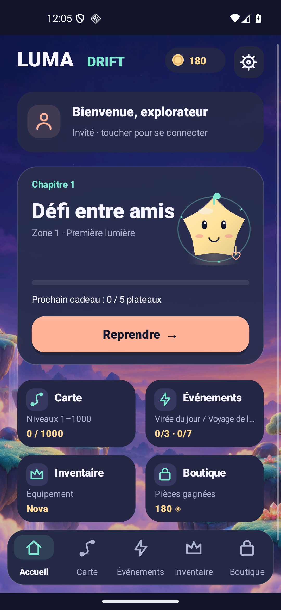
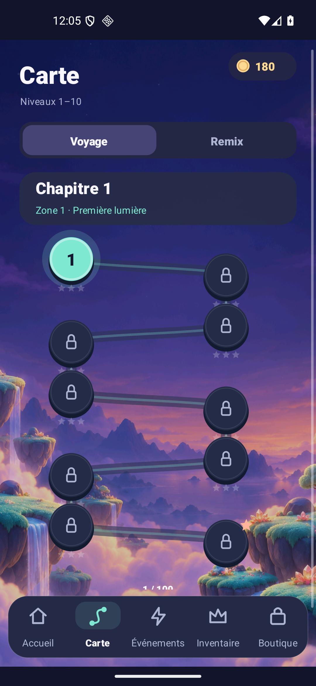
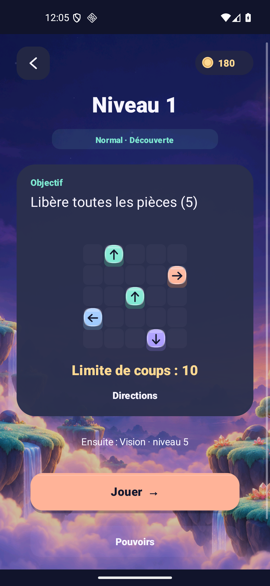

<h1 align="center">Luma Drift</h1>
<p align="center"><strong>A small light. A clever escape.</strong><br>An Android puzzle about arrows, gates, keys and the order of your moves.</p>
<p align="center"><a href="https://luma-drift-production.web.app/"><strong>Public website</strong></a> · <a href="docs/RELEASE_1_6.md"><strong>1.6 release & evidence</strong></a><br><a href="https://raw.githubusercontent.com/nabz0r/AndroidHit/main/releases/luma-drift-1.6.0-rc1.apk">Download Android APK · 1.6.0-rc1</a> · <a href="docs/RELEASE.md">Install & verify</a> · <a href="docs/README.md">Documentation</a></p>
<p align="center">1,000 Journey levels · 240 Remix · 6 sealed-passage workshop challenges<br>24 companions · 18 equipment items · 6 languages · Original art & music</p>
<p align="center"><sub>Signed internal candidate: 1.6.0-rc1 / code 7. Provider approval, human difficulty and retention remain separate qualification.</sub></p>

## A route with a reason to change pace

The 1.6 playable candidate adds a ten-board saga map, a briefing before a fresh board, clearer owned/equipped/locked inventory, scrollable screens and explicit account-session states. It integrates keys and sealed cells into ordinary Journey, with a separate authored rhythm of introduction, practice, peaks and recovery. The [qualification record](docs/VALIDATION_1_6.md) ties each installed observation to its exact APK.

Each piece leaves along its arrow when its path and exit gate are open. Switch pieces change gates; paired Remix switches change two. A key piece opens its matching fixed cells when it leaves. A legal exit can still close a gate needed later, so choosing the order matters. Undo restores pieces, gates and key seals together.

- **1,000 Journey boards and 240 Remix boards:** frozen J/K content with certified complete solutions. Source layouts are reused transparently; added seal variants have their own versioned identities.
- **Teaching before combinations:** the first six Journey boards retain their known layouts. Board 12 isolates one key and one seal, with open gates and no switches; boards 14 and 17 practice the combination. Keys occur on 167 Journey boards and 29 Remix boards.
- **Visible context:** Normal, Hard and Expert labels accompany a board's objective and element. These are authored labels, not difficulty ratings calibrated against people.
- **Fixed action allowance:** every new board needs N exits and has N+3–5 initial actions. Blocked present-piece attempts and successful Undo spend actions unless protected; restart is free. Content and allowances do not react to purchases, ads, losses or account state.
- **Six powers:** preview and confirm the effect before one charge is committed. Saved timed effects and unfinished Flow steps preserve their interruption/recovery contract.
- **Local events:** three daily and seven weekly stages, visible progress and one-time rewards, using the device calendar.

The independent V3 suite passed **582,831 checks** across all 1,240 new boards, including solutions, exact reference comparisons, genuinely blocking seals, saved histories and geometric uniqueness. The measured naive policy chooses uniformly among legal exits: its aggregate success is higher on recovery beats than peaks. That is a technical comparison, **not a human difficulty, retention or revenue result**. [Content and compatibility](docs/PROGRESSION_V3.md) · [Measurements](docs/data/progression-v3-summary.md).

## Keep the board you started

Existing C/R, B/Q, G/H, P and event codes continue to identify their original layouts. New J/K codes identify the V3 route. An unfinished 1.5 G/H attempt restores its exact layout, move history and original action allowance; it is not silently replaced by the new board at the same position. Earlier B/Q restoration also remains available. Progression, inventory and equipment stay on the device. Google sign-in does not provide a gameplay cloud save.

Historical content, solution orders, codes and allowances have matching pre-change/post-change fingerprints. An [actual API-26 Lab upgrade](docs/validation/v1.6/upgrade-api26.json) preserves a real 1.5 attempt, its 8/9 actions, coins and stock; cancelling a new-board preview keeps that attempt intact. Finishing it and starting a fresh V3 run is also recorded. Production-package and broader device acceptance remain separate. [Compatibility proof and reproduction](docs/PROGRESSION_V3.md#frozen-identities-and-save-compatibility).

## Your companion, your loadout

Choose one of 24 original companions, a color theme and one item in each of **Head, Aura and Charm**. The 18 equipment items have fixed sources and bounded benefits: at most +3 coins on an eligible first victory, −5 coins per power pack, or one protected blocked attempt per run. Items do not change the puzzle layout or gate rules. Companion identity and themes remain cosmetic.

The 1.6 inventory presentation separates ownership, equipment and locked acquisition conditions. A preview explains the exact effect/source before a confirmed purchase or equip action. Purchased account cosmetics remain separate from locally earned ownership. [Equipment contract](docs/AVATAR_EQUIPMENT.md) · [1.6 UX contract](docs/UX_1_6.md).

## Original presentation, honest evidence

The candidate combines tactile vector puzzle pieces and companions with the original generated Aurora Atlas environment. Original ambient music, effects, haptics and reduced motion have separate settings. French, English, German, Spanish, Portuguese and Italian are included. Canvas controls expose accessibility labels and keyboard focus; compact layouts and capped font scaling have their own checks; full TalkBack, large-text and physical-phone acceptance remains open.

These are installed **production 1.6 Android captures**. They show real controls. Home is resuming an existing friend/workshop challenge; its saved session was preserved. The environment artwork has its own [prompt and pixel provenance](docs/art/aurora-atlas-v1.json).

<p align="center">



</p>

[Inventory capture](docs/screenshots/v1.6/ui/final-production/companions-en.png) · [Art and audio](docs/ART_AUDIO.md) · [Design system](docs/DESIGN_SYSTEM.md) · [Executed checks and limits](docs/VALIDATION_1_6.md).

## Account and commercial boundaries

The 1.6 identity source distinguishes Guest, Refreshing, Connected, Reauthentication required and Error, and guards late callbacks after account changes. A refreshed session model or configured provider does not establish a successful real Google login. Ordinary gameplay and local inventory remain available independently of sign-in.

Default production settings force Google sample ad units and keep real checkout gated. Purchased gold has its own account-bound server wallet; editable local coins cannot authorize paid server funds. Final artifact configuration, real provider sign-in, installed consent handling, ad readiness, Play license-test purchase/refund/recovery and public-store approval need their own qualification. No commercially activated release is claimed here.

There is no Firebase Analytics gameplay tracking. The optional play journal stays local unless the player explicitly exports it; Google SDK traffic is described separately. [Privacy](docs/PRIVACY.md) · [Production activation guide, in French](docs/DEPLOIEMENT_PAS_A_PAS.md) · [Server wallet](server/README.md).

## Build and verify

The source declares **production 1.6.0-rc1 / code 7** and isolated **Lab 1.6.0-sandbox / code 7**. Minimum API 26, compile/target API 36, Java 17 source, Gradle 8.14.3 and AGP 8.11.0. Use a JDK 21 runtime for the pinned standalone lint analyzer. Exact signed bytes and source-input hashes are recorded in the [release manifests](docs/RELEASE.md).

```sh
export JAVA_HOME=/path/to/jdk-21
export ANDROID_HOME=/path/to/android-sdk
./gradlew assembleProductionDebug

scripts/test-engine.sh
scripts/test-progression-v3.sh
scripts/test-move-budget.sh
scripts/test-difficulty.sh
scripts/test-sealed.sh
scripts/test-data.sh
scripts/test-economy.sh
scripts/test-meta.sh
scripts/test-collection-events.sh
scripts/test-audio.sh
scripts/test-inventory-presentation.sh
scripts/test-experience-layout.sh
python3 scripts/test-identity-session.py
scripts/test-billing-policy.sh
scripts/test-wallet-recovery.sh

./gradlew assembleProductionRelease bundleProductionRelease lintProductionRelease
./gradlew assembleLabRelease bundleLabRelease lintLabRelease
```

Release signing uses an ignored local `signing.properties`; private keys do not belong in the repository. [Development](docs/DEVELOPMENT.md) describes reproducible authoring, signed packaging and the distinction between host tests and Android execution. [Release status](docs/RELEASE_1_6.md) identifies the 1.6 APK/AAB and checksums; preserved 1.5 files retain their original bytes and scope.

## What still makes or breaks a hit

More content and a different interface do not establish enjoyment, D1/D7 return, acquisition cost or revenue. The next product decisions require first-time-player observation, physical-device checks and complete cohort windows. [Roadmap](docs/ROADMAP.md) · [Hit audit](docs/HIT_AUDIT.md).

Preserved release records: [1.5](docs/RELEASE_1_5.md), [1.4](docs/PRODUCTION_RELEASE.md), [1.3](docs/VALIDATION_1_3.md), [1.2](docs/VALIDATION_1_2.md), [offline 1.1](docs/VALIDATION_1_1.md). Source: **AGPL-3.0**. [License and notices](LICENSE) · [Third-party notices](docs/THIRD_PARTY_NOTICES.md).
