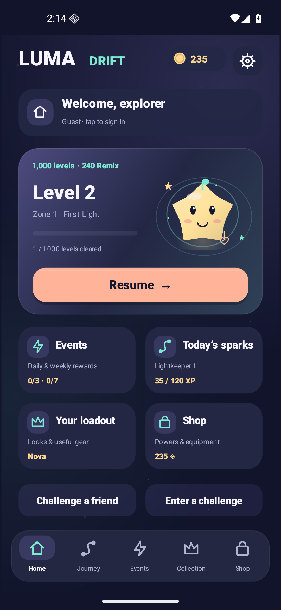
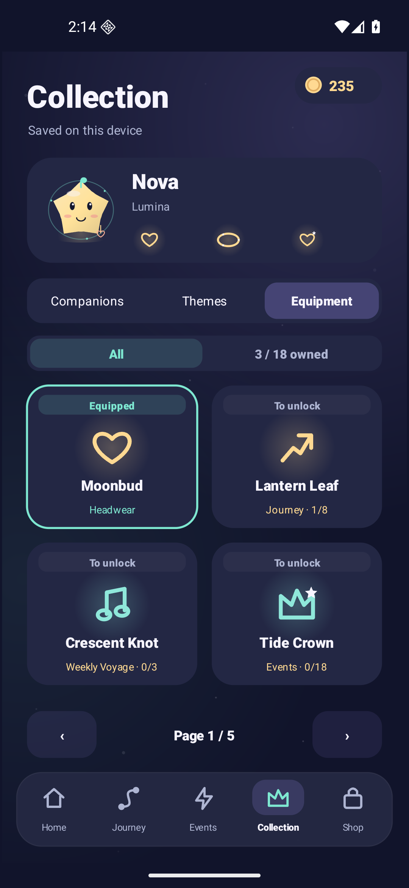
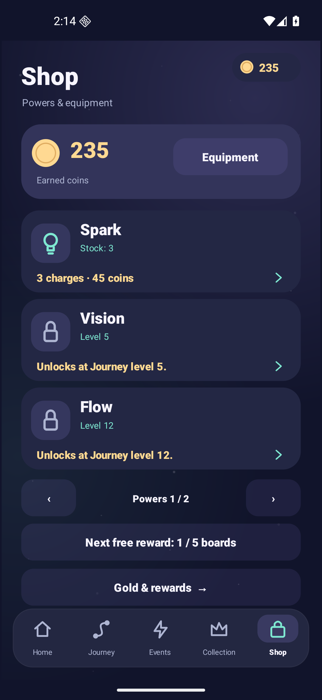

<p align="center"></p>

<h1 align="center">Luma Drift</h1>
<p align="center"><strong>A small light. A clever escape.</strong><br>An Android puzzle about arrows, gates and the order of your moves.</p>
<p align="center"><a href="https://luma-drift-production.web.app/"><strong>Visit the website</strong></a> · <a href="https://raw.githubusercontent.com/nabz0r/AndroidHit/main/releases/luma-drift-1.5.0-rc1.apk"><strong>Download Android APK · 1.5.0-rc1</strong></a><br><a href="docs/RELEASE.md">Install & verify</a> · <a href="docs/README.md">Documentation</a> · <a href="docs/ROADMAP.md">Roadmap</a></p>
<p align="center">1,000 Journey levels · 240 Remix · 6 sealed-passage prototypes<br>24 companions · 18 equipment items · 6 languages · Original vector art & music</p>
<p align="center"><sub>Android release candidate. Live advertising and commercial checkout still require qualification.</sub></p>

## Your next escape, in one place

The 1.5 lobby brings the current board, equipped companion, missions, events, collection and shop together. A visible profile card says whether you are a guest or connected through Google. The welcome uses the actual signed-in Google identity; a login flag does not invent an account. Puzzle progress and equipment remain saved on the device.

<p align="center">



</p>

Your next board, your loadout and every offer have a place in the lobby. These are [installed 1.5 captures](docs/validation/v1.5/ui-acceptance.md), with matching [French](docs/screenshots/v1.5/home-fr.png) and English evidence.

## Plan the order

Each piece leaves along its arrow when its path and exit gate are open. Switch pieces change gates, and paired Remix switches change two. A legal move can leave an unsolvable position: inspect the switches before clearing the easiest piece.

- **1,000 Journey boards:** three teaching introductions, then increasingly demanding choices. All fixed layouts have certified solutions and are distinct even under rotation/reflection/translation.
- **240 Remix boards:** a separate route with paired gate changes, unlocked by Journey progress.
- **Per-board actions:** N required exits plus a fixed allowance of 2–4 spare actions. Blocked attempts and successful Undo cost an action; a free restart is always available. Difficulty does not depend on purchases or losses.
- **Six powers:** preview the exact effect, confirm one charge, see active state and stock. Flow starts one move immediately, then resumes its remaining steps after pause or recreation; it does not spend another charge on resume.
- **Daily and weekly play:** visible goals, stage progress, reset time and one-time completion rewards. Events follow the device calendar.

The exact model of uniformly choosing a legal move clears the first 240 new Journey positions at a mean 30.02%, compared with 89.04% for the old layouts. This is a structural audit, **not a human difficulty rating or retention result**. [Content measurements](docs/data/progression-v2-summary.md) · [Rules and powers](docs/MOVE_BUDGET_POWERUPS.md).

## Keys open new possibilities

The **Sealed passages** tab contains six playable prototypes. A wall blocks a real path until its matching key piece leaves. Undo restores both the key and wall. Later prototypes combine keys with switches: taking a key too early can close the wrong gate.

<p align="center">


</p>

These six challenges use unlimited actions and award no currency, XP or equipment. They test a new puzzle rule before it spreads through the campaign. [Rules, six designs and exhaustive engine checks](docs/data/sealed-engine-summary.md).

## Your companion, your loadout

Choose one of 24 original companions, a color theme and **one item in each of three equipment slots**. Collection cards distinguish **owned**, **equipped** and **to unlock**; a filter shows only owned items. Previews explain the exact source, benefit and price before any purchase.

| Slot | Limited benefit | How to obtain items |
|---|---|---|
| Headwear | Up to +3 earned coins on a board's first victory | Journey clears, weekly wins, event stars or earned-coin shop |
| Aura | Up to 5 earned coins off power packs; minimum price 1 | Journey, weekly, event and shop milestones |
| Charm | At most one blocked attempt protected per run for advanced charms | Event/weekly milestones or earned coins |

Looks remain cosmetic; functional equipment is labeled separately. All 18 items have fixed acquisition conditions. Owning more items does not stack their benefits. Weekly and event acquisitions stay owned after the calendar rotates. Gear and earned currency are local; Google login does not imply cloud save. [Full item table](docs/AVATAR_EQUIPMENT.md).

## Art, sound and accessibility

The game uses original procedural vector silhouettes, animated particles and a new eight-bar ambient composition. Music, effects, haptics and reduced motion have separate switches. French, English, German, Spanish, Portuguese and Italian are included. Canvas controls expose accessibility labels and keyboard focus. The [vector brand kit](docs/store/README.md) extends the game's indigo, mint, peach and lilac palette across the repository and website. [Art and audio](docs/ART_AUDIO.md) · [Release details and validation](docs/RELEASE_1_5.md).

## Production status

**1.5 is a playable quality candidate, with sample advertising and checkout gated.** It includes the owner's public Firebase/AdMob configuration, optional Google identity and the implemented Play Billing/wallet adapters. It does not activate real advertising or payments. Account-bound purchased gold stays separate from device-earned coins; editable local data cannot authorize paid server funds.

The wallet server and public pages are deployed for qualification. Public Hosting/Cloud Run probes are recorded; successful Web sign-in/deletion and a published AdMob consent message are owner-reported. Android Google sign-in, installed consent/refusal, real ad readiness, Play products/license-test purchases, RTDN/Scheduler and commercial approval still need qualification. Installed consent acceptance/refusal has not been recorded.

- [Public site and privacy/deletion pages](https://luma-drift-production.web.app/)
- [Production activation guide, in French](docs/DEPLOIEMENT_PAS_A_PAS.md)
- [Wallet server](server/README.md) · [Android paid wallet](docs/WALLET_ANDROID.md) · [Hosting evidence](docs/validation/hosting-preview.md)

There is no Firebase Analytics gameplay tracking. The opt-in play journal remains local until the player explicitly exports it; Google SDK network traffic is described separately in the privacy documentation.

## Build and verify

Current versions are **production 1.5.0-rc1 / code 6** and isolated **Lab 1.5.0-sandbox / code 6**. Minimum API 26, compile/target API 36, Java 17 source, Gradle 8.14.3 and AGP 8.11.0. Use a JDK 21 runtime for the pinned standalone lint analyzer; release sources remain Java 17 compatible. Both channels include the SDKs listed in [third-party notices](docs/THIRD_PARTY_NOTICES.md).

```sh
export JAVA_HOME=/path/to/jdk-21
export ANDROID_HOME=/path/to/android-sdk
./gradlew assembleProductionDebug

scripts/test-engine.sh
scripts/test-move-budget.sh
scripts/test-difficulty.sh
scripts/test-sealed.sh
scripts/test-data.sh
scripts/test-economy.sh
scripts/test-meta.sh
scripts/test-collection-events.sh
scripts/test-audio.sh
scripts/test-billing-policy.sh
scripts/test-wallet-recovery.sh
python3 scripts/test-commerce-receipts.py

./gradlew assembleProductionRelease bundleProductionRelease lintProductionRelease
./gradlew assembleLabRelease bundleLabRelease lintLabRelease
```

Release signing uses an ignored local `signing.properties`; no private key belongs in the repository. The [Play bundle](releases/luma-drift-1.5.0-rc1.aab) is a delivery artifact, not a published store listing. See [installation, hashes and channel boundaries](docs/RELEASE.md), [versioned evidence](docs/validation/v1.5/) and the [roadmap](docs/ROADMAP.md). UI smoke scripts require an explicitly selected emulator and document whether they use a synthetic test profile.

## What still makes or breaks a hit

The new mechanics, content and presentation expand the testable product. They do not establish enjoyment, D1/D7 return, acquisition cost or revenue. The next product decision comes from first-time-player observations and complete cohort windows, then careful difficulty tuning. [Hit audit](docs/HIT_AUDIT.md) · [Study and release roadmap](docs/ROADMAP.md).

Preserved releases: [offline 1.1](docs/VALIDATION_1_1.md), [Lab 1.2](docs/VALIDATION_1_2.md), [actions/powers 1.3](docs/VALIDATION_1_3.md), [production preparation 1.4](docs/PRODUCTION_RELEASE.md). Old binaries and reports retain their original scope.

Source: **AGPL-3.0**. Original art/audio and third-party notices are documented separately. [License](LICENSE).
