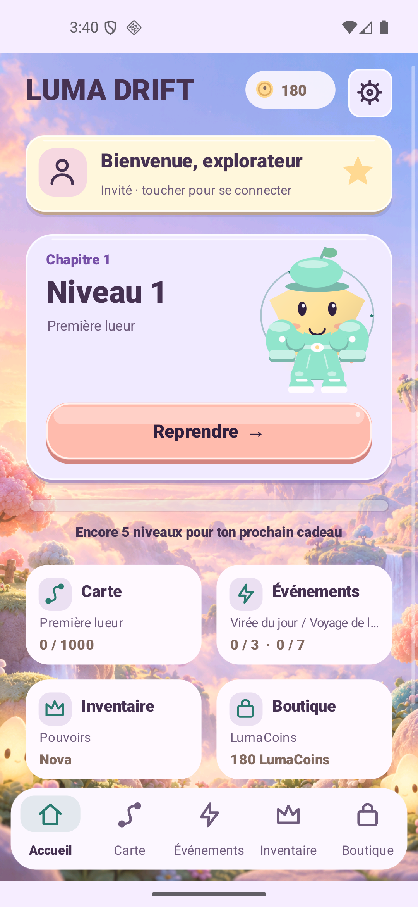
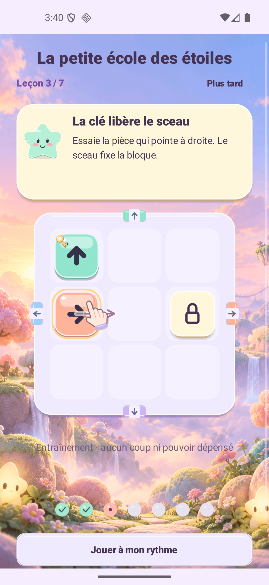
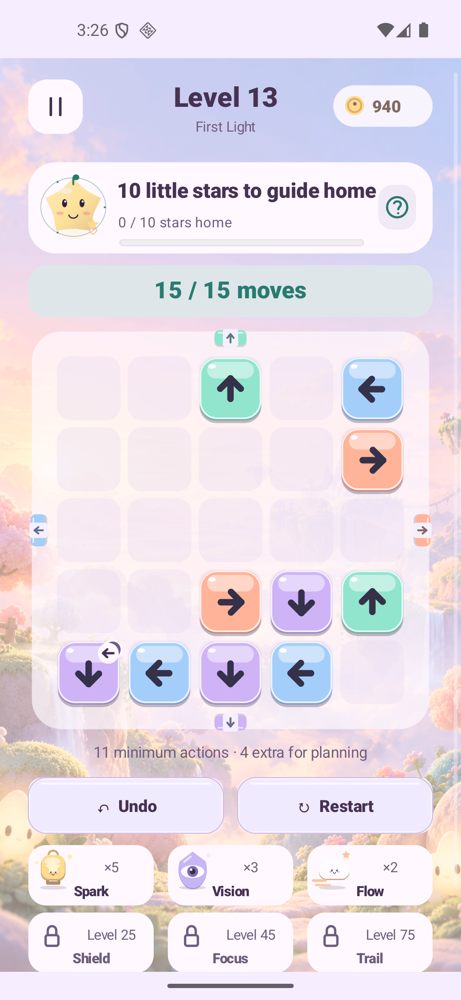

<h1 align="center">Luma Drift</h1>
<p align="center"><strong>A soft little world. Every move matters.</strong><br>Guide the stars home. Read the gates. Find your own little aha.</p>
<p align="center"><a href="https://raw.githubusercontent.com/nabz0r/AndroidHit/main/releases/luma-drift-1.8.0-rc1.apk"><strong>Download signed Android APK · 1.8.0-rc1</strong></a><br><a href="https://luma-drift-production.web.app/">Website</a> · <a href="docs/RELEASE_1_8.md">Release & evidence</a> · <a href="docs/README.md">Documentation</a> · <a href="docs/ROADMAP.md">Roadmap</a></p>
<p align="center">1,000 Journey boards · 240 Remix · 7 interactive lessons<br>24 companions · 24 wardrobe cosmetics · 6 powers · 6 languages</p>

<p align="center"></p>

These are unedited Android SDK captures of **Lab 1.8**, not web mockups or Google-account acceptance. [Exact installed APK and native evidence](docs/validation/v1.8/README.md).

## A puzzle you can understand and recover

The full default route is reauthored as **L/M**. A piece follows its arrow; another piece, a seal or a closed exit can block it. A key removes its matching seal. Switches change gates when they leave.

Now you can **open a closed gate for one action**. Each level's budget is based on its exact minimum productive actions plus a fixed margin. Exit order can save an opening or require another: the limit measures planning, rather than only charging mistakes around an unavoidable N-piece solution.

- **Look before choosing.** A switch or gate previews its immediate open/closed consequences. Confirm costs one action; cancel costs none.
- **Correct freely.** Undo restores the last productive action and refunds its move, even at zero. Restart is free. No new-route state is a permanent logical dead end.
- **Follow a useful hint.** Spark, Focus, Trail and Flow understand both piece exits and gate openings. One confirmed charge produces one durable effect; showing an active effect again does not spend another charge.
- **See the real goal.** Actual remaining stars, progress, the next earned gift and collection ownership stay visible. Difficulty, prices and odds do not change in response to spending or losses.

[Gameplay](docs/GAMEPLAY.md) · [Every level, exact solver and compatibility](docs/PROGRESSION_V4.md) · [Six powers](docs/MOVE_BUDGET_POWERUPS.md).

## Little star school

A new guest or connected local profile can learn on seven small playable boards: arrows, blockers, keys, gates, switches, refunded Undo and Spark. A glowing object and illustrated fingertip demonstrate the action; **tap or drag along the arrow**. Instructions wait for the player.

**Skip, resume at the same step, or replay from Help.** Finishing all lessons unlocks an explicit one-time gift of **100 LumaCoins + 2 Sparks**. Practice spends no inventory, awards no campaign wins and cannot farm the gift through login, replay or double taps. Landscape uses a compact board/instruction layout. Reduced motion keeps static cues.

[Tutorial state, reward and failure recovery](docs/TUTORIAL.md) · [UX and research references](docs/UX_1_8.md).

## A world that feels yours

Dream Glade, an original generated illustration, surrounds cream/lilac surfaces, plum text, plush pieces and distinct power silhouettes. The companion, wardrobe, actual session status and next adventure lead the home screen. The full scrollable map has ten 100-level atmospheres and original synthesized music, with separate music/effects settings.

Collect 24 companions and 24 appearance-only clothing items across Hat / Outfit / Shoes / Gloves. Owned, equipped and unowned states show their source. The older 18 Head / Aura / Charm equipment items retain their separate bounded benefits.

Seven claimed daily visits grant **40 / 50 / 60 / 70 / 80 / 100 / 150 LumaCoins**, then repeat. A missed day loses nothing. Daily and weekly quests have separate goals. LumaCoins are earned and local; LumaGold is the separate premium account wallet. The earned cosmetic capsule costs 150 LumaCoins and discloses item odds and duplicate compensation before a spend. Real checkout and paid premium draws remain closed.

[Design system](docs/DESIGN_SYSTEM.md) · [Art prompt and pixel hash](docs/art/dream-glade-v18.json) · [Wardrobe economy](docs/ECONOMY_1_7.md) · [Existing equipment](docs/AVATAR_EQUIPMENT.md).

## Tested claims, exact deliverables

The independent V4 audit covers all **1,240 boards**, **13,254,058 reachable action states** and **57,403,554 legal transitions**, with **773,092,810 assertions** comparing exact cost, previews, Undo and typed state restoration. All states remain recoverable. There are **591 key/seal boards** and **1,161 boards with a measured ordering choice that affects cost**. T daily/weekly events select from 980 audited geometries.

Both signed APKs and AABs pass signature, official bundletool and 16KB ZIP/native ELF alignment checks. Both release lint reports have zero errors. [Final Android tests, gestures, six languages, audio and restored preferences](docs/validation/v1.8/README.md) are distinct from the source simulations. Human comprehension, physical-phone performance and D1/D7 retention are still to measure; no hit or revenue result is implied.

| Artifact | Download | SHA-256 |
| --- | --- | --- |
| Production APK · 7.71 MB | [1.8.0-rc1](releases/luma-drift-1.8.0-rc1.apk) | `aab583241c42179e5cffb80bdd32f9a502be124a3e8a75ccf94936e538db87d4` |
| Production AAB | [1.8.0-rc1](releases/luma-drift-1.8.0-rc1.aab) | [Manifest](releases/manifest-1.8.0-rc1.json) |
| Separate Lab APK/AAB | [Lab APK](releases/luma-drift-1.8.0-sandbox.apk) · [AAB](releases/luma-drift-1.8.0-sandbox.aab) | [Manifest](releases/manifest-1.8.0-sandbox.json) |

Android 8+ / API 26; version code 9; production package `com.androidhit.lumadrift`. Install over the existing app to retain local saves. Previous artifacts and their exact checksums remain available. [Install/signatures](docs/RELEASE.md) · [All checksums](releases/SHA256SUMS.txt).

## Compatibility and service status

Historical C/R/B/Q/G/H/J/K/P/E codes retain their original layouts and rules. Active current policy-2 attempts keep their old board and allowance while migrating to refunded Undo; much older policy-1 attempts retain their original accounting until restarted. New attempts use policy 3. Existing numbered stars, unlocks, balances, possessions and rewards remain; replacing a board does not award its old stars again.

Google is optional and does not synchronize gameplay saves. The existing deployed friend service and opt-in map snapshots remain prepared for real two-account qualification; this release does not fabricate friends or gifts. Test advertising is forced, real checkout is gated, and paid cosmetic draws are disabled in both app and server. The existing Cloud Run service is unchanged. No remote gameplay analytics SDK was added.

[Privacy](docs/PRIVACY.md) · [Two-account qualification](docs/QUALIFICATION_SOCIALE.md) · [Production setup](docs/DEPLOIEMENT_PAS_A_PAS.md) · [Server](server/README.md).

## Build and explore

Use JDK 21 for the pinned lint analyzer, the Android SDK and the Gradle wrapper. Java source compatibility remains 17. Private signing files are ignored and never published.

```sh
./gradlew assembleProductionRelease bundleProductionRelease lintProductionRelease
./gradlew assembleLabRelease bundleLabRelease lintLabRelease
scripts/test-strategy-v4.sh
scripts/test-tutorial-v18.sh
```

[Development](docs/DEVELOPMENT.md) lists the storage, economy, identity, audio and SDK integration checks. [Native QA runner](scripts/v18-ui-test/README.md) uses real Android controls and SDK touch events, with no profile injection. [Roadmap](docs/ROADMAP.md) prioritizes observed player comprehension before commercial activation. [Historical 1.7](docs/RELEASE_1_7.md) and earlier evidence keep their own scope and hashes.

Original game source and repository assets: **AGPL-3.0**. [Notices](docs/THIRD_PARTY_NOTICES.md). No Candy Crush or Crash Fever artwork, characters, audio or code is included.
