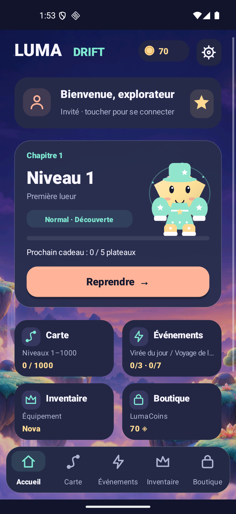
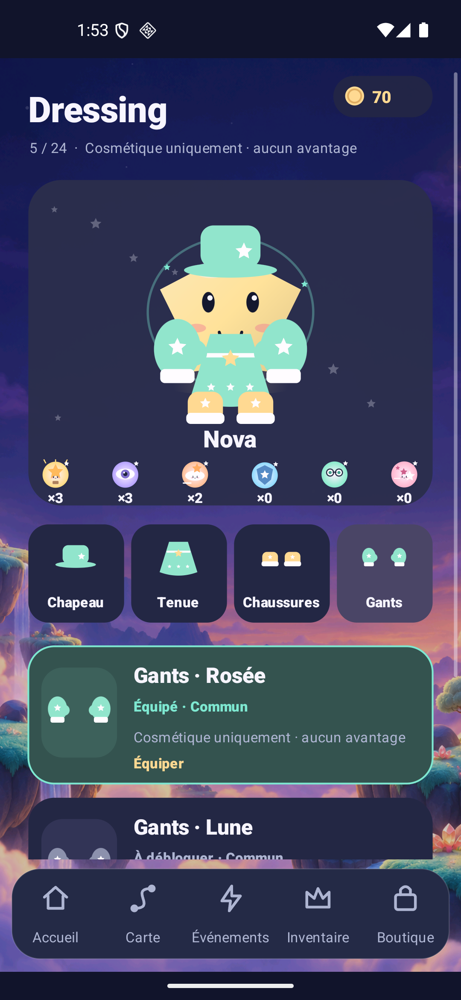
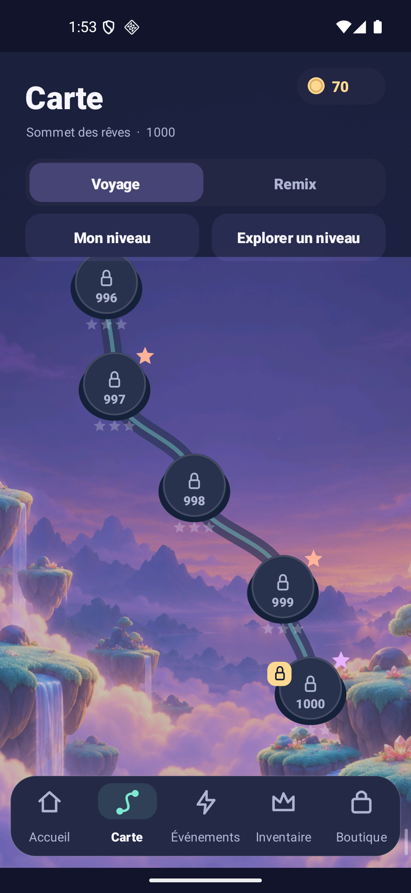

<h1 align="center">Luma Drift</h1>
<p align="center"><strong>A small light. A clever escape.</strong><br>An Android puzzle about arrows, gates, keys and the order of your moves.</p>
<p align="center"><a href="https://luma-drift-production.web.app/"><strong>Public website</strong></a> · <a href="docs/RELEASE_1_7.md"><strong>1.7 candidate & evidence</strong></a> · <a href="docs/README.md"><strong>Documentation</strong></a><br><a href="https://raw.githubusercontent.com/nabz0r/AndroidHit/main/releases/luma-drift-1.7.0-rc1.apk">Download signed Android APK · 1.7.0-rc1</a> · <a href="docs/RELEASE.md">Install & verify</a></p>
<p align="center">1,000 Journey levels · 240 Remix · 24 companions<br>24 four-slot wardrobe cosmetics · 18 separate equipment items · 6 languages</p>
<p align="center"><sub>Signed 1.7.0-rc1 / code 8 · 5.59 MB. Installed Android checks, service rollout and website publication are qualified separately. Earlier release bytes and evidence are preserved.</sub></p>

## A puzzle can be solvable and your current route can be closed

The reported level-13 problem led to an exhaustive audit of **all 1,000 Journey and 240 Remix boards**. Every board can finish within its original starting allowance, with no power, ad or purchase. Their layouts, identities and budgets are unchanged. A legal move can nevertheless close a gate needed later while other legal moves remain; the previous immediate-stuck check missed that case.

The 1.7 source diagnoses the actual remaining state. It distinguishes a safe next move, too few actions, and a route with no completion. In the last case, extra actions alone cannot repair the gate order: Undo or free restart is the relevant recovery. Hints point to a safe move in the current state and cannot spend stock on a doomed route. [Reproducible J13 diagnosis](docs/validation/v1.7/board-audit-journey13.md) · [Independent reachability audit](docs/validation/v1.7/board-audit.md).

The audit enumerated **1,101,868 reachable subsets** and **3,348,959 legal transitions**, including keys, seals, gate changes, undo recovery and budgets. Its 49,063,063 assertions check the technical model, not human enjoyment or retention. The user's exact saved attempt was unavailable, so the J13 reproduction is a mechanism diagnosis rather than a claim about their actual taps.

## A longer journey, a companion that feels yours

The 1.7 candidate combines a continuously scrollable **1–1,000 Journey map**, ten 100-level biomes, a four-slot dressing room, a nonpunitive daily gift cycle and separate daily/weekly quests. [UX contract](docs/UX_1_7.md) · [Candidate status and evidence](docs/RELEASE_1_7.md).

- **Explore the route:** scroll the whole map, jump to a level or return to your current board. Locked positions stay visible; exploration does not unlock them. Each 100-level biome changes its environment tint and original synthesized arrangement.
- **Plan the board:** a briefing states the objective, mechanic, authored difficulty and fixed action allowance. Keys occur on 167 Journey boards and 29 Remix boards; Journey 12 teaches the rule before later combinations.
- **Dress the companion:** hat, outfit, shoes and gloves show their owned/equipped/unowned state and exact source. All 24 new wardrobe items are visual only. Halloween and Valentine designs remain permanently owned.
- **Return at your pace:** seven claimed visits give 40/50/60/70/80/100/150 LumaCoins, then repeat. Missing days never resets the cycle. Daily and weekly quests have different targets and once-per-period claims.
- **Understand the two wallets:** LumaCoins are earned and stored locally. LumaGold belongs to the separate premium account wallet. Neither balance is automatically converted into the other.
- **Choose a cosmetic capsule:** 150 earned LumaCoins, common/rare/epic odds of 60%/30%/10%, individual odds and duplicate compensation shown before spending. This local capsule never spends LumaGold. The native premium account catalogue is prepared, with both APK and server draw gates closed.
- **Friends and limited gifts:** authenticated backend/client source prepares mutual friendships, opt-in shared progress and one-hint gifts with limits. Deployment and real two-account acceptance are separate gates; the interface must expose an unavailable service honestly.

Six powers, three daily and seven weekly event boards, original companion silhouettes, six themes, optional sign-in, local save/resume and the existing three-slot equipment are retained. [Rewards, wardrobe, odds and persistence](docs/ECONOMY_1_7.md) · [Existing equipment](docs/AVATAR_EQUIPMENT.md).

## Cosmetic wardrobe and equipment are different systems

The **new wardrobe** contains 24 appearance-only items in Hat / Outfit / Shoes / Gloves. Sources include claimed daily gifts, lifetime weekly/event progress, earned-coin direct purchases and earned cosmetic capsules. No wardrobe item changes movement allowances, puzzle geometry, rewards, power stock, prices or drop odds.

The **existing 18 equipment items** occupy Head / Aura / Charm. Their previously stated bounded benefits remain: at most +3 coins on an eligible first victory, −5 coins per power pack, or one protected blocked attempt per run. Companion identity and themes remain cosmetic. The two systems retain their separate rules.

The prepared account vault shows its own authenticated ownership and conditional probabilities. Its future guarantee means new to the account; that design can already exist in the earned local wardrobe. Both premium draw gates stay closed. [Exact local economy](docs/ECONOMY_1_7.md) describes the probabilities, duplicate compensation, save recovery and the distinction from prepared premium server transactions.

## Keep the board and inventory you started

Historical C/R, B/Q, G/H, J/K, P and event codes keep their original layouts. The 1.7 diagnostic changes neither the frozen route nor its fixed N+3–5 initial budgets. Free restart remains available; fixed content and margins do not react to spending, ads, losses or account status.

Existing stars, unlocks, companions, skins, powers, earned balance and equipment remain in their existing saves. New wardrobe, reward and receipt keys use separate versioned namespaces. Google sign-in does not provide a gameplay cloud save. Shared friend positions, when the prepared service is deployed and consented to, are social snapshots rather than an authoritative cross-device progression save.

[Content compatibility](docs/PROGRESSION_V3.md) · [1.7 qualification directory](docs/validation/v1.7/README.md) · [Preserved actual 1.5→1.6 upgrade](docs/validation/v1.6/upgrade-api26.json).

## Original presentation and evidence

Code-native pastel pieces, companion silhouettes and wardrobe drawings sit over the original generated Aurora Atlas environment. The ten biome arrangements use procedural audio, with separate music/effect controls and no runtime music download. The six Android languages are French, English, German, Spanish, Portuguese and Italian; the public website is French/English.

These are unedited captures from the **final Lab 1.7 APK**, `d7fea345…`, on API 36 with a 16KB-page kernel. The passing native run covers 38 assertions and 32 captures, using the existing guest qualification session without profile injection. Daily gift and capsule actions used its actual earned balance; all original preferences were restored byte for byte afterward. These are Lab images, not production-package or real-account acceptance.

<p align="center"></p>

[Exact installed run and restored profile](docs/validation/v1.7/ui-sdk-final-menus2/host-report.json). The earlier failed final-menu oracle and pilot runs remain separately labelled.

[Illustrated tour](docs/VISUAL_GUIDE.md) · [Art and audio](docs/ART_AUDIO.md) · [Design system](docs/DESIGN_SYSTEM.md) · [Atlas provenance](docs/art/aurora-atlas-v1.json).

The [1.7 website qualification](docs/validation/site-v1.7/README.md) passes 2,219 offline checks and 18 local FR/EN browser views at measured CSS widths 320/390/1366, with actual Lab captures and the correct APK route. Hosting publication is the next separate delivery step; the [preserved 1.6 Hosting record](docs/validation/site-v1.6/README.md) is not reused as 1.7 evidence.

## Identity, privacy and commercial boundaries

Guest play remains available. Google session snapshots distinguish refreshing, connected, reconnect-required and error states, with guards against late callbacks after account changes. A configured provider or provider-sheet cancellation is not successful real authentication.

Default production settings force sample ads and keep real checkout gated. Purchased LumaGold is account-bound server currency; editable local saves cannot authorize it. Real Google success, installed consent choices, ad readiness, Play license-test purchase/refund/recovery, server rollout and public-store approval require their own qualification. No commercial activation, measured revenue or retention improvement is claimed.

There is no Firebase Analytics gameplay tracking. The optional play journal stays local unless the player explicitly exports it. Opt-in friend progress is a separately disclosed social data flow. [Privacy](docs/PRIVACY.md) · [Production activation, in French](docs/DEPLOIEMENT_PAS_A_PAS.md) · [Server](server/README.md).

## Build and verify

Declared production **1.7.0-rc1 / code 8**, isolated **Lab 1.7.0-sandbox / code 8**. Minimum API 26, compile/target API 36, Java 17 source, Gradle 8.14.3 and AGP 8.11.0. Use a JDK 21 runtime for the pinned standalone lint analyzer. Release signing uses an ignored local `signing.properties`; private keys do not belong in the repository.

```sh
export JAVA_HOME=/path/to/jdk-21
export ANDROID_HOME=/path/to/android-sdk
./gradlew assembleProductionDebug

scripts/test-board-audit-v17.sh
scripts/test-rewards-cosmetics-v17.sh
python3 scripts/test-social-strings-v17.py
scripts/test-engine.sh
scripts/test-progression-v3.sh
scripts/test-move-budget.sh
scripts/test-data.sh
scripts/test-economy.sh
scripts/test-meta.sh
scripts/test-collection-events.sh
scripts/test-audio.sh
scripts/test-inventory-presentation.sh
scripts/test-experience-layout.sh
python3 scripts/test-identity-session.py
scripts/test-billing-policy.sh
scripts/test-wallet-recovery.sh

./gradlew assembleProductionRelease bundleProductionRelease lintProductionRelease
./gradlew assembleLabRelease bundleLabRelease lintLabRelease
```

[Development](docs/DEVELOPMENT.md) · [Exact release bytes and signing](docs/RELEASE.md) · [1.7 evidence](docs/validation/v1.7/README.md). JVM adapters and fixed-seed simulations are labelled separately from an installed Android run or two real accounts.

More content and systems do not establish a hit. First-time-player observation, physical phones and complete D1/D7 cohort windows remain the next product gates. [Roadmap](docs/ROADMAP.md) · [Hit audit](docs/HIT_AUDIT.md).

Preserved releases: [1.6](docs/RELEASE_1_6.md), [1.5](docs/RELEASE_1_5.md), [1.4](docs/PRODUCTION_RELEASE.md), [1.3](docs/VALIDATION_1_3.md), [1.2](docs/VALIDATION_1_2.md), [offline 1.1](docs/VALIDATION_1_1.md). Source: **AGPL-3.0**. [License](LICENSE) · [Third-party notices](docs/THIRD_PARTY_NOTICES.md).
