<p align="center">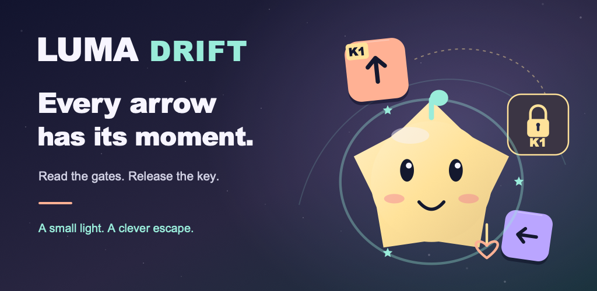</p>

<h1 align="center">Luma Drift</h1>
<p align="center"><strong>A small light. A great escape.</strong><br>Tap. Change the gates. Find the order.</p>
<p align="center"><a href="https://raw.githubusercontent.com/nabz0r/AndroidHit/main/releases/luma-drift-1.4.0-rc1.apk"><strong>Download Luma Drift · 1.4.0-rc1</strong></a><br><a href="https://raw.githubusercontent.com/nabz0r/AndroidHit/main/releases/luma-drift-1.1.0.apk">Stable offline APK · 1.1.0</a> · <a href="docs/RELEASE.md">Install & checksums</a> · <a href="docs/ROADMAP.md">Roadmap</a></p>
<p align="center">480 campaign & Remix boards · 6 languages · Original art & audio<br>Production candidate + isolated monetization test Lab</p>

## Current release: production preparation

**[Production APK · 1.4.0-rc1](releases/luma-drift-1.4.0-rc1.apk)** · [Play AAB](releases/luma-drift-1.4.0-rc1.aab) · [Implementation & activation](docs/PRODUCTION_RELEASE.md) · [Actual validation](docs/VALIDATION.md).

The candidate brings the full puzzle into the production package, `com.androidhit.lumadrift`, with the owner's Firebase/Google configuration and three separate AdMob rewarded placements. A real Play Billing client and a Firebase-authenticated, Firestore-backed purchase/wallet server are implemented. **The delivered build forces Google sample creatives and blocks checkout while the deployed wallet origin is missing.** It is not a live monetization launch.

Purchased gold belongs to a server account and buys permanent companions/themes; locally earned coins, powers and offline progression stay on the device. No editable local balance becomes paid gold. The server verifies tokens, credits once, consumes after durable delivery and reconciles refunds. [Android wallet](docs/WALLET_ANDROID.md) · [Server setup and tests](server/README.md).

The [FR/EN public pages](docs/PUBLIC_PAGES.md) prepare the developer site, privacy policy and external account-deletion route. They have been rendered and checked locally, and the owner's Firebase Web identity configuration is now integrated. Hosting, publisher/support details, the site's API connection and live deletion qualification remain to complete; the owner has confirmed its Firebase authorized domains.

**Owner deployment walkthrough (French): [server, public pages, Play purchases and AdMob](docs/DEPLOIEMENT_PAS_A_PAS.md).** The root Hosting configuration is prepared; no cloud resources or public site are deployed by this repository change.

**Deployment follow-up:** the owner has now deployed Cloud Run; external checks reach the application and reject an anonymous wallet request. The first health check exposed a reserved Cloud Run URL, corrected to `/health` in source with 43 passing server tests. [Incident, evidence and redeployment](docs/validation/cloud-run-health-route.md). The fixed cloud check and purchase qualification remain to complete; the delivered Android APK/AAB are unchanged.

<table>
<tr><td align="center">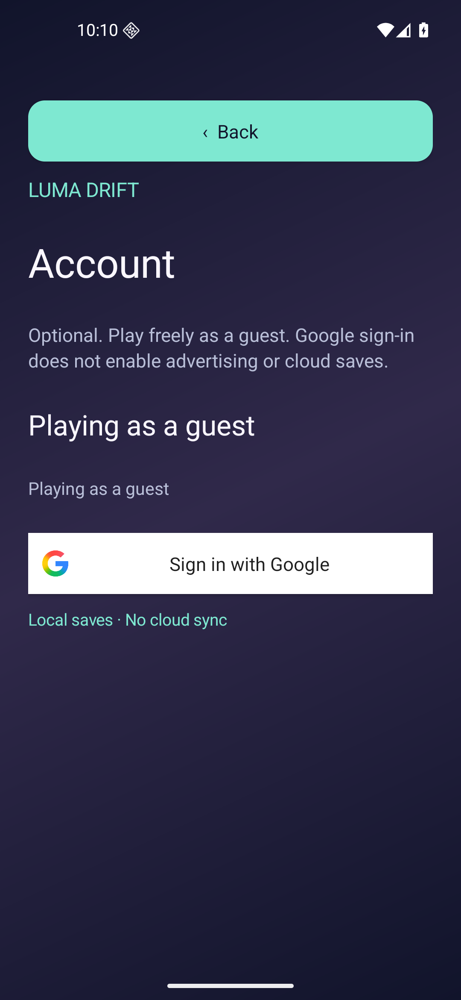<br><strong>Your account, your choice</strong><br>Guest play and optional Google identity.</td><td align="center">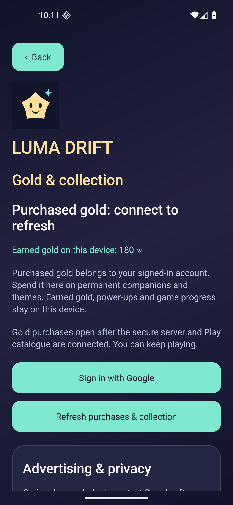<br><strong>Clear currency boundaries</strong><br>Account purchases stay separate from local coins.</td><td align="center">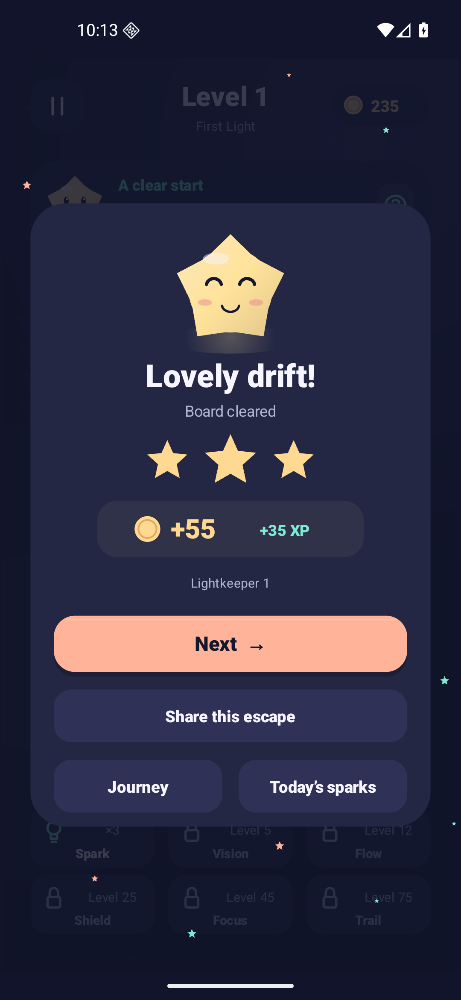<br><strong>The full game stays playable</strong><br>Actual production-candidate victory.</td></tr>
</table>

These are actual installed **1.4.0-rc1** captures. The Google provider interface was opened and cancelled; completed Google login and Play payments remain unqualified. The website image below is a local rendering of prepared pages, not a hosted site. [Exact execution](docs/validation/v1.4/production-ui.txt).

Current isolated test build: [Lab 1.4 APK](releases/luma-drift-1.4.0-sandbox.apk) · [Lab AAB](releases/luma-drift-1.4.0-sandbox.aab). It has no production Firebase asset and never launches real checkout.


<p align="center">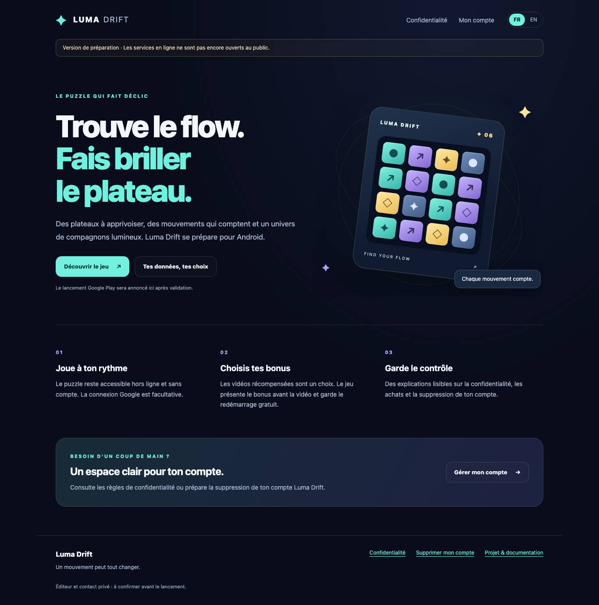</p>

## Preserved deliveries


| | Stable game | Luma Drift Lab |
| --- | --- | --- |
| Version | **1.1.0** | **1.3.0-sandbox** · code 4; 1.2 preserved as history |
| Android name | Luma Drift | Luma Drift Lab |
| Application ID | `com.androidhit.lumadrift` | `com.androidhit.lumadrift.sandbox` |
| Status | Signed, tested delivery | Signed delivery; recorded Android 16 gameplay and SDK tests passed |
| Money and ads | Earned coins only; no ads or billing SDK | No-charge gold simulation; optional Google test ads |
| Collection | Six original companions, six themes | 24 companions across three pages, six themes |
| Account | Guest/local play only | Optional Google/Firebase Auth adapter; owner configuration absent |
| Network | No Internet permission | Google SDK routes can contact Google; see [privacy](docs/PRIVACY.md) |
| Install | **[Stable APK](https://raw.githubusercontent.com/nabz0r/AndroidHit/main/releases/luma-drift-1.1.0.apk)** | **[Lab 1.3 APK · 3.9 MB](https://raw.githubusercontent.com/nabz0r/AndroidHit/main/releases/luma-drift-1.3.0-sandbox.apk)** · [Preserved 1.2](https://raw.githubusercontent.com/nabz0r/AndroidHit/main/releases/luma-drift-1.2.0-sandbox.apk) |

The preserved Lab installs beside the production game with its own save and wallet. Lab 1.3 updates the same sandbox application as 1.2; simulated gold never transfers into production purchased gold. These are historical deliveries: current `main` provides production and Lab build flavors. Their preserved release bytes remain unchanged; [stable 1.1 source is preserved at commit 15751be](https://github.com/nabz0r/AndroidHit/tree/15751bec3f332f60ba1ba6fef0c0b82f47f941c0), along with its APK. [Test guide and account setup](docs/MONETIZATION_SETUP.md) · [Research and design decisions](docs/MONETIZATION_RESEARCH.md).

## New in Lab 1.3: plan every action

The delivered Lab keeps the original board pool and introduces a measured order, an explicit action allowance and six powers. Its signed final APK passed the recorded Android 16 gameplay and real Google test-ad cases; physical-device comfort and player retention remain unmeasured.

- **A smoother 480-board progression:** original layouts stay intact, while a frozen within-chapter order reduces measured upward spikes. Journey 1–6 and Remix 1–3 remain fixed. This is a transparent structural model, not a human difficulty rating. [Measurements and CSV](docs/DIFFICULTY.md).
- **Visible moves, free restart:** a present-piece tap costs one action even when blocked; successful Undo costs one; empty taps and thinking time cost nothing. Every board has a certified solution inside its initial allowance. At exhaustion, restart free or optionally extend for 100 sandbox gold or an earned test ad, at most twice per attempt. [Exact rules](docs/GAMEPLAY.md#lab-13-action-allowance).
- **Six powers, learned gradually:** Spark, Vision, Flow, Shield, Focus and Trail unlock at Journey 1/5/12/25/45/75. The shop has two pages with previews, explicit pack prices and optional earned-ad +1 power. Ordinary commerce retains its separate +35-test-gold ad; each video grants only its announced reward. A free deterministic power is claimable per five distinct Journey clears; there is no paid random loot.
- **Explicit upgrade boundary:** earned stars/unlocks stay at their numbered positions, while coins, XP, inventory and cosmetics remain; an older interrupted Lab board resets with a notice because the content order/session policy changed. New attempt counters and Shield charges persist. New B/Q challenge codes identify balanced boards; old C/R/E codes retain their layouts.

### Actual 1.3 screens

These installed-game captures use an **explicit synthetic emulator profile**: Journey 75 access, 10,000 local test gold, four of each power and five seeded clears for the free-loot case. They demonstrate the interface, not 75 boards played or earned progression. The original six game-owned preference files were restored byte for byte after testing. [Exact run and restoration](docs/validation/v1.3/move-power-ui-smoke.txt) · [Fixture record](docs/validation/v1.3/move-power-profile.json).

<table>
<tr><td align="center">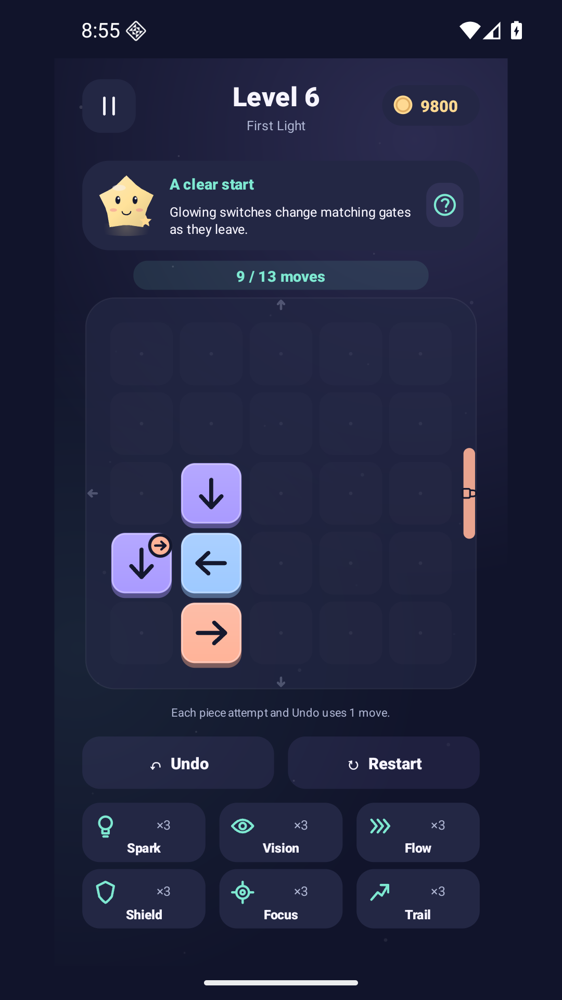<br><strong>Plan every exit</strong><br>Visible actions, six optional powers.</td><td align="center">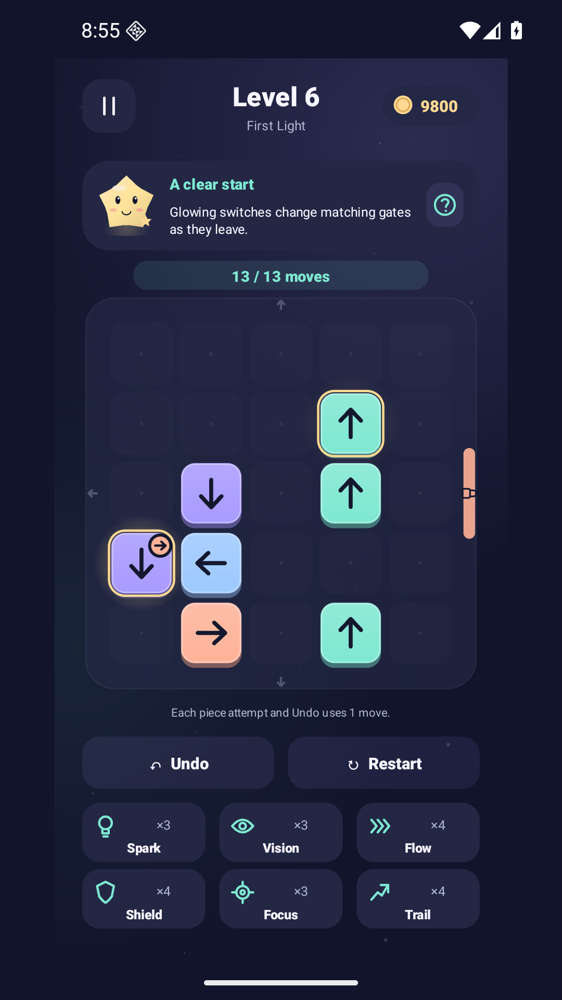<br><strong>See the safe choices</strong><br>Focus highlights exact safe exits.</td><td align="center"><br><strong>Follow a possible path</strong><br>Trail numbers up to five steps.</td></tr>
<tr><td align="center">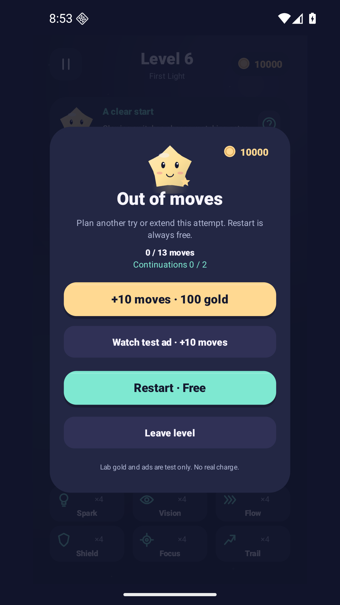<br><strong>Choose your next try</strong><br>Free restart stays in view.</td><td align="center">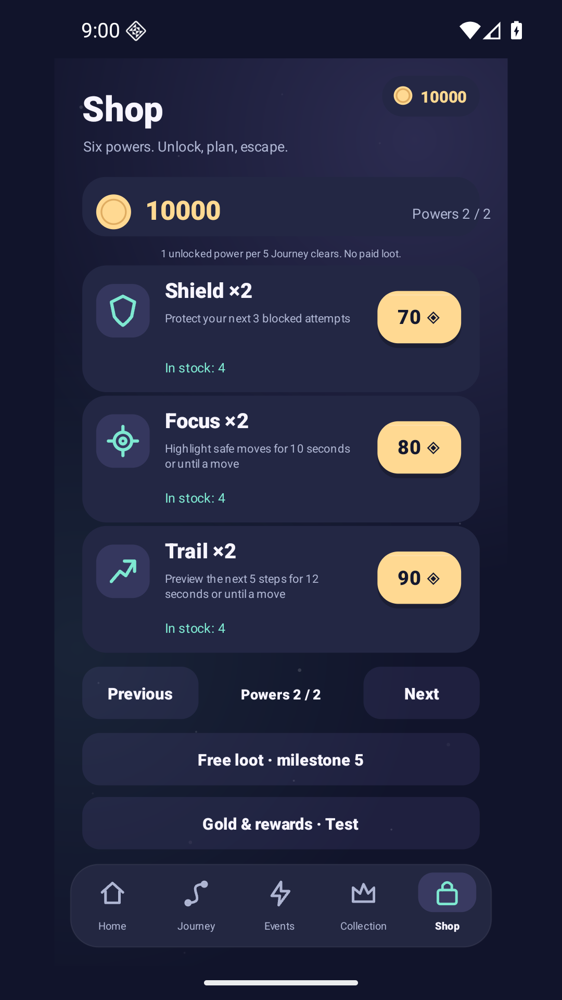<br><strong>Understand every pack</strong><br>Preview, price and milestone loot.</td><td align="center"><br><strong>One offer, one reward</strong><br>Test-ad continuation: +10 actions.</td></tr>
</table>

The final-binary run checked action costs, exhaustion across recreation, two exact 100-gold debits, free restart, unlimited friend practice, unlock gates, all six powers, a pack purchase and one free milestone claim. **Two actual Google test ads** then granted +10 actions and Spark ×1 respectively, with **zero extra gold** and no duplicate continuation after recreation. The optional [local journal export](docs/validation/v1.3/ad-journal-export.json) observed two impressions and two USD 0-micros paid callbacks; test diagnostics establish no income. For this historical 1.3 run, Google login, real checkout and production advertising were unconfigured/unvalidated. Current candidate configuration is described above; live qualification remains pending.

<table>
<tr><td align="center">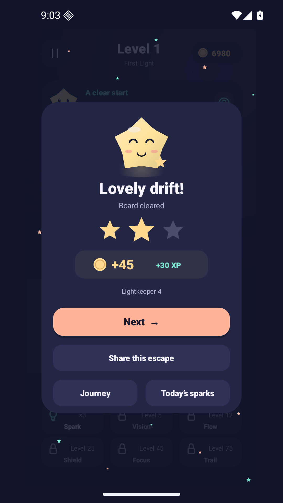</td><td><strong>The last action still wins.</strong><br><br>A separate run used the existing save without fixture edits: four exit/Undo cycles, then five certified exits, spending all 13 actions. It earned two stars, 45 coins and 30 XP, with no ad, purchase or exhaustion offer.<br><br>This victory frame is separate from the synthetic-profile gallery above. <a href="docs/validation/v1.3/exact-zero-ui.txt">Exact Android interaction record</a>.</td></tr>
</table>

## One move changes the next

Each light follows its arrow. A clear path and an open gate let it escape. A switch changes one gate; a paired Remix switch changes two. Choose the order and empty the board. In the preserved 1.1/1.2 releases, Undo and blocked taps have no action allowance; Lab 1.3 counts them as described above. Restart remains free and there is no countdown during a puzzle.

<table>
<tr><td align="center">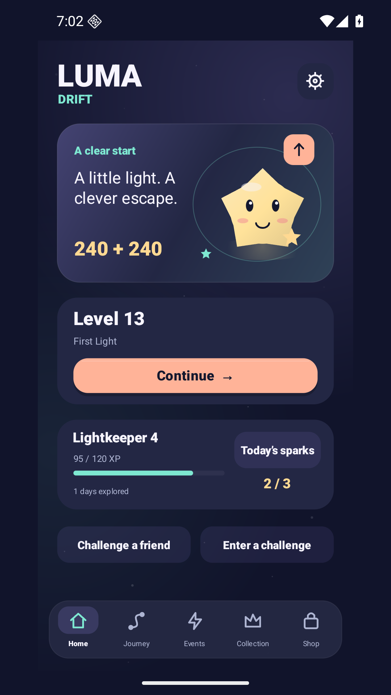<br><strong>Your next escape</strong><br>Continue, grow your rank, share a challenge.</td><td align="center">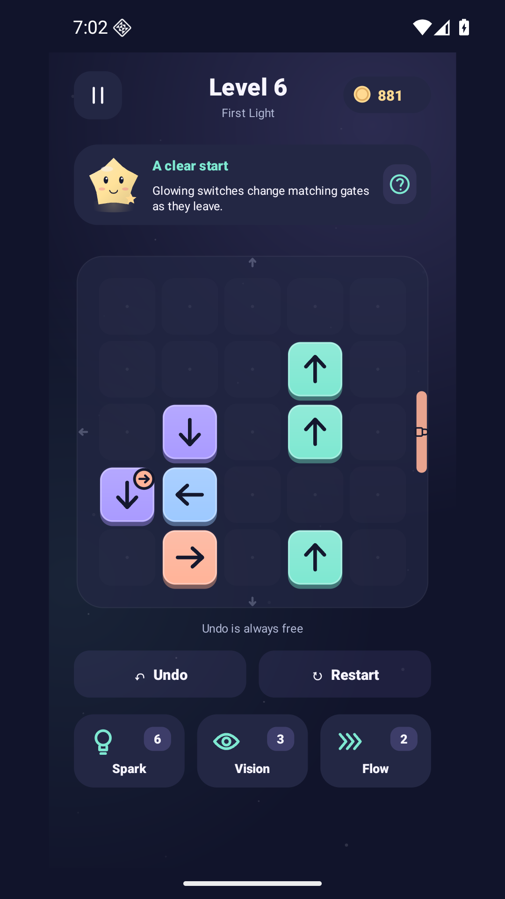<br><strong>Read the path</strong><br>Arrows, switches and visible gate states.</td><td align="center">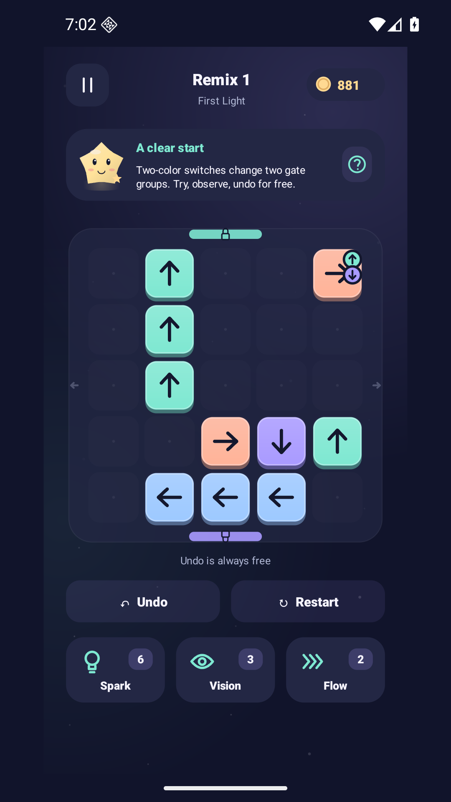<br><strong>Change two gates</strong><br>240 extra boards after Journey level 12.</td></tr>
</table>

Screenshots show the installed **stable 1.1 app**. See the [illustrated walkthrough](docs/VISUAL_GUIDE.md) for the shop, collection, missions and local journal. They do not depict or validate the later Lab SDK integration.

## Inside version 1.1

| Play | Collect | Return & share |
| --- | --- | --- |
| 240 original Journey boards across eight chapters | Six vector companions and six color themes | Three daily missions with earned-coin rewards |
| 240 Remix boards with paired gate switches | Optional star badge after seven distinct clears | First-clear XP, ranks and days explored |
| Three daily puzzles and seven weekly stages | Spark, Vision and Flow powers | Exact C/R/E friend codes and actual-board share cards |
| Contextual coaching and a safe first opening | Earned currency only; no paid solutions | Opt-in local journal with explicit JSON export |

French, English, German, Spanish, Portuguese and Italian are included. Music, effects, haptics and reduced motion have separate settings. Interrupted boards and progression stay on the device. Version 1.1 keeps the original boards and 1.0 save format compatible.

Stable 1.1 has no account, network permission, automatic telemetry, online leaderboard or backend. Android's share sheet opens only after a player requests a challenge or journal export. Friend challenges use the same starting board and award no coins, XP or progression; powers are unavailable. Daily/weekly events follow the device date.

## Preserved Lab 1.2: features and gallery

The Lab keeps the puzzle and expands its collection, event presentation and optional test surfaces:

- **24 original companions:** 18 additional silhouettes join the original six, with three pages of eight, native preview dialogs and explicit buy/equip actions. All remain cosmetic and use game coins. [Collection and events](docs/COMPANIONS_EVENTS.md).
- **Clearer local events:** visible goals, completed stages, reward ranges, a next-stage action, reset countdown and completion bonus. They still follow the device calendar and do not imply a remote event service.
- **Optional Google account:** Settings opens a guest-first account surface. Credential Manager and Firebase Auth are integrated, but the owner configuration is absent, so the delivered default shows “not configured.” No successful live login or cloud save is claimed. Account choice and advertising choice remain independent. [Configuration and limits](docs/GOOGLE_SIGN_IN.md).
- **Rewarded test ads:** declare an adult state, explicitly opt in, pass UMP's request-eligibility gate, then manually load an ad. An earned-reward callback grants 35 test gold once; a load or dismissal alone grants nothing. An unavailable service leaves play usable.
- **Three simulated packs:** 500, 1,400 or 3,600 gold. Native controls simulate Cancel, Pending or Complete and clearly say no charge. Pending survives restart, completion grants once, and repeating the same transaction adds zero. The real Play checkout route stays disabled.
- **Transparent item prices:** a bounded progression curve uses distinct campaign + Remix clears. It does not use spending, failures, ad choices or a personal willingness-to-pay estimate. Cosmetics keep fixed prices. [Exact bands and prices](docs/GAMEPLAY.md#lab-item-prices).
- **Optional local observations:** impression and paid-event callbacks can enter the journal when enabled. There is no Firebase Analytics or remote gameplay analytics. Optional Firebase Auth serves identity only. Test values are not revenue, and Google's SDK traffic is separate from the local journal.

<table>
<tr><td align="center">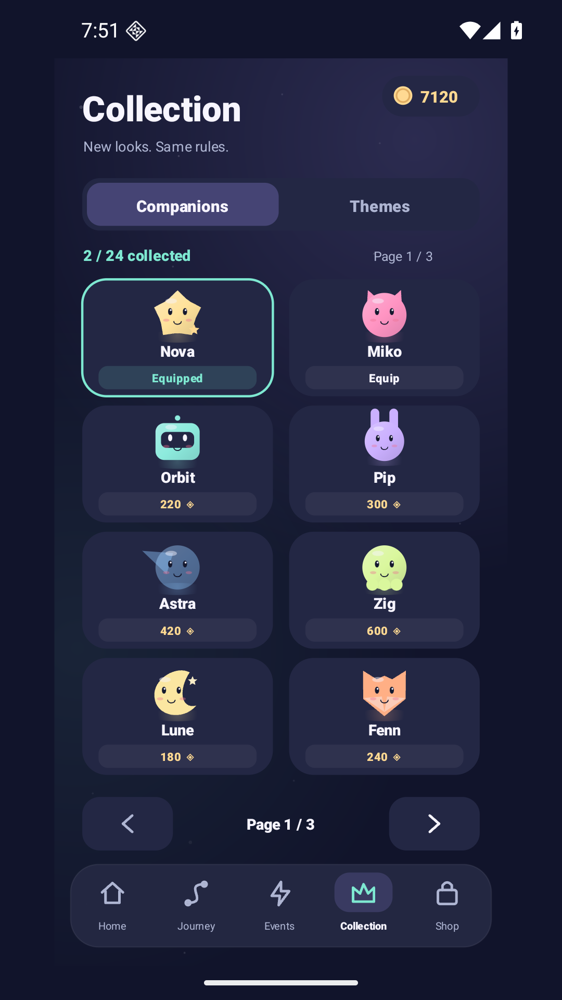<br><strong>Familiar lights</strong><br>Original companions, preserved.</td><td align="center">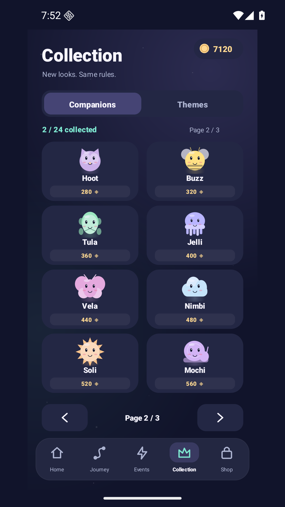<br><strong>New silhouettes</strong><br>24 companions, three pages.</td><td align="center">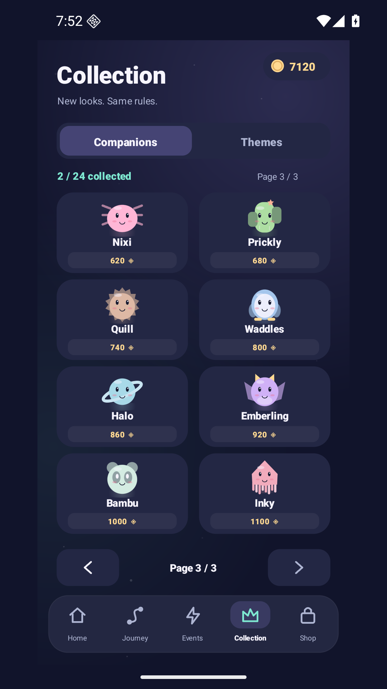<br><strong>Your constellation</strong><br>Earn, preview and equip.</td></tr>
<tr><td align="center">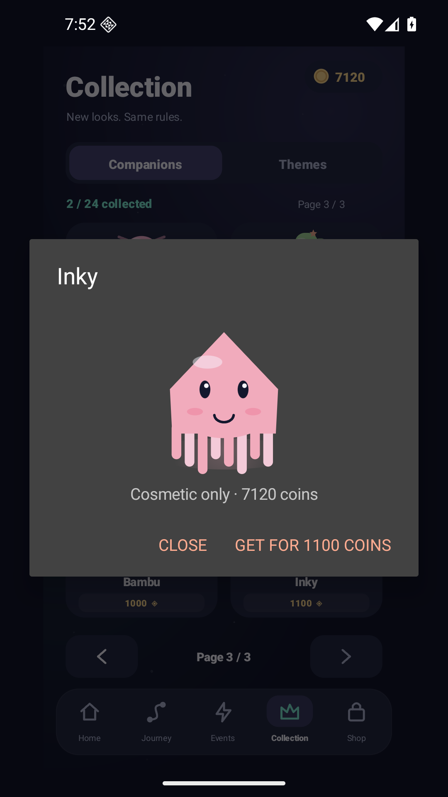<br><strong>Look before buying</strong><br>Opening a preview spends nothing.</td><td align="center">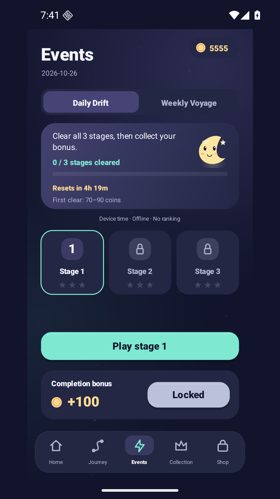<br><strong>A daily escape</strong><br>Goal, stages and bonus in view.</td><td align="center">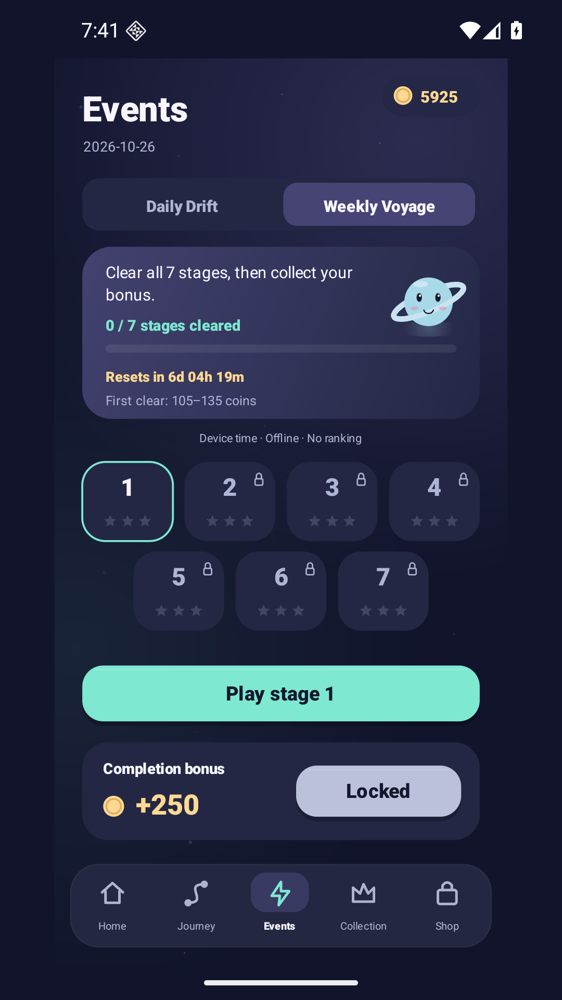<br><strong>A longer voyage</strong><br>Seven local weekly puzzles.</td></tr>
<tr><td align="center">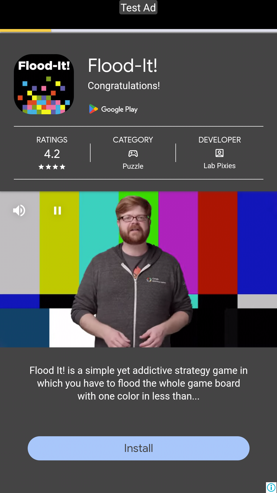<br><strong>Real SDK, test creative</strong><br>Optional reward; no revenue claim.</td><td align="center">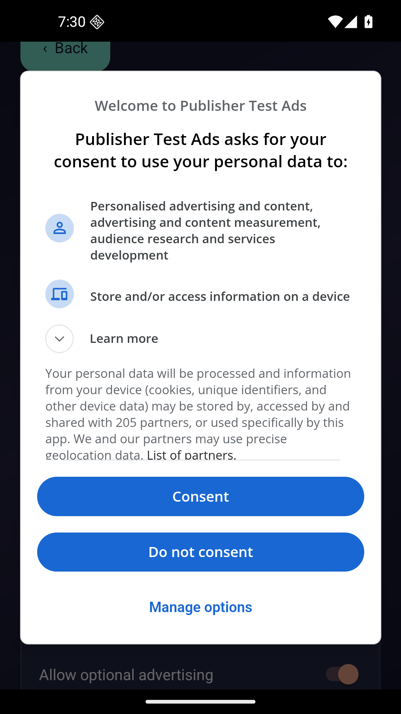<br><strong>Choices stay visible</strong><br>Google's test consent form.</td><td align="center">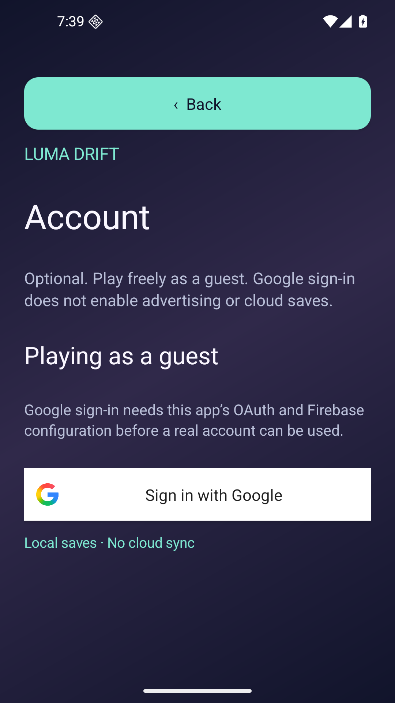<br><strong>Guest comes first</strong><br>Owner sign-in setup is still required.</td></tr>
</table>

These are actual installed **Lab 1.2** captures and historical results; they do not show the new 1.3 allowance or six-power shop. Google's **Test Ad / Publisher Test Ads** screens are SDK test material, not a Luma Drift rating, store listing or production approval. The test run displayed a rewarded creative and credited **35 test gold**, exercised UMP refusal and no-charge pack cancel/pending/restart/idempotence, browsed all 24 companions, and cleared all ten daily/weekly stages with one-time bonuses. Six-language collection/event checks passed. The opt-in local journal captured one actual test impression, reward and paid callback at USD 0 micros; it was cleared and disabled afterward. Google account evidence covers guest/missing-configuration behavior in English and French; actual login remains untested.

The [preserved 1.2 validation](docs/VALIDATION_1_2.md) identifies those exact packages, executed checks and remaining limits. Owner-configured consent, Play license-test purchases, production fulfillment, live identity and commercial results remain separate future work. Paid-event callback observation is not claimed from an SDK test-ad screenshot.

## Could this be a hit?

**The stable game is playable; market success is unproven.** Version 1.1 strengthens the first session, the gate mechanic, return goals and friend handoff. Engine tests establish solvability and consistency. They do not measure fun, retention or acquisition cost. Neither the stable shop nor Lab simulations establish real revenue.

The [hit audit](docs/HIT_AUDIT.md) explains the product choices and evidence gaps. The [roadmap](docs/ROADMAP.md) puts observation of first-time players and D1/D7 return ahead of additional monetization. Its decision thresholds are project hypotheses, not claimed industry benchmarks.

## Build & verify

Current source builds **production 1.4.0-rc1** and **Lab 1.4.0-sandbox**: Java 17 and Android Canvas, minimum API 26, target/compile API 36; Gradle 8.14.3 and AGP 8.11.0. Both current channels include GMA Next-Gen 1.6.0, UMP 4.0.0, Billing 9.1.0, Credential Manager 1.6.0, Google ID 1.2.1, Firebase Auth 25.0.0, desugaring and transitive dependencies. Release builds use R8/resource shrinking. Stable 1.1 predates these integrations and has no third-party runtime SDK.

```sh
export JAVA_HOME=/path/to/jdk-17
export ANDROID_HOME=/path/to/android-sdk
./gradlew assembleProductionDebug

scripts/test-engine.sh
scripts/test-data.sh
scripts/test-meta.sh
scripts/test-economy.sh
scripts/test-collection-events.sh
scripts/test-difficulty.sh
scripts/test-move-budget.sh
scripts/test-billing-policy.sh
scripts/test-wallet-recovery.sh
./gradlew assembleProductionRelease bundleProductionRelease lintProductionRelease
./gradlew assembleLabRelease bundleLabRelease lintLabRelease
```

Release builds need your private signing configuration; see [development](docs/DEVELOPMENT.md). Keep the existing signing key when updating an installed package. Private keys and local properties are excluded from this repository. The [validation report](docs/VALIDATION.md) separates logic tests, signature checks, emulator interaction and physical-device limits.

Current production and Lab lint runs record **0 errors and 5 warnings each**: three intentional small synchronous preference commits and two update advisories. The [build report](docs/validation/v1.4/android-build.txt) uses standalone lint 9.4.0 through the recorded experimental override. [Server tests](server/TESTING.md) and [website tests](docs/PUBLIC_PAGES.md#executed-validation) remain separate from Android and Google live-service qualification.

## Explore the project

| For… | Read |
| --- | --- |
| Playing and understanding every feature | [Visual guide](docs/VISUAL_GUIDE.md) · [Gameplay & economy](docs/GAMEPLAY.md) |
| Exploring the Lab's collection and local events | [Companions & events](docs/COMPANIONS_EVENTS.md) |
| What's new and what comes next | [Changelog](docs/CHANGELOG.md) · [Roadmap](docs/ROADMAP.md) · [Hit audit](docs/HIT_AUDIT.md) |
| Inspecting the new progression and allowance | [480-board difficulty audit](docs/DIFFICULTY.md) · [Move-limit research](docs/MOVE_LIMITS_RESEARCH.md) · [Action & power contracts](docs/MOVE_BUDGET_POWERUPS.md) |
| Installing and checking the delivery | [Release](docs/RELEASE.md) · [Validation](docs/VALIDATION.md) · [Artifact manifest](releases/manifest.json) |
| Building or changing the game | [Architecture & development](docs/DEVELOPMENT.md) · [Level design](docs/LEVEL_DESIGN.md) |
| Understanding monetization tests | [Lab setup](docs/MONETIZATION_SETUP.md) · [Primary-source research](docs/MONETIZATION_RESEARCH.md) |
| Configuring optional Google identity | [Google sign-in](docs/GOOGLE_SIGN_IN.md) |
| Activating owner accounts and production services | [Production release](docs/PRODUCTION_RELEASE.md) · [Owner checklist](docs/PRODUCTION_ONBOARDING.md) · [Public pages](docs/PUBLIC_PAGES.md) |
| Art, sound and store preparation | [Art & audio](docs/ART_AUDIO.md) · [Store listing](docs/STORE_LISTING.md) · [Brand kit](docs/store/README.md) |
| Data and provenance | [Privacy](docs/PRIVACY.md) · [License](LICENSE) · [Third-party notices](docs/THIRD_PARTY_NOTICES.md) · [Research archive](docs/RESEARCH.md) |

[All documentation](docs/README.md). The initial French research is retained as historical planning; its proposed Godot stack and revenue scenarios do not describe this native implementation or measured business results.

## License

[GNU AGPL v3](LICENSE), including the original code, vector graphics and synthesized sounds. Android platform facilities, Google SDKs, transitive dependencies and build tools retain their own terms; the Gradle wrapper is [Apache 2.0](https://github.com/gradle/gradle/blob/master/LICENSE). The repository license does not grant rights in those SDKs or third-party marks. Production integration needs its own terms review. Trademark availability, Play approval and commercial success have not been established.
