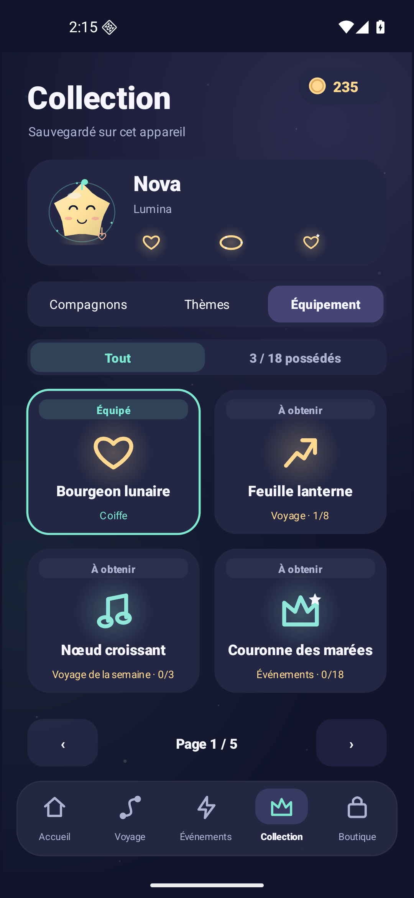
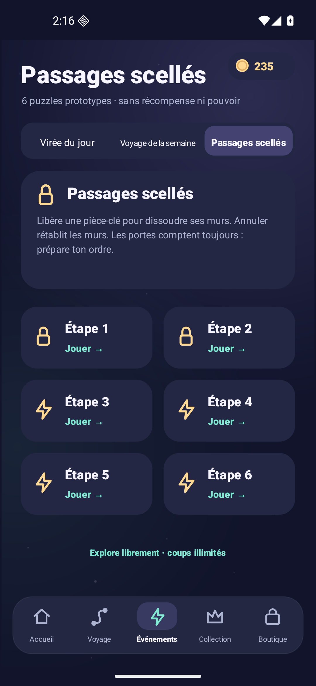

# Companions, equipment and event clarity

The **1.5 candidate** presents three collection tabs: Companions, Themes and Equipment. Four large cards per page distinguish **Owned**, **Equipped** and **To unlock**. An owned-only filter and permanent equipped-avatar hero keep inventory readable. The 24 companion identities and six themes remain cosmetic; the new 18 equipment items have separate explicit, bounded benefits. [Equipment table and sources](AVATAR_EQUIPMENT.md) · [Current validation](VALIDATION.md).

<p></p>

Daily and weekly tabs retain visible goals, stages, reset times and one-time completion rewards. Their lifetime victories/stars can unlock permanent equipment. A third tab offers six separate key/wall practice puzzles with unlimited actions and no economic reward; it is a prototype pack, not a timed online event.

Equipment has **Head, Aura and Charm** slots, with six items per slot. Visible benefits are bounded at +3 local coins on an eligible first victory, −5 coins per power pack, and one protected blocked attempt per run; one equipped item per slot prevents stacking within it. Starter/milestone claims do not spend money, and the four coin-priced items use only earned local coins. Ownership/loadout are device-local, with no Google gameplay/equipment cloud save or paid-gold import. The Sealed pack also awards no XP, missions or progression. [Exact acquisition and receipt rules](AVATAR_EQUIPMENT.md).

Current [installed 1.5 acceptance](VALIDATION.md#installed-android-acceptance) covers equipment, P challenges and the revised UI; the final [EN/FR capture repeat](validation/v1.5/ui-smoke.txt) explicitly preserves balances/inventory. The 1.2 screenshots and dated results below remain historical evidence rather than screenshots of this candidate.

## Historical Lab 1.2 collection and event guide

The following screenshots and eight-card pagination describe **Lab1.2**, not the current four-card/three-tab layout. The catalog IDs, silhouettes and fixed companion prices remain applicable.

Luma Drift's lab release expands the collection from **6 to 24 companions** and makes each event's objective, progress, next stage, coin rewards, reset time, and completion bonus visible on one screen. These changes are implemented; visual/runtime release checks are recorded separately in [VALIDATION.md](VALIDATION.md).

## Screen guide

These are genuine Android emulator captures at 1080 × 1920, not concept mockups.

| Browse distinct silhouettes | Preview before spending |
| --- | --- |
|  |  |
| Eight cards per page keep all 24 companions reachable; price and equip state remain visible. | Opening or closing a preview spends nothing. The confirmation button states the exact coin cost. |

| Daily: three clear steps | Weekly: seven stages on one screen |
| --- | --- |
|  |  |
| Goal, progress, reset time, board earnings, next action, and final bonus are visible together. | The compact stage grid leaves the play button and completion reward fully visible. |

## Collection

The original Nova, Miko, Orbit, Pip, Astra, and Zig keep their exact IDs, prices, and silhouettes. Existing ownership and equipped companion saves continue to resolve to the same entries. All 24 companions are cosmetic: no score multiplier, puzzle advantage, extra rewards, or exclusive stage access.

The collection has separate **Companions** and **Themes** tabs. Companions appear in three pages of eight, with an owned counter and page counter. Each card shows the actual vector character, name, price or equip state. Tapping a card opens a larger native preview. An explicit confirmation spends coins and equips the cosmetic; merely browsing or opening a preview does not spend coins. The same preview flow serves the six existing themes.

| Companion | Original silhouette | Coins |
| --- | --- | ---: |
| Nova | Star | Free |
| Miko | Cat | 160 |
| Orbit | Robot | 220 |
| Pip | Rabbit | 300 |
| Astra | Comet | 420 |
| Zig | Ghost | 600 |
| Lune | Crescent moon | 180 |
| Fenn | Fox | 240 |
| Hoot | Owl | 280 |
| Buzz | Bee | 320 |
| Tula | Turtle | 360 |
| Jelli | Jellyfish | 400 |
| Vela | Moth | 440 |
| Nimbi | Cloud | 480 |
| Soli | Sun | 520 |
| Mochi | Snail | 560 |
| Nixi | Axolotl | 620 |
| Prickly | Cactus | 680 |
| Quill | Hedgehog | 740 |
| Waddles | Penguin | 800 |
| Halo | Ringed planet | 860 |
| Emberling | Dragon | 920 |
| Bambu | Panda | 1,000 |
| Inky | Squid | 1,100 |

The total companion cost is **12,200 coins**. A fresh profile starts with 180 coins; completing all 240 Journey boards at three stars yields 13,200 more. Thus every companion can be earned through that campaign income when coins are reserved for companions. Themes and items compete for that same wallet; daily events, weekly events, and Remix offer additional earned coins. This arithmetic is an economy constraint, not a forecast of how fast people will complete the game.

The new silhouettes are constructed directly in Android Canvas: geometric bodies, ears, wings, gills, shells, horns, tentacles, spines, and rings. The names, shapes, palette combinations, and drawing code are original project work. No character image, sprite, or mascot from another game was imported. A name's inclusion here does not constitute a trademark clearance search.

## Event screen

The screen now answers the following questions without opening a separate help panel:

1. **What do I do?** Clear all three Daily Drift stages, or all seven Weekly Voyage stages, then collect the bonus.
2. **Where am I?** A cleared-stage counter, progress bar, numbered stage cards, best stars, and locked/completed states show the current position.
3. **What can I earn?** The first-clear range is shown before starting: 70–90 coins per daily board or 105–135 per weekly board, depending on stars. The separate completion bonus is 100 or 250 coins.
4. **What happens next?** A prominent button opens the next available uncleared stage. Every unlocked stage remains directly replayable. When the event is complete, the main button offers a replay.
5. **When does it reset?** A countdown uses the current device time zone and local calendar. Daily resets happen at local midnight; weekly resets happen at local Monday midnight. The screen explicitly labels device time and offline operation.
6. **How do I get the final bonus?** The bonus card is always on screen. Its button explains how many stages remain when locked, collects once when complete, and shows “Collected” afterward.

Daily cards use one row of three. Weekly cards use a four-plus-three grid so all seven stages and the final bonus fit in the minimum 390 × 780 logical viewport. Stage cards have accessible labels with stage number, replay/play action, and lock status; touch targets exceed 44 logical pixels in both dimensions. Paging controls are 78 × 46. The dialog uses Android's native controls.

### Calendar and reward boundaries

Events are deterministic local challenges, not server-scheduled tournaments. No fake competitors, ranks, countdown urgency, or live participation figures are displayed. Changing the device date or time zone can change the available period; a trustworthy global schedule would require a backend and has not been added here.

`EventSchedule` computes the next calendar boundary, rather than subtracting a fixed 24-hour or seven-day duration. Consequently, daylight-saving transitions can produce 23- or 25-hour daily periods. The last partial minute is rounded up; the timer does not display zero minutes while the old period is still active. It is a wall-clock display and does not affect puzzle animation or active play-time measurement.

Existing `GameStore` rules are retained: stages unlock in order, rewards are granted once per period with only newly earned star differences on improvement, completion bonuses cannot be collected twice, and a board saved under an expired period cannot claim the new period's rewards. Event play does not unlock Journey or Remix progress. The screen refreshes from the store; it does not invent a parallel reward ledger.

## Research behind the presentation

Research was checked before these changes. Dream Games' [official Royal Match event directory](https://dreamgames.helpshift.com/hc/en/3-royal-match/section/23-events-and-tournaments/) describes step-based goals and rewards for several events. King's [official event feature guide](https://candycrush.zendesk.com/hc/en-us/articles/7391185946909-What-extra-game-features-are-available) tells players to check each event's goals, rules, rewards, and countdown. These sources support making those elements explicit and easy to find. They do not establish that this particular layout improves retention or revenue.

Luma Drift applies that information hierarchy to its own escape-puzzle rules and original art. It does not copy another game's screen, proprietary event names, characters, level data, reward schedule, or competitive system. There are no forced advertisements in the event flow.

## Verification

Run:

```sh
./scripts/test-collection-events.sh
```

The current result is **87,121 passing checks**. The clock suite compares Android-compatible `Calendar` calculations with an independent Java `java.time` local-date oracle across **604 time zones and 14,496 boundary scenarios**, covering US/EU daylight-saving changes, Monday rollover, New Year, and leap day. It also verifies the final millisecond before a reset, the reset instant, round-up behavior, and Luxembourg's 23/25-hour dates. Catalog checks freeze the original six entries, verify 24 distinct IDs and shape indices, price bounds, lookup round-trips, and the campaign-income budget.

The exact run output is in [collection-events-tests.txt](validation/lab/collection-events-tests.txt). These deterministic simulations do not establish human enjoyment, device-wide compatibility, retention, or hit potential. See [HIT_AUDIT.md](HIT_AUDIT.md) and [ROADMAP.md](ROADMAP.md) for the player evidence still required.

### Actual Android UI run

The [full UI report](validation/lab/collection-events-ui-smoke.txt) records an Android 16 emulator run at 1080 × 1920. It browsed all 24 cards, opened and cancelled previews without spending, bought Miko for exactly 160 earned coins, confirmed an already owned companion without another debit, re-equipped Nova for free, and verified the six existing theme cards.

The same run solved **all ten real event boards through their visible touch controls** using the engine's certified solutions. Daily boards paid 270 coins in total, then the 100-coin bonus; weekly boards paid 945, then the 250-coin bonus. Repeated collection of each bonus paid zero. The six-language loop checked collection, daily, and weekly screens in EN/FR/DE/ES/PT/IT, including accessible summaries and clickable controls inside the display bounds, then restored English. The crash buffer was clean. This test did not enter an advertising or payment flow.

A [final installed-build check](validation/lab/collection-final-ui-smoke.txt) refreshed all three collection-page screenshots after the art/name spacing polish, bought Orbit for exactly 220 coins, and repeated the zero-cost confirmation/equip checks. Both final event screens kept their controls in frame, rejected duplicate completion rewards, and opened playable stage-one replays (16 daily pieces and 18 weekly pieces). English Home was restored; age, advertising, and journal preferences were left untouched.

To reproduce on a dedicated emulator with the Lab APK installed and English selected:

```sh
python3 scripts/smoke-collection-events.py --serial emulator-5580
```

The script refuses physical-device serials and never installs, clears saves, edits private preferences, or enters ad/payment screens. It may spend earned coins on one affordable companion. An event whose bonus was already collected is replayed without inventing another first-clear or completion reward.
