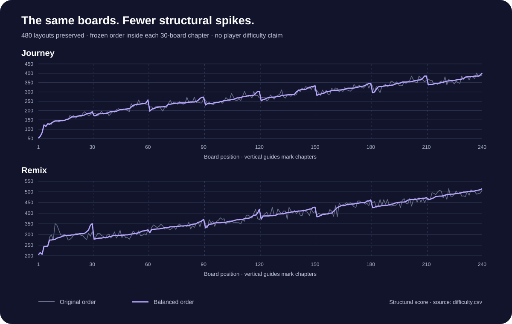

# A measured progression for 480 boards

> **Historical Lab 1.3 audit.** Its 480-board reordering and recorded results are preserved below. Current 1.5 uses **1,000 new G Journey boards + 240 new H Remix boards**, while B/Q still resolve through `legacyGet()` / `legacyRemix()`. [Current before/after audit](data/progression-v2-summary.md) · [All current rows](data/progression-v2-audit.csv) · [Release contract](RELEASE_1_5.md).

The current offline audit certifies every layout and checks uniqueness after all eight rotations/reflections, translation and consistent arrow/gate transformations. It does not prove uniqueness under every possible abstract puzzle isomorphism. After three introductory boards, later G/H content includes unsafe legal ordering choices. Fixed mistake margins are 2–4 actions; Journey allowances range from 9 to 23. No runtime player/payment signal changes the layouts or budgets.

On the matched first 240 positions, uniform choice among legal exits gives modeled clear rates of **89.04% → 30.02%** for Journey and **57.96% → 22.55%** for Remix. The complete 1,000-board Journey model averages **11.96%**. These are exact results for a deliberately naive policy, not human pass rates or retention. Separate seeded blind taps include blocked-action costs. Current `scripts/test-difficulty.sh` checks both historical and v2 contracts; its [1.5 record](validation/v1.5/difficulty-tests.txt) contains **161,985 checks** and supersedes the historical command result below.

**Lab 1.3 progression component · 26 October 2026 · Structural measurements, not human difficulty ratings**

`BalancedCatalog` gives the existing **240 Journey + 240 Remix** boards a frozen progression order. It keeps every original layout and solution; it does not generate replacement puzzles. All 480 boards were measured and verified solvable. Of them, 216 Journey and 225 Remix boards move to another position within their original chapter.

This component is separate from the preserved stable/Lab 1.2 delivery. A JVM pass does not establish installed behavior or player difficulty. The [separate final 1.3 runtime report](validation/v1.3/move-power-ui-smoke.txt) records covered Android cases, with an explicit synthetic profile; neither report establishes enjoyment, retention or a Candy Crush equivalent.

## What changed

- Journey boards **1–6** and Remix boards **1–3** keep their exact original positions, preserving movement, blocking and the first gate/paired-gate introductions.
- The remaining boards are ordered by a declared structural score **inside each original 30-board chapter**. Equal scores keep original-number order.
- Each returned level has its new position/chapter number but preserves the original grid, gates, pieces, certified solution, seed and event flag.
- Original `LevelCatalog` definitions remain intact. Legacy C/R challenge identities resolve against that original catalog; new B/Q codes identify the balanced Journey/Remix order. On upgrade, earned stars/unlocks stay at their numbered positions rather than being remapped to original source IDs. An older interrupted sandbox board resets with a visible notice; wallet, XP, inventory and cosmetics remain.
- The Android app uses static permutation tables and lazy single-level caching. It does not sort 480 boards or run the difficulty analyzer during startup.

Chapter membership is conserved, so chapter averages stay exactly the same. The improvement is the order of encounters: fewer abrupt upward changes within a chapter, followed by a recovery at chapter boundaries. It is not a promise that every successive board is harder than the last.

## Score: a transparent proxy

For each original board the offline analyzer records:

| Symbol | Measured quantity |
|---|---|
| N | Number of pieces |
| B | Initially path-blocked pieces, independently of gate state |
| C | Pieces initially pointing toward a closed gate |
| S | Switch pieces |
| P | Pieces changing more than one gate |
| E | Ordered piece-to-piece blocking-ray dependencies |
| F | Certified-path positions with exactly one legal move |
| L / U | All legal choices sampled along the certified solution / those that cannot lead to a full clear |

The integer score is:

```text
10N + 5B + 4C + 10S + 12P + 2E + 2F + round(20U / L)
```

These weights are **project heuristics**, chosen to describe workload, dependencies and potentially misleading exits. They are not fitted to players or copied from another game's algorithm. A forced path may be easy to recognize for one player and difficult for another; that is one reason this is called a structural score.

The analyzer evaluates safety with the exact solver, not an approximate timeout. It samples every prefix of the recorded certified solution, then examines every legal next choice at that prefix. This is not an exhaustive enumeration of all possible play histories and not a random-player pass-rate simulation.

Across the audited paths, Journey contributes **7,122 legal choices, 76 unsafe**, and Remix **7,608 legal choices, 394 unsafe**. Those counts describe this sampling procedure; they are not the probability that a human makes a mistake.

## Measured before and after




All adjacent-change statistics include chapter boundaries and the unchanged teaching prefix. A “large upward jump” here means **more than 30 structural points**, an explicit analysis threshold rather than a player-derived boundary.

| Measure | Original Journey | Balanced Journey | Original Remix | Balanced Remix |
|---|---:|---:|---:|---:|
| Mean absolute adjacent change | 12.21 | **4.26** | 14.45 | **3.57** |
| Mean positive adjacent rise | 6.81 | **2.86** | 7.86 | **2.44** |
| Largest positive adjacent rise | 43 | **41** | 77 | **37** |
| Upward jumps over 30 points | 10 | **1** | 14 | **1** |

The remaining largest rise in each family is at **board 3 → 4**. Journey retains that blocking introduction inside its fixed prefix. Remix finishes its fixed three-board introduction, then begins the remaining chapter at the lowest available score. The progression does not hide those transitions by changing an old tutorial or pretending the whole curve is monotonic.

| Chapter | Journey mean | Remix mean |
|---|---:|---:|
| 1 | 147.13 | 284.33 |
| 2 | 207.13 | 297.23 |
| 3 | 235.77 | 338.53 |
| 4 | 262.10 | 366.27 |
| 5 | 290.57 | 401.97 |
| 6 | 314.33 | 426.60 |
| 7 | 345.17 | 450.33 |
| 8 | 364.97 | 490.63 |

These chapter means increase in both families; their numerical ranges are not interchangeable with star ratings or pass percentages. [All 480 rows and source mappings](data/difficulty.csv) · [Generated summary including ranges](data/difficulty-summary.md).

## Verification and reproducibility

Run from the repository:

```sh
scripts/test-difficulty.sh
```

The recorded run passed **19,054 checks** in **1.31 seconds on the development host**, which is not an Android timing. [Exact output](validation/v1.3/difficulty-tests.txt).

The suite checks every mapped solution, exact-solver equivalence, source layouts/metadata, chapter membership, complete unique permutations, fixed teaching prefixes, deterministic score/tie ordering, increasing chapter means, cache identity, invalid indices and actual reduction of adjacent variability/large spikes. Every board appears once; no difficult board is deleted to improve the averages.

The normal run regenerates the CSV and summary from source. `scripts/test-difficulty.sh --emit-order /private/tmp/luma-difficulty` emits the independently computed candidate tables for comparison with the frozen production arrays. Changing a weight or board definition must regenerate/review the tables and measured evidence; the runtime never silently rebalances boards from player behavior.

## What “like Candy Crush” means here

King's [official game-mode guide](https://candycrush.zendesk.com/hc/en-us/articles/360000754897-Which-game-modes-will-I-find) describes different goals and Hard/Super Hard/Nightmarishly Hard/Legendary labels. The reviewed help page does not publish a numerical balancing function that another developer can reproduce. We use the owner's request as a goal for understandable progression and visible challenge, not a claim to copy King's levels or private tuning.

The next useful evidence is a small human study: can players explain the gate rule, do they notice the first paired switch, where do they repeatedly undo or restart, and do later chapters feel earned rather than merely longer? Assess the new action allowance and six-power inventory separately; solvable boards and a smoother score curve cannot establish that the economy is comfortable. [Player-study protocol](HIT_AUDIT.md).
