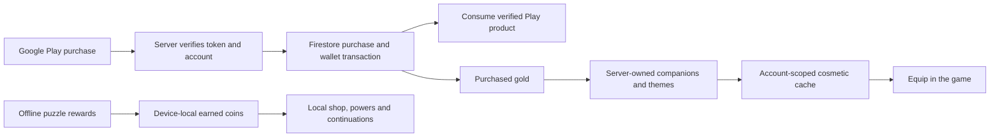

# Luma Drift 1.4 — production preparation

**1.4.0-rc1 · Android version code 5 · `com.androidhit.lumadrift` · 26 October 2026**

This release candidate introduces the owner's Google configuration, three AdMob placement IDs, a real Play Billing client and a server-authoritative purchased-gold service. It remains a preparation release: sample ad creatives are forced and checkout is blocked without an explicitly configured deployed wallet origin. No production deployment, completed Google login, Play payment or commercial result is inferred from these changes.

## What the player can use

The production package contains the 480-board measured progression, move allowances, six milestone powers, 24 companions, six themes, local events, synthesized music and six languages. Guest play stays offline. Its package updates the original production/stable installation; the `.sandbox` Lab remains separate.

The ordinary coin balance is earned locally and supports the existing offline game shop, powers and continuations. **Purchased gold is a separate account wallet.** Its first integration buys permanent companions and themes at fixed server catalog prices. After a successful server refresh, those cosmetics become usable through the normal collection/equip interface. Signing out removes account-only ownership from the active view; signing back into the same account and refreshing restores it. Locally bought cosmetics remain local. No local balance is imported into paid gold.

Paid powers and paid-wallet continuations are not enabled in this first integration. Local earned-coin and optional-ad routes still serve those gameplay uses. A wider server consumable API exists for future integration but is disabled by default; it is not advertised as a shipped paid-power feature.

## Ownership and value flow



These are implemented routes, not a diagram of an already deployed service. The local cosmetic cache is display/equip convenience, not a trusted source of funds or server ownership. Server APIs independently enforce identity, price, balance and permanent ownership.

## Purchase lifecycle

1. The signed-in player opens the store. The app fetches actual Play products and the authenticated server wallet; it does not invent a price.
2. Checkout uses the selected ordinary buy offer and a SHA-256 Firebase UID account binding. No checkout is available without the deployment origin, eligible account, wallet fetch and Play product.
3. Pending or completed observed tokens are submitted for independent Google verification. Pending adds no gold.
4. A Firestore transaction binds a unique token to the account and credits the allowlisted amount once. Only after that durable commit does the server consume the product.
5. Retries and maintenance recover unfinished consumption. RTDN and Voided Purchases reconciliation process refunds; a spent refunded balance becomes debt and blocks further spending until covered. Client callbacks never mint paid gold.
6. Cosmetic spending uses an account/request key and fixed SKU allowlist. A retry cannot debit twice or repurchase the same permanent cosmetic.

Server implementation, environment, IAM, testing and deployment instructions are in [server/README.md](../server/README.md). The [Android integration contract](WALLET_ANDROID.md) describes the app boundary. Google recommends server verification and backend consumption in its [billing security guidance](https://developer.android.com/google/play/billing/security).

## Configuration supplied by the owner

| Setting | Configured value |
|---|---|
| Firebase project | `luma-drift-production` |
| Firebase Android app | `1:369472826910:android:dfb29318d5a24e71c3080f` |
| OAuth Web client | `369472826910-is1dc25hc6fdtbecfhf0h04o40n4us21.apps.googleusercontent.com` |
| AdMob app | `ca-app-pub-6914185503996225~9670436379` |
| Earned-gold rewarded unit | `ca-app-pub-6914185503996225/7013317595` |
| Continuation rewarded unit | `ca-app-pub-6914185503996225/7504272185` |
| Power rewarded unit | `ca-app-pub-6914185503996225/7093208640` |
| Play products | `luma_gold_500`, `luma_gold_1400`, `luma_gold_3600` |

Firebase's public client API key is included in the production asset alongside these client identifiers. It is not a service-account key. No private signing key, password or privileged server credential is published. The production asset is not included in the Lab flavor.

The owner has not yet supplied a public support address or domain. The server origin is empty in the delivered candidate. The [configuration report](validation/v1.4/production-readiness.json) distinguishes correctly assembled internal configuration from live activation.

## Public pages and deletion

The [static site](../public/index.html) contains FR/EN developer, privacy and account-deletion pages, plus the publisher's app-ads.txt line. It includes a prepared external Google sign-in/deletion flow with explicit confirmation. It remains disabled until the owner's Firebase **Web** application, authorized domain and deployed API are configured. An Android Firebase app ID cannot substitute for the Web app ID.

Android account deletion calls the wallet service when it is configured; it does not fall back to deleting only Firebase if that service fails. Without a configured wallet service, no paid wallet can be created by this build and the existing Firebase-only account route applies. Local offline game progress is separate. The server deletion workflow and limited retained transaction audit are explained in the [privacy/deletion preparation](PUBLIC_PAGES.md); the default audit period is a configurable engineering choice, not a claimed legal requirement.

The site is prepared in the repository and has not been hosted. Screenshots of it show locally rendered pages, not live Google authentication or production account deletion.

## Build and activation

```sh
# Signed preparation candidate: production package, sample creatives, no wallet origin
./gradlew assembleProductionRelease bundleProductionRelease lintProductionRelease

# Isolated Lab regression build
./gradlew assembleLabRelease bundleLabRelease lintLabRelease

# Local candidate configuration report; does not contact Google
python3 scripts/check-production-config.py
```

After deploying and qualifying the service, `-PlumaWalletUrl=https://YOUR_REVIEWED_SERVICE_ORIGIN` supplies the server origin. `-PlumaLiveAds=true` disables sample-unit forcing only for the production flavor. These are explicit build settings, not evidence of account approval. Do not use live ad traffic for QA. A public release still needs owner consent messages, app-ads.txt/readiness, Play declarations, actual Google/device tests, license-test purchase lifecycle and the applicable closed-test review.

Use the [owner onboarding checklist](PRODUCTION_ONBOARDING.md) for console steps and [Validation](VALIDATION.md) for exactly executed checks.
