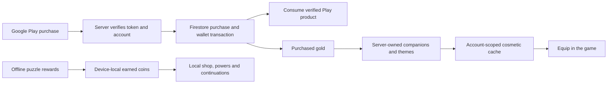

# Production candidate and activation boundary

## 1.17 — final candidate qualification in progress

Production is **1.17.0-rc4 / code22**, with isolated **1.17.0-sandbox-rc4**. Candidate F passes [four-package binary verification](validation/v1.17/candidate-f/binaries/binary-final-candidate.json) and host responsive-root tests. Exact-F native interface/audio/fresh/full1,000 qualification, Git publication and Firebase delivery remain pending. E's earlier scopes and compact composition rejection remain separately recorded. [Release register](RELEASE_1_17.md) · [Evidence](validation/v1.17/README.md).

The production package, existing signing identity and local save keys are retained. Earned LumaCoins, house, clothing, profile and badge changes remain device-local. The 23-companion and five-outfit pools spend earned LumaCoins, not paid LumaGold. The retained test-ad forcing, closed real checkout, unconfigured wallet origin and disabled paid premium draws must be checked against the final manifests; no source UI change activates them.

The actual 1.17 game scope does not validate live advertisements, payments, Google sign-in, account deletion, cloud progression, Play publication, physical-phone performance or player retention. Existing website privacy/deletion/configuration and server gates are preserved; their provider qualifications below retain their original dates and limits. The [1.17 website template](validation/site-v1.17/README.md) is unpublished and must not be confused with a Hosting receipt.
<!-- FINAL_117: PRODUCTION_STATUS — replace pending status only from accepted final binary/native/publication records; keep commercial boundaries explicit. -->

## Preserved production and provider records

The dated records below identify their own APKs and provider observations. They are not1.17 execution evidence.

## Preserved 1.13 — home candidate and preserved activation gates

Production **1.13.0-rc2 / code 14**, isolated Lab **1.13.0-sandbox-rc2**. [Release/artifacts](RELEASE_1_13.md) · [Home contract](HOME_1_13.md) · [Qualification](validation/v1.13/README.md). The exact RC2 production APK is `c68be62fd940e753fc06c4b5677a48cafaf077a4710755b3bdf96467d571e31b` and Lab APK is `85cd018d5d7ee17f7343921d5367859e261acb7bdc1443bcd02d6bd7618953fa`. Its [build](validation/v1.13/build-rc2.txt), [source freeze](validation/v1.13/source-freeze-rc2.json) and [binary verification](validation/v1.13/binaries-rc2/binary-verification.txt) pass. RC1 hashes and native observations stay historical after the reproduced tutorial Later→Resume crash.

The candidate adds a local furnished home and a real three-piece opening around the unchanged puzzle route. House purchases use earned LumaCoins; they do not activate server money, paid cosmetics or cloud saves. Exact RC2 installed scopes pass 798 retained-Lab checks, 55 fresh-Lab checks, 90 targeted tutorial checks, seven production startup checks and 35 production house checks, with the restoration/cold boundaries in [the qualification register](validation/v1.13/README.md).

[Source `67774c14`](https://github.com/nabz0r/AndroidHit/commit/67774c143a60017049207adcedf2ea63fe048d97) is published on `main`. The [publication receipt](validation/v1.13/publication.json) independently confirms four immutable public APK/AAB downloads, HTTP200 and exact frozen bytes/SHA-256, **38,006,707 bytes total**. The FR/EN website passes 2,150 offline source assertions and 14 local browser states. [Firebase Hosting delivery](validation/site-v1.13/deployment.json) is finalized from that same source `67774c14` at **28 October 2026,16:03:50.235 UTC**, version `170cf6d048c1b40f`, with 108 files /77,610,834 bytes. [Independent public-origin verification](validation/site-v1.13/public-origin.json) confirms all 108 payloads and three directory aliases, HTTP200 and exact bytes/SHA-256. Documentation-only follow-up commits do not change this deployed source identity or establish real provider acceptance.

The owner’s existing Play draft application and internal-tester workflow are background context. This work does not establish an APK/AAB upload, review, approval or public Play release. Real Google/two-account/social acceptance, UMP consent/decline, ad eligibility and licensed purchase/pending/refund/recovery remain independently qualified. These APKs force test ads, leave the purchase wallet origin empty and keep premium draws disabled. Server deployment is unchanged.

## Preserved 1.12 — atelier UI and purchase recovery

Production **1.12.0-rc2 / code 13**, Lab **1.12.0-sandbox-rc2**. [Release](RELEASE_1_12.md) · [Qualification](validation/v1.12/README.md). The current work revises native Home/shop/item pages and the account wallet presentation. An optional cached account balance is display-only; real spending still requires a fresh server wallet and all existing gates. The earned-power transaction now retries its exact debit/grant on storage refusal.

Play publication, real Google/two-account/social acceptance, UMP consent and licensed purchase/pending/refund/recovery remain separate. These bytes force test ads, have no wallet purchase origin and disable paid cosmetic draws. At the start of that preserved work the website was 1.10; its later confirmed 1.12 Hosting receipt is preserved in [the site record](validation/site-v1.12/README.md). Server deployment was unchanged.

## Preserved 1.11 — pre-Play bug hunt

Production **1.11.0-rc2 / code 12** and isolated **1.11.0-sandbox-rc2** fix equipment visibility, application feedback and local-save defects. [Exact release](RELEASE_1_11.md) · [Qualification](validation/v1.11/README.md) · [Artifact identities](validation/v1.11/candidate.json).

The owner's supplied Play screenshots show the Luma Drift draft app and the internal tester-list workflow. The walkthrough is paused for app bug hunting; this turn performs no Play upload or submission. Creating the app does not activate products, ads or Google sign-in acceptance. Test ads remain forced, the wallet purchase origin is empty, and paid cosmetic draws are disabled. Google identity does not synchronize local gameplay. Provider qualification and physical-phone acceptance are separate from package/SDK tests.

The website remains on its confirmed 1.10 Hosting version; Cloud Run is unchanged. Earlier deliveries below retain their dated package/test scope and their historical next steps.

## Preserved 1.9 production boundary


Current 1.9 source, signed APK/AAB files and site are [delivered from main 6fbb1649](RELEASE_1_9.md), with independent public-download hashes and a finalized Hosting receipt. Real commerce stays gated; creating the Play application is the next owner step.

## Preserved 1.9 delivery · 27 October 2026

**Production 1.9.0-rc1 / code 10** uses `com.androidhit.lumadrift`; the separate Lab package uses `.sandbox`. The [production APK](../releases/luma-drift-1.9.0-rc1.apk) is SHA-256 `b02225c0464bf35cc1c04f64f0a4c8b1db610bde36b293bae9790f1a9e2c2b05`; the [Lab APK](../releases/luma-drift-1.9.0-sandbox.apk) is `acb3e1b0cfa71f84435d6cb0cf0fc73e3d4b434009deef972c54d86d9e7c09c7`. The [release record](RELEASE_1_9.md) identifies all four signed outputs, source hashes, binary checks and native-test scope. Production and Lab bytes, source oracles, native acceptance, GitHub delivery and website deployment are separate evidence layers in the [validation index](validation/v1.9/README.md).

The update corrects tutorial gate gestures and preview visibility, exposes actual gift claims, offers one trial charge per unlocked power, and uses transparent action-based star grading. It adds optional [Guardians](GUARDIANS.md) and free visual treatments. The published L/M/T puzzle identities, server code and deployed Cloud Run configuration are unchanged. [First-player audit and 2026 source limits](PLAYER_AUDIT_2026.md).

These are the **FINAL5** bytes. They retain exact Studio/guardian-list/typed-encounter restoration introduced in FINAL4 and add a typed local-save Retry barrier around persistent write/read-flush failures. Retrying flushes the pending transaction without granting it twice; onward Guardian navigation waits for a successful attempt save. Guardian gestures use the actual hit target so the visible Retry control is not swallowed by an underlying piece. [Source durability evidence](validation/v1.9/local-save/README.md) and native fault qualification remain separate.

Historical FINAL4 Lab SHA-256 `f8d554a446d4511baafb4edc3012f4014d0ae420c02e6fffdc29fc58b93a9e08` passed [fresh-guest C](validation/v1.9/ui-sdk-fresh-guest-c/host-report.json), 85 checks / 17 PNGs, and its [normal full-100 route](validation/v1.9/ui-sdk-final4-full100/host-report.json), 2,277 checks / 79 PNGs. C was a first Lab installation with production absent before and after; its new guest profile remains and rotation settings were restored. The full run restored its saved test environment. Historical FINAL3 runs and raw failures are also retained. No earlier result is relabelled as acceptance of these bytes.

FINAL5 [full-100/menu/Guardian/language acceptance](validation/v1.9/ui-sdk-final5-full100/host-report.json) passes **2,277 checks / 79 PNGs** on the exact Lab APK, API 36 ARM64 with 16 KiB pages, and restores its saved test environment. The [first-install guest D run](validation/v1.9/ui-sdk-fresh-guest-d/host-report.json) passes **85 checks / 17 PNGs** on API 36 ARM64 with 4 KiB pages; Lab was absent beforehand, production absent before and after, its new guest profile remains and rotation settings were restored. [Production startup](validation/v1.9/ui-sdk-production-final5/host-report.json) passes **7 checks / 1 PNG** on the exact production APK and restores its saved environment. These are current-byte native results, separate from provider acceptance.

The [FINAL5 persistent-save fault run 3](validation/v1.9/ui-sdk-final5-storage-fault3/host-report.json) passes **524 checks / 14 PNGs** on the exact Lab APK. Two real permission cycles (`500 → 771`) deny writes and restore access: the pending Guardian layer peel remains on screen when Back is pressed and the physical Retry button saves it once; the reward remains exactly 100 pending coins through a still-blocked retry and Activity recreation, then durably changes **1,830 → 1,930 coins** with its receipt. A repeated claim adds zero. Memory and XML disk state are checked separately, and directory permissions, rotation and the saved test environment are restored. This is Activity recreation with an in-process pending transaction, **not process death while that transaction is pending**. The first two raw failed runs remain unchanged: [fault 1](validation/v1.9/ui-sdk-final5-storage-fault/host-report.json) stopped on the harness rotation wait before any permission lock, and [fault 2](validation/v1.9/ui-sdk-final5-storage-fault2/host-report.json) expected “Retry” while the actual control was labelled “Try again”. Neither failure is relabelled as a pass; run 3 supplies its own completed fault-recovery evidence.

| Final candidate setting | Actual boundary |
| --- | --- |
| Sample advertising | Forced; the owner's production placement IDs do not enable live traffic in these bytes |
| Paid wallet origin | Empty; real checkout remains blocked |
| Paid cosmetic draws | Disabled |
| Social API | Configured, but real Google-account and two-account friend/gift acceptance remain unqualified |
| Local saves | Journey, practice, earned currency, power trials, avatar style and Guardian state remain on this installation |
| Google identity | Optional adapter; no gameplay cloud save and no real SSO success established by these release tests |

The owner reports that the **Play developer account is approved**. This is owner testimony, not an independently observed Console state, and does not establish a created Play application, an approved listing, accessible products or a published app. The next owner workflow is to create the Play application **after this delivery**, select the identified signed AAB for its test release, and then qualify the required real providers. The existing APK/AAB will not start accepting payments merely because the Console account is approved.

## Activation work remains separate

Google identity requires actual account/device acceptance against the production package, signing configuration and Firebase project. Friends/gifts require two distinct real identities and observed invite, acceptance, quota, single-credit and account-switch behaviour; the [two-device protocol](QUALIFICATION_SOCIALE.md) is still the protocol to execute. Six synthetic behaviour profiles and Android guest tests are not substitute Google accounts.

A purchase-qualification build must explicitly configure the deployed wallet origin and retain test advertising. Qualify actual Play products and licence-test purchase states, one-time server credit, retries, consumption, account binding, refunds and recovery before opening a real-money route. Commercial advertising also needs its own consent/device/placement acceptance; tests continue to use sample creatives. Paid draws retain their separate closed gate. No genuine ad impression, real-money transaction, SSO session or provider acceptance is asserted by the source simulations or this gameplay release.

The existing Firebase website and wallet deployment have dated records below. For the current website, use [website 1.9 delivery evidence](validation/site-v1.9/README.md), which separates prepared source, original native captures, local browser checks and Hosting management evidence. The new local gameplay fields do not imply new server telemetry or gameplay cloud synchronization. [Current privacy inventory](PRIVACY.md) · [Public-page contract](PUBLIC_PAGES.md).

---

## Preserved 1.4 foundation and dated deployment observations

The following record preserves the original release versions, timestamps, probes and owner statements. Its then-pending Play identity status is historical; the newer owner-reported approval above does not retroactively alter those observations or qualify purchases. Earlier network probes are not re-executed or inferred from the 1.9 source tests.

**1.4 foundation, preserved scope.** Current game delivery is [1.8.0-rc1 / code 9](RELEASE_1_8.md), with its own [executed qualification](validation/v1.8/README.md). The older 1.5 had 1,000 Journey boards, 240 Remix, six P prototypes and 18 local equipment items. The implementation/deployment follow-up below retains its dates and 1.4 artifact scope. The separate [1.5 website redesign](PUBLIC_PAGES.md#15-visual-refresh-and-new-evidence) does not inherit these earlier served-byte checks.


**1.4.0-rc1 · Android version code 5 · `com.androidhit.lumadrift` · 26 October 2026**

This release candidate introduces the owner's Google configuration, three AdMob placement IDs, a real Play Billing client and a server-authoritative purchased-gold service. It remains a preparation release: sample ad creatives are forced and checkout is blocked without an explicitly configured deployed wallet origin. The signed candidate alone establishes no completed Google login, Play payment or commercial result. Later deployment observations are recorded separately below.

**Deployment/configuration follow-up · 27 October 2026:** Cloud Run is deployed at `https://luma-wallet-369472826910.europe-west1.run.app`. External probes confirm `/health` HTTP 200, an anonymous wallet HTTP 401 and the final site's deletion preflight HTTP 204. The initial `/healthz` check encountered a reserved Cloud Run path; the `/health` source correction passed 43 server tests. [Observed evidence and limits](validation/cloud-run-health-route.md). Play identity verification remains pending. Scheduler and RTDN are not deployed; automatic audit purging is not active. This follow-up changes neither delivered APK/AAB nor their empty embedded wallet origin, and establishes no live purchase or actual deletion.

## What the player can use

The production package contains the 480-board measured progression, move allowances, six milestone powers, 24 companions, six themes, local events, synthesized music and six languages. Guest play stays offline. Its package updates the original production/stable installation; the `.sandbox` Lab remains separate.

The ordinary coin balance is earned locally and supports the existing offline game shop, powers and continuations. **Purchased gold is a separate account wallet.** Its first integration buys permanent companions and themes at fixed server catalog prices. After a successful server refresh, those cosmetics become usable through the normal collection/equip interface. Signing out removes account-only ownership from the active view; signing back into the same account and refreshing restores it. Locally bought cosmetics remain local. No local balance is imported into paid gold.

Paid powers and paid-wallet continuations are not enabled in this first integration. Local earned-coin and optional-ad routes still serve those gameplay uses. A wider server consumable API exists for future integration but is disabled by default; it is not advertised as a shipped paid-power feature.

## Ownership and value flow



These are implemented lifecycle routes. Only the deployed service's public routing, anonymous rejection and final/preview-site CORS have been checked; the purchase/refund lifecycle is not qualified. The local cosmetic cache is display/equip convenience, not a trusted source of funds or server ownership. Server APIs independently enforce identity, price, balance and permanent ownership.

## Purchase lifecycle

The contract below describes implemented code. Actual Play purchases remain unqualified, and scheduled recovery/RTDN still require deployment and acceptance.

1. The signed-in player opens the store. The app fetches actual Play products and the authenticated server wallet; it does not invent a price.
2. Checkout uses the selected ordinary buy offer and a SHA-256 Firebase UID account binding. No checkout is available without the deployment origin, eligible account, wallet fetch and Play product.
3. Pending or completed observed tokens are submitted for independent Google verification. Pending adds no gold.
4. A Firestore transaction binds a unique token to the account and credits the allowlisted amount once. Only after that durable commit does the server consume the product.
5. Retries and maintenance recover unfinished consumption. RTDN and Voided Purchases reconciliation process refunds; a spent refunded balance becomes debt and blocks further spending until covered. Client callbacks never mint paid gold.
6. Cosmetic spending uses an account/request key and fixed SKU allowlist. A retry cannot debit twice or repurchase the same permanent cosmetic.

Server implementation, environment, IAM, testing and deployment instructions are in [server/README.md](../server/README.md). The [Android integration contract](WALLET_ANDROID.md) describes the app boundary. Google recommends server verification and backend consumption in its [billing security guidance](https://developer.android.com/google/play/billing/security).

## Configuration supplied by the owner

| Setting | Configured value |
|---|---|
| Firebase project | `luma-drift-production` |
| Firebase Android app | `1:369472826910:android:dfb29318d5a24e71c3080f` |
| Firebase Web app (site) | `1:369472826910:web:47e79b67e7a3abd0c3080f` |
| Public publisher name | `nabilux` |
| Public support / private correspondence | `nabz0r+gaming@gmail.com` |
| Site wallet API origin | `https://luma-wallet-369472826910.europe-west1.run.app` |
| Delivered APK wallet API origin | Empty; unchanged candidate blocks checkout |
| OAuth Web client | `369472826910-is1dc25hc6fdtbecfhf0h04o40n4us21.apps.googleusercontent.com` |
| AdMob app | `ca-app-pub-6914185503996225~9670436379` |
| Earned-local-coins rewarded unit | `ca-app-pub-6914185503996225/7013317595` |
| Continuation rewarded unit | `ca-app-pub-6914185503996225/7504272185` |
| Power rewarded unit | `ca-app-pub-6914185503996225/7093208640` |
| Play products | `luma_gold_500`, `luma_gold_1400`, `luma_gold_3600` |

Firebase's public client API key is included in the production asset alongside these client identifiers. It is not a service-account key. No private signing key, password or privileged server credential is published. The production asset is not included in the Lab flavor.

The exact public publisher name is **nabilux**; it does not identify a legal person or organization in this documentation. The support address is public, with private correspondence. The stable hosting origin `https://luma-drift-production.web.app` now serves the qualification pages; independent reads confirmed all five sampled resources and repository-identical bytes. Stable-domain Google sign-in/deletion success is now owner-reported only, without independent runtime evidence. A temporary qualification preview is now deployed. Its Cloud Run origin is now configured in `public/site-config.js`; the delivered Android candidate still has an empty origin. The [original candidate configuration report](validation/v1.4/production-readiness.json) remains historical evidence for those unchanged APK/AAB bytes.

## Public pages and deletion

The [static site](../public/index.html) contains FR/EN developer, privacy and account-deletion pages, the supplied public contact and the publisher's app-ads.txt line. Its Firebase **Web** app and real Cloud Run origin are configured. The owner reports the message “Ton compte Luma Drift et son portefeuille serveur ont été supprimés” after the guided Web deletion tests on the preview and stable domain. This is owner testimony, not independent observation, log/screenshot evidence or Firebase Console verification. Authenticated wallet GET, payments and Android Google login remain unqualified. Final and preview Firebase Auth domains are confirmed. After the owner updated the server allowlist, independent final and preview API preflights both returned HTTP 204 with their exact allowed origins. Stable-site publication is confirmed; the owner also reports the stable-origin Google sign-in/deletion success, without independently measured DELETE or Firebase Console verification.

`preparation: true` displays the qualification banner; it is not an authentication or deletion lock. On an authorized host, a recent real Google identity and explicit confirmation can delete the actual app account and wallet. The guided deletion now has the owner-reported success message above; no independent DELETE status or Firebase Console state is established. The Google Account itself stays intact. The stable site is now published with the banner and closed purchases/live ads preserved. The owner reports Luma Drift’s stable privacy URL, saved European-consent draft/settings and **Published** state in AdMob, with six languages, refusal/close enabled and GDPR-region targeting. There is no independent console observation or proof of UMP display in the game, app-ads.txt verification, ad readiness or revenue activation. Next test the message in the existing production APK while retaining sample ads. This qualification remains separate from commercial activation. An Android Firebase app ID cannot substitute for the Web app ID. This website configuration change does not rebuild the Android candidate.

Android account deletion calls the wallet service when it is configured; it does not fall back to deleting only Firebase if that service fails. Without a configured wallet service, no paid wallet can be created by this build and the existing Firebase-only account route applies. Local offline game progress is separate. The server deletion workflow and limited retained transaction audit are explained in the [privacy/deletion preparation](PUBLIC_PAGES.md); the default 365-day audit period is configurable. Automatic purging is not active until the pending scheduled maintenance and its provider access are configured and qualified.

The [qualification preview](https://luma-drift-production--qualification-uht107xg.web.app) is deployed and reachable: the landing page, privacy page, deletion page, public configuration and app-ads.txt returned HTTP 200 with the expected public contact/configuration and headers. [Recorded Hosting evidence](validation/hosting-preview.md). This verifies static delivery, not Google OAuth, actual deletion or payments. The website screenshots remain locally rendered captures. Independent reads separately confirm stable-site delivery; no successful OAuth/deletion on the stable domain or AdMob approval is inferred.

## Build and activation

```sh
# Signed preparation candidate: production package, sample creatives, no wallet origin
./gradlew assembleProductionRelease bundleProductionRelease lintProductionRelease

# Isolated Lab regression build
./gradlew assembleLabRelease bundleLabRelease lintLabRelease

# Local candidate configuration report; does not contact Google
python3 scripts/check-production-config.py
```

A new internal-test build must use the actual deployed origin, `-PlumaWalletUrl=https://luma-wallet-369472826910.europe-west1.run.app`, with sample ads retained, before purchase qualification. The existing published APK/AAB have not been rebuilt with this setting. `-PlumaLiveAds=true` disables sample-unit forcing only for the production flavor. These are explicit build settings, not evidence of account approval. Do not use live ad traffic for QA. A public release still needs owner consent messages, app-ads.txt/readiness, Play declarations, actual Google/device tests, license-test purchase lifecycle and the applicable closed-test review.

Use the [owner onboarding checklist](PRODUCTION_ONBOARDING.md) for console steps and [Validation](VALIDATION.md) for exactly executed checks.
