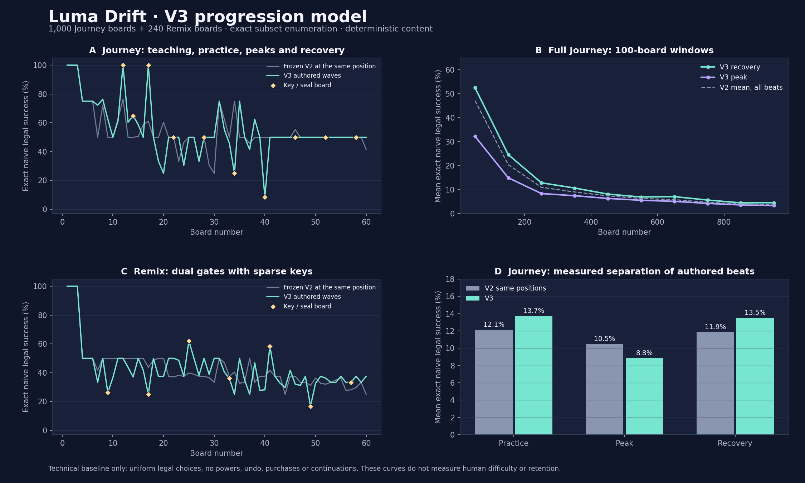

# V3 content and pacing

Luma Drift 1.6 uses a new, frozen J/K route: **1,000 Journey boards and 240 Remix boards**. It changes the order and adds sparse key/seal variants while preserving every historical board identity. It does not inspect purchases, currency, previous failures, account state, ads or the individual player to choose a board or its allowance.

## What the old route actually required

The independent exact audit found genuine irreversible gate-order traps on the certified paths of 997 of the 1,000 G boards. The legal-random baseline chooses uniformly among legal exits, so its failures are real order-dependent dead ends rather than blocked taps. Its median success decreases from 50.00% on G1–30 to 4.72% on G481–1000; the smallest measured value is 1.57%. Mean safe-versus-dangerous decision points along the certificate rise from 2.07 in the first 30 boards to 7.26 after board 480.

The old route therefore already contained planning challenges. Its structural score was sorted within 30-board groups, while its average exact legal-random success continued downward. That gave the technical curve little deliberate local relief and no keys in normal Journey. The V3 goal is clearer teaching, different elements, and explicit peaks and recovery, rather than simply increasing a piece count or squeezing an allowance.

Every before/after row is available in [the exact audit](data/progression-v3-audit.csv); the aggregate measurements and scope are in [the generated summary](data/progression-v3-summary.md). The complete reference analysis is in `scripts/ProgressionAnalysis.java`. Exhaustive subset enumeration uses double precision for probabilities; the independent reachability and returned solutions are also checked as boolean legal paths.

## Method and sources

Jeremy Kang's King-authored GDC Europe 2016 presentation identifies objective count, moves, blockers and their levels as balancing controls (page 56). Its pacing slide distinguishes game modes, hard versus easy boards, short versus long boards, and the rate of new content, illustrated with peaks and troughs (page 59). These are design dimensions used here; the presentation does not validate Luma Drift's numbers or player response. [King: Level Design Saga, GDC 2016](https://media.gdcvault.com/gdceurope2016/presentations/KANG_Jeremy_LevelDesignSaga.pdf).

King's own help describes fixed blockers and collecting a matching key to open sealed cells. In Luma Drift, an exiting key opens its explicitly associated cells; undo restores both the piece and those cells. The shared design principle is a visible dependency with a clear goal, not a copy of Candy Crush art, board layouts or matching rules. [King: Which Blockers can I find in the game?](https://candycrush.zendesk.com/hc/en-us/articles/360000754717-Which-Blockers-can-I-find-in-the-game).

## The fixed route

- Journey 1–6 retains the G1–6 positions, arrows, switches and solution orders. Boards 1–3 teach extraction; board 4 introduces gate changes, followed by practice.
- The first authored peak is board 10. The three key lessons at 12, 14 and 17 all have a Normal label and one key opening one fixed cell.
- Board 12 isolates the new rule: at most nine pieces, no switches, all gates open, and no gate-order trap. Its positions and arrows come from a frozen G source. This one explicitly encoded teaching variant neutralizes that source's switch masks; the original G board remains unchanged.
- Boards 14 and 17 combine the learned key rule with the existing gate rules. They carry the Practice descriptor.
- Thereafter, Journey key boards appear at `22 + 6k`: 167 of 1,000 boards in total. Remix introduces a key board at 9 and revisits the element at `17 + 8k`: 29 of 240 boards. There are one to three fixed cells and at most two keys per affected board. The exact counts are frozen, not randomized at launch.
- The recurring ten-board rhythm combines Introduction, Practice, Peak and Recovery. Normal, Hard and Expert are authored labels with measured separation under the declared naive policy; Expert starts after the early teaching sequence. They are not human difficulty ratings calibrated by playtesting.
- Every original G/H source is assigned once within its original 30-board group. Key variants preserve its certified solution order and add only cells that open before they are required by that solution. Each fixed cell also obstructs a genuinely legal alternative before its key leaves; none is merely decorative.

The objective is always to empty the board. `OPEN_SEALS` means “open the seals and clear every piece”, not a second win condition that can complete a partly filled board. The visible element identifies arrows, gates, dual gates, or keys and seals.

The fixed initial budget is the necessary N exits plus three to five extra actions, depending on the authored teaching/recovery/peak row. All 1,240 certificates finish in N exits with no power, continuation, advertising or payment. Historical G/H budgets keep their exact old margins. Restart is available independently of a purchase.

## Frozen identities and save compatibility

| Family | Source | Lookup | Status |
| --- | --- | --- | --- |
| C / R | Original 240 + 240 | `LevelCatalog.get / remix` | Preserved |
| B / Q | Historical reordered 240 + 240 | `BalancedCatalog.legacyGet / legacyRemix` | Preserved |
| G / H | Frozen V2 1,000 + 240 | `BalancedCatalog.getV2 / remixV2` | Preserved |
| J / K | Frozen V3 1,000 + 240 | `BalancedCatalog.get / remix` | New identities |
| P | Six sealed workshop challenges | `SealedCatalog.get` | Preserved |
| E | Historical event seed | `LevelCatalog.event` | Preserved |

`ChallengeCode.resolve()` binds every family to its own content. New J/K codes have their own CRC-protected identifiers and cannot reinterpret an existing G/H share. The checksum detects transcription errors; it is not authentication.

The UI save schema uses `content_version=4` for the J/K route, `3` for already-started G/H attempts, and `2` for historical B/Q attempts. `Level.progressionVersion` is a separate content marker: 3 for J/K, 2 for G/H, and 0 for historical/P/event boards. `MoveBudget` keeps policy version 2 and selects the correct fixed allowance from the level's content marker. Existing policy-1 restoration remains available.

Host tests replay every current certificate prefix, every G/H active-session prefix, gate and seal state, and the matching budget counters. Pre-change and post-change SHA-256 family digests cover historical layouts, seeds, solution orders, codes and allowances, including P and extreme event seeds. The separate [API-26 Lab runtime report](validation/v1.6/upgrade-api26.json) preserves a real 1.5 G1 attempt through installation, resume and preview cancellation with the original 8/9 action balance; it also records a fresh J2 content-4 run at 11/11. This runtime sample does not replace the exhaustive host contract or qualify the production package, other devices or every interruption.

## UI contract

`BalancedCatalog.info(number, remix)` supplies `ProgressionInfo` without running the solver or generator on the phone. Its fields include difficulty, beat, objective, element, localized-copy keys, key and fixed-cell counts, source family/number, grid size, piece count and mistake allowance. `sourceFamily` is G or H; `sourceNumber` identifies the frozen source. Board 12's neutral-switch teaching variant is explicitly represented in the frozen row.

The enum values are `NORMAL/HARD/EXPERT`, `INTRODUCTION/PRACTICE/PEAK/RECOVERY`, `CLEAR_BOARD/OPEN_SEALS`, and `ARROWS/GATES/DUAL_GATES/KEYS_AND_SEALS`. All cell coordinates, switch states and key associations needed for rendering remain on `Level`, `Tile` and `Barrier`; no account, inventory or store object is involved in content lookup.

## Reproduction and limits

```sh
scripts/generate-progression-v3.sh
scripts/test-progression-v3.sh
```

The first command is an offline authoring tool and writes the frozen Java lookup plus its selection CSV. It reuses the preserved G/H lookup and existing exact selection inputs. The second checks compatibility fingerprints, all 1,240 new solutions, oracle comparisons, key relevance, symmetry uniqueness and save/budget restoration, then writes the audit CSV and summary. `scripts/plot-progression-v3.py` renders the standalone curves with matplotlib.

Uniqueness covers all eight rotations/reflections, translations, reordering of piece IDs, arrows, switch directions, gate states and key-to-seal associations. It does not prove that two puzzles cannot share an abstract dependency graph. Reused unmodified G/H layouts are disclosed as reused sources; added seal variants have distinct geometry/dependency descriptions and J/K identities.

These model results establish the declared rules and deterministic content. They do not establish fun, retention, conversion, human completion rate, device performance or commercial success. Observing people play the teaching boards and the peaks is still required before assigning calibrated human difficulty ratings.


