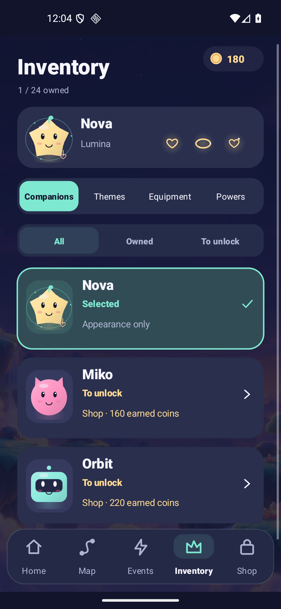

# Luma Drift documentation

**A little spark. A great escape.** Read the rules, inspect the delivered game, and keep test evidence separate from the next proposal.

Current playable candidate: **1.6.0-rc1 production / 1.6.0-sandbox Lab, code 7**. The saga map, prelevel briefing, inventory/session presentation and frozen J/K progression are described in [the 1.6 candidate record](RELEASE_1_6.md). [Final signed artifacts](RELEASE.md) and [installed acceptance](VALIDATION_1_6.md) identify the exact binaries and remaining limits. Host-side source checks are recorded under [validation/v1.6](validation/v1.6/).

Current delivery: **[1.6.0-rc1 APK](../releases/luma-drift-1.6.0-rc1.apk)** · [Play AAB](../releases/luma-drift-1.6.0-rc1.aab) · [Executed qualification](VALIDATION_1_6.md).

Preserved delivery: **[1.5.0-rc1 production APK](../releases/luma-drift-1.5.0-rc1.apk)** · [Play AAB](../releases/luma-drift-1.5.0-rc1.aab) · [Original signatures and hashes](RELEASE.md). These code-6 artifacts and their captures retain their 1.5 evidence; they are not 1.6 downloads. Default candidate settings force sample ads and keep real checkout gated.

The source contains **1,000 Journey boards, 240 Remix boards, six Sealed passages workshop challenges, 24 companions, six themes, 18 equipment items in three slots and six powers**. V3 adds keys/seals to 167 Journey boards and 29 Remix boards while preserving historical identities and active sessions. Its six languages are French, English, German, Spanish, Portuguese and Italian. Progress and equipment stay on the device; optional Google identity does not provide cloud saves.

The following captures come from the final production **1.6** package; Home resumes a preserved practice challenge.

## Play and understand

| Guide | What it answers |
|---|---|
| [Release and installation](RELEASE.md) | Which APK to install, channel separation, signing and checksums |
| [1.6 candidate](RELEASE_1_6.md) | Current artifacts, compatibility, host checks and installed acceptance |
| [1.6 UX](UX_1_6.md) | Saga navigation, briefing, readable inventory and session states |
| [V3 progression](PROGRESSION_V3.md) | J/K identities, authored waves, sparse key lessons, exact oracle and legacy restoration |
| [Preserved 1.5](RELEASE_1_5.md) | Original lobby, G/H progression, workshop keys, equipment and powers |
| [Illustrated tour](VISUAL_GUIDE.md) | Real Android views and the distinction from website illustrations |
| [Gameplay](GAMEPLAY.md) | Arrow/gate rules, actions, rewards and fair friend challenges |
| [Avatar equipment](AVATAR_EQUIPMENT.md) | All 18 items, sources, prices, three slots and exact benefit limits |
| [Powers and recovery](MOVE_BUDGET_POWERUPS.md) | Six effects, one-charge confirmation, Flow persistence and continuations |
| [Companions and events](COMPANIONS_EVENTS.md) | Collection, local daily/weekly play and ownership |
| [Validation](VALIDATION.md) | Executed checks, actual APK identities, synthetic profiles and remaining limits |

## One visual identity

| Guide | What it answers |
|---|---|
| [Design system](DESIGN_SYSTEM.md) | Night palette, pastel arrows, companion-led composition, type, motion and image provenance |
| [Art and audio](ART_AUDIO.md) | Code-drawn game art, themes, original sound and measured playback |
| [Brand assets](store/README.md) | Promotional originals, editable assets and export sizes |
| [Store copy](STORE_LISTING.md) | Preserved 1.5 copy drafts; final 1.6 marketing must match its qualified artifact |
| [Public website](PUBLIC_PAGES.md) | FR/EN homepage, policy/deletion routes, local checks and deployment evidence |

The game, public pages and GitHub presentation share a visual family. The website **1.6 refresh is a candidate** until its own deployment is recorded. Its product imagery must identify the [final production Android captures](validation/v1.6/ui-final-production/report.json) separately from the retained [1.5 vector brand kit](store/assets.json) and [generated Aurora Atlas environment](art/aurora-atlas-v1.json). Frames and surrounding artwork are web compositions, not Android controls. New local checks, asset provenance and any delivery result belong under `docs/validation/site-v1.6/`.

The earlier [independent delivery of all 23 Hosting payloads plus three aliases](validation/site-v1.5/delivery.json) verifies the 1.5 website revision only. [Earlier Hosting observations](validation/hosting-preview.md) also retain their recorded revision; neither record verifies the new candidate.

## Identity, privacy and commercial gates

| Guide | What it answers |
|---|---|
| [Data and privacy inventory](PRIVACY.md) | Local saves/equipment, Google SDK paths, exports and account deletion |
| [Optional Google sign-in](GOOGLE_SIGN_IN.md) | Real identity, guest play and absence of cloud progression |
| [Monetization configuration](MONETIZATION_SETUP.md) | Current production/Lab flags, sample placements and purchase gates |
| [Android purchased-gold wallet](WALLET_ANDROID.md) | Server-authoritative paid funds, permanent cosmetics and account recovery |
| [Owner onboarding](PRODUCTION_ONBOARDING.md) | Existing public IDs and remaining provider/account steps |
| [Déploiement pas à pas — français](DEPLOIEMENT_PAS_A_PAS.md) | Existing Cloud Run/Hosting project, qualification and activation steps |
| [1.4 production foundation](PRODUCTION_RELEASE.md) | Historical implementation and separately dated deployment follow-up |
| [Server](../server/README.md) | Purchase verification, Firestore transactions, IAM and scheduled recovery |

The deployed wallet and earlier public pages have recorded routing/CORS observations. Web sign-in/deletion and the AdMob message's Published state are owner-reported. Completed Android login, installed UMP acceptance/refusal, Play license-test purchases, RTDN/Scheduler, automatic audit purge and commercial approval retain their separate qualification gates. Preserved 1.5 APKs embed an empty wallet origin; final 1.6 flags/origin must be read from its actual package. A source or site redesign does not remove these gates.

## Build, evidence and next decisions

| Guide | What it answers |
|---|---|
| [Development](DEVELOPMENT.md) | Architecture, tools, signing and reproducible checks |
| [Level design](LEVEL_DESIGN.md) | Current J/K metadata, preserved G/H/C/R/B/Q identities, keys and workshop rules |
| [Difficulty](DIFFICULTY.md) | Structural audits and why exact-solver results are not player retention |
| [Roadmap](ROADMAP.md) | Physical-device/player studies and later commercial gates |
| [Hit audit](HIT_AUDIT.md) | Unproven product assumptions and a measurable observation protocol |
| [Changelog](CHANGELOG.md) | Delivered scope by version |
| [Third-party notices](THIRD_PARTY_NOTICES.md) | SDK, Google branding and source/audio provenance |
| [Research archive](RESEARCH.md) | Dated market, licensing and initial concept decisions |

Historical [1.1](RELEASE_1_1.md), [1.2](RELEASE_1_2.md), [1.3](RELEASE_1_3.md), [1.4](RELEASE_1_4.md) and [1.5](RELEASE_1_5.md) reports retain their original packages, hashes, dates and limitations. [VALIDATION.md](VALIDATION.md) is the preserved 1.5 acceptance record; [the 1.6 record](VALIDATION_1_6.md) identifies its own final binary and acceptance evidence. Old screenshots and synthetic tests are not relabelled as final-release evidence.
