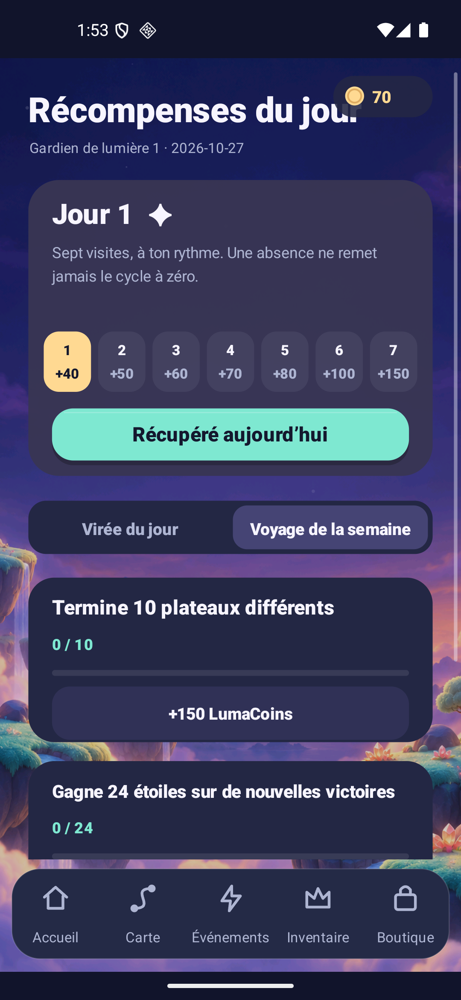

# Luma Drift documentation

**A little spark. A great escape.** Read the actual rule, inspect the exact delivered bytes, and distinguish implementation, installed acceptance and service rollout.

Current declared candidate: **production 1.7.0-rc1 / Lab 1.7.0-sandbox, code 8**, under qualification. [Candidate scope](RELEASE_1_7.md) · [UX contract](UX_1_7.md) · [1.7 executed record](validation/v1.7/README.md). Final package/download and website deployment status must follow those records rather than an older screenshot.

Current signed package: **[production 1.7.0-rc1 APK](../releases/luma-drift-1.7.0-rc1.apk)** · [Play AAB](../releases/luma-drift-1.7.0-rc1.aab) · [Exact package hashes](validation/v1.7/package-production.json). Packaging is complete; installed acceptance and service/website rollout remain separately recorded.

Preserved signed delivery: **[production 1.6.0-rc1 APK](../releases/luma-drift-1.6.0-rc1.apk)** · [Play AAB](../releases/luma-drift-1.6.0-rc1.aab) · [Exact installed 1.6 qualification](VALIDATION_1_6.md). Those code-7 artifacts keep their original evidence; they are not rebuilt 1.7 packages.

The 1.7 source retains **1,000 Journey, 240 Remix, six sealed-passage workshop challenges, 24 companions, six themes, 18 functional equipment items and six powers**. It adds **24 appearance-only wardrobe items in four slots**, a continuously scrollable map with ten 100-level biomes, a seven-visit daily gift cycle and separate daily/weekly quests. Its six Android languages are French, English, German, Spanish, Portuguese and Italian. Progress and earned inventory remain local; Google sign-in is not a gameplay cloud save.

The following **final Lab 1.7** screenshots come from a passing 38-assertion native run on the exact delivered Lab APK, using its guest session without profile injection. All original preferences were restored afterward; the [run report](validation/v1.7/ui-sdk-final-menus2/host-report.json) identifies the 32 captures, APK hash and API-36/16KB device. Production-package, real-authentication and service acceptance remain separate.

## Understand the new candidate

| Guide | What it answers |
| --- | --- |
| [1.7 candidate](RELEASE_1_7.md) | Exact source scope, level-13 diagnosis, qualification and deployment boundaries |
| [1.7 UX](UX_1_7.md) | Dead-end recovery, safe hints, scrollable map, ownership, reward and currency presentation |
| [1.7 economy](ECONOMY_1_7.md) | Daily/weekly claims, all 24 wardrobe sources, earned capsules, odds, duplicates and durable receipts |
| [Reachability audit](validation/v1.7/board-audit.md) | Why all 1,240 boards are initially solvable and why a legal route can become doomed |
| [Journey 13 diagnosis](validation/v1.7/board-audit-journey13.md) | The complete 13-action-budget solution, legal doomed prefix and exact Undo recovery |
| [1.7 qualification](validation/v1.7/README.md) | Executed source checks, identified Android runs and remaining limits |
| [Installation and signatures](RELEASE.md) | APK/AAB identities, channel separation, checksums and signing |
| [Illustrated tour](VISUAL_GUIDE.md) | Captures labelled by package/version and the distinction from web compositions |

## Rules, route and possessions

| Guide | What it answers |
| --- | --- |
| [Gameplay](GAMEPLAY.md) | Direction/gate rules, actions, rewards and reward-free friend practice |
| [V3 progression](PROGRESSION_V3.md) | Frozen J/K content, sparse key lessons, authored waves and historical restoration |
| [Existing avatar equipment](AVATAR_EQUIPMENT.md) | 18 Head/Aura/Charm items and their bounded benefits; separate from the new cosmetic wardrobe |
| [Powers and recovery](MOVE_BUDGET_POWERUPS.md) | Six effects, confirmation, durable one-charge use and interrupted Flow |
| [Companions and events](COMPANIONS_EVENTS.md) | Original companion collection and local daily/weekly stages |
| [Level design](LEVEL_DESIGN.md) | Versioned layouts, workshop rules and preserved family identities |
| [Difficulty](DIFFICULTY.md) | Structural measurements and the boundary between a solver and human difficulty |

LumaCoins are earned and device-local. LumaGold is the separate account premium balance. The new earned capsule costs LumaCoins only; prepared paid cosmetic server draws remain disabled by default. A wardrobe item does not grant a puzzle advantage, while pre-existing functional equipment keeps its disclosed limits.

## One visual family

| Guide | What it answers |
| --- | --- |
| [Design system](DESIGN_SYSTEM.md) | Pastel/night palette, readable rules, slot shapes, currency labels, motion and image provenance |
| [Art and audio](ART_AUDIO.md) | Native silhouettes and wardrobe, generated Atlas, biome arrangements and playback evidence boundaries |
| [Brand kit](store/README.md) | Original promotional artwork, editable assets and historical export provenance |
| [Public pages](PUBLIC_PAGES.md) | FR/EN homepage, support/privacy/deletion routes and separate Hosting delivery |
| [Store copy](STORE_LISTING.md) | Historical copy draft; marketing must match the qualified new artifact |

The previously published [website 1.6](validation/site-v1.6/README.md) has its own record of 18 local responsive states, real final-APK imagery, source hashes and Firebase completion. The [retained 1.5 site](validation/site-v1.5/README.md), original brand vectors and [Atlas pixel provenance](art/aurora-atlas-v1.json) remain distinct. Native screenshots do not independently establish a website revision or public-origin byte comparison.

## Accounts, social data and commercial gates

| Guide | What it answers |
| --- | --- |
| [Privacy inventory](PRIVACY.md) | Local saves, Google SDK flows, opt-in social data, exports and deletion |
| [Google sign-in](GOOGLE_SIGN_IN.md) | Optional identity, guest play, session states and absence of gameplay cloud saves |
| [Monetization setup](MONETIZATION_SETUP.md) | Test-ad and checkout gates, production/Lab separation |
| [Purchased wallet](WALLET_ANDROID.md) | Server-authoritative paid funds and account ownership recovery |
| [Owner onboarding](PRODUCTION_ONBOARDING.md) | Public IDs and remaining provider/account steps |
| [French deployment guide](DEPLOIEMENT_PAS_A_PAS.md) | Cloud Run/Hosting qualification and owner activation |
| [Server](../server/README.md) | Purchase verification, Firestore, prepared social/gift/cosmetic routes and closed premium default |

A configured service URL is not proof that new routes are deployed. The prepared friend feature requires scoped deployment and real two-account acceptance; map positions are opt-in snapshots, not trusted completion or cloud progression. Successful Android Google login, installed UMP acceptance/refusal, Play license-test purchase/refund/recovery, live ad eligibility and public-store approval retain separate gates. No revenue or retention result is inferred from a redesigned interface or synthetic transaction test.

## Build and decide what comes next

| Guide | What it answers |
| --- | --- |
| [Development](DEVELOPMENT.md) | Architecture, tools, signing and reproducible checks |
| [Roadmap](ROADMAP.md) | Device/player acceptance, service rollout and later commercial qualification |
| [Hit audit](HIT_AUDIT.md) | Unproven assumptions and an actual observation/cohort protocol |
| [Changelog](CHANGELOG.md) | Versioned implementation and delivery scope |
| [Notices](THIRD_PARTY_NOTICES.md) | SDK/Google mark and original source/art/audio provenance |
| [Research archive](RESEARCH.md) | Dated market, initial concept and licensing work |

Historical reports remain available: [1.6](RELEASE_1_6.md), [1.5](RELEASE_1_5.md), [1.4](RELEASE_1_4.md), [1.3](VALIDATION_1_3.md), [1.2](RELEASE_1_2.md) and [1.1](RELEASE_1_1.md). Their packages, dates, synthetic profiles, screenshots and limits are not relabelled as 1.7 evidence. [VALIDATION.md](VALIDATION.md) is the preserved 1.5 acceptance record; new runs belong under their own version.
