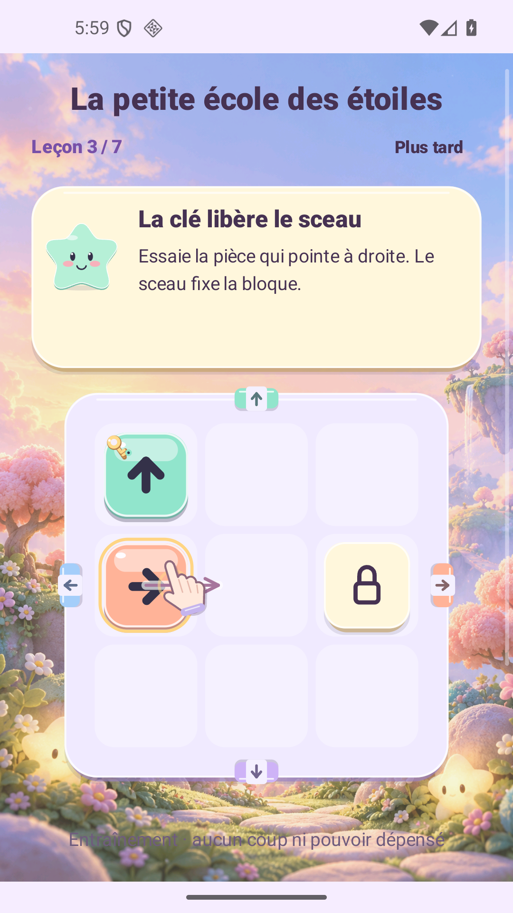
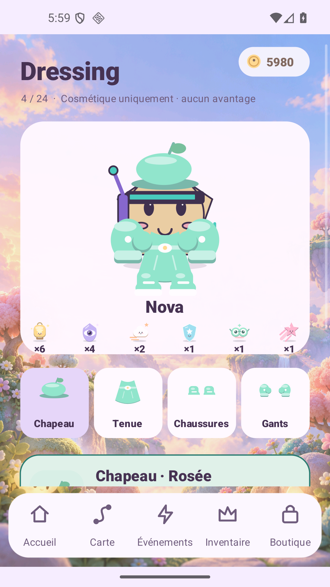

# Luma Drift documentation

## Current1.16 — a closer home and a local player card

[Release and exact bytes](RELEASE_1_16.md) · [Qualification register](validation/v1.16/README.md) · [Official-reference audit](research/v1.16/reference-audit.md).

The home uses the actual scene viewport with default close-up, pan and an explicit whole-room control. Collection and Atelier have larger original illustrations, accented pill actions and icon-medallion navigation. The local profile adds a nickname, chosen flag and three slots for six earned badges. Two versioned earned-coin banners offer23 companions and five complete four-piece outfits with visible odds, duplicate returns and atomic recoverable receipts. Existing purchases, clothing ownership, free styles and the byte-identical1.15 puzzle engine remain.

[Production APK](../releases/luma-drift-1.16.0-rc1.apk) · [AAB](../releases/luma-drift-1.16.0-rc1.aab) · [Manifest](../releases/manifest-1.16.0-rc1.json). Candidate B, code18; exact native acceptance and public website delivery are separately indexed in the qualification register.

## Preserved1.15 — relay puzzles and dedicated destinations

[Release and exact bytes](RELEASE_1_15.md) · [Gameplay and compatibility](GAMEPLAY_1_15.md) · [Qualification register](validation/v1.15/README.md) · [Design audit](AUDIT_REFONTE_UI_2026_10_28.md).

Adventure, immersive play, Home, Collection and Atelier separate the main tasks. A 1,000-board U Journey uses piece-controlled gates, keys and freely refunded correction. Three 10 × 10 rooms, zoom/pan, forty-two furniture designs and illustrated item previews extend the home. Existing challenge identities, an active run, purchases and room coordinates are retained. The exact signed [production APK](../releases/luma-drift-1.15.0-rc1.apk) completes U1–U1000 on Android with49,575 native checks and12,016 actual touches. Build, lint, signatures, manifests, bundles, normal/compact interfaces, six languages, real Lab upgrade, earned purchases and cold restoration pass their separate scopes.

The [existing FR/EN website](https://luma-drift-production.web.app/#screens) is updated to1.15 with twelve original native captures, including a genuinely furnished eleven-design salon. All132 public payloads and three directory aliases match deployed source `79034ede32cacb6fdd7acb4ed975212da1c9747d`, including the signed production APK/AAB/manifest. [Website qualification and Hosting receipt](validation/site-v1.15/README.md). Lab remains a local separate package; GitHub and Play are not updated in this website follow-up.

## Preserved 1.14 — deliberate puzzles and visible rules

[Release and qualification status](RELEASE_1_14.md) · [Rules and compatibility](GAMEPLAY_1_14.md) · [UX decisions](UX_1_14.md) · [Execution register](validation/v1.14/README.md) · [Website register](validation/site-v1.14/README.md).

A versioned 1,000-board N Journey introduces its mechanics through thirty authored opening boards. Visible gate buttons, causal feedback and contextual help accompany real productive-action limits, free refused attempts and one saved Return per attempt. The companion’s furnished home and local earned economy remain. Source, installed-byte, publication and Hosting evidence have separate scopes; RC2 source curriculum checks and its independent episode review pass; signed-byte/native qualification continues. Retained RC1 evidence is intermediate.

## Preserved 1.13 — solve a little, come home

[Release and frozen artifacts](RELEASE_1_13.md) · [Home contract](HOME_1_13.md) · [Qualification](validation/v1.13/README.md) · [Production APK](../releases/luma-drift-1.13.0-rc2.apk) · [AAB](../releases/luma-drift-1.13.0-rc2.aab).

The main game remains 1,000 Journey +240 Remix puzzles. A three-piece first encounter leads into a furnished room with the actual equipped companion, hugs, clear-path movement, placement previews, rotation, storage and one furniture wish. Five starter furnishings and two wall/floor choices are included; seven other furnishings and two additional choices of each surface use existing earned LumaCoins. Furniture ownership, placement and appearance have exact local-save recovery. [Architecture](DEVELOPMENT.md).

Current version: production **1.13.0-rc2**, isolated Lab **1.13.0-sandbox-rc2**, code **14**. Source checks pass 891 home/durability assertions and 18 real opening-board checks. The complete RC2 Lab route passes 798 native checks/13 actually played boards, with separate 90-check fast-tutorial, 55-check fresh, seven-check production startup and 35-check production house scopes. See the qualification record for exact hashes, restore/cold boundaries, binary and delivery results; historical RC1/1.12 observations are not current acceptance. [Source `67774c14`](https://github.com/nabz0r/AndroidHit/commit/67774c143a60017049207adcedf2ea63fe048d97) is published on `main`; [four immutable public APK/AAB downloads](validation/v1.13/publication.json) independently return HTTP200 with exact frozen bytes/SHA-256. The FR/EN website passes 2,150 source assertions and 14 local browser states. [Firebase delivery](validation/site-v1.13/deployment.json) is finalized from that same source at 28 October 2026,16:03:50.235 UTC, version `170cf6d048c1b40f`; [independent public-origin checks](validation/site-v1.13/public-origin.json) match all 108 payloads plus three directory aliases exactly.

Test ads, closed checkout and disabled premium draws are retained. Local house/gameplay saves are not synchronized by Google sign-in. Physical-device comfort, native-speaker review, human comprehension/retention and real provider lifecycle remain distinct work.

## Preserved 1.12 — the little atelier

[Verified GitHub delivery](validation/v1.12/publication.json): source `32bf07ea`, four exact signed APK/AAB public downloads, with native acceptance and commercial boundaries recorded separately.

[Production APK](../releases/luma-drift-1.12.0-rc2.apk) · [AAB](../releases/luma-drift-1.12.0-rc2.aab) · [Changes and limits](RELEASE_1_12.md) · [Qualification](validation/v1.12/README.md) · [Research](research/ux-v112.md).

Two explicit currencies, original illustrated powers, lighter Home/shop surfaces and ordinary navigable item pages replace dense modal browsing. Ownership, effect, stock, cost and Equip remain distinct. Account balance is last-known or unknown, never a fake zero. A reproduced refused-write power-purchase defect now uses the exact tracked save/retry boundary. Production and Lab retain test ads and closed checkout; no Play or Hosting mutation. Final native results: Lab **1,179 checks/40 clears**, production **7 startup +35 shop checks**, and account-wallet UI **45 checks/6 languages**. [Executed scopes](validation/v1.12/ui-bugs/SDK_UI_FINAL.md) · [Wallet replay](validation/v1.12/commerce-native/README.md).

Website 1.12 is separately deployed: [FR/EN pages and actual native gallery](validation/site-v1.12/README.md), exact current APK route,12 responsive DOM states andFirebase CLI/live-channel receipt. Source`91ffac7a`, version `180b7fc68c516c9b`, finalized28 October 2026 at 14:08:23.437 UTC. The Android release itself made noHosting change.

## Preserved 1.11 — equipment visibility and bug hunting

[Production APK](../releases/luma-drift-1.11.0-rc2.apk) · [AAB](../releases/luma-drift-1.11.0-rc2.aab) · [Changes and limits](RELEASE_1_11.md) · [Exact artifacts](validation/v1.11/candidate.json) · [Qualification](validation/v1.11/README.md) · [Roadmap](ROADMAP.md).

Production 1.11.0-rc2 and isolated Lab 1.11.0-sandbox-rc2, code 12. Portrait composition, visible equipment feedback, worn item names, theme rendering, pending inventory reads and first-profile save recovery are corrected. Preview, purchase and equipment remain separate. The first native visual tests now compare actual art and cross a real cold-process boundary; see the qualification record for executed results and fixture failures. Earlier 1.10 state/selection tests do not establish item visibility.

[GitHub delivery receipt](validation/v1.11/publication.json): source `aef6f991`, exact tree verified; four signed APK/AAB public downloads independently streamed, HTTP 200, matching sizes and SHA-256 hashes.

At the 1.11 app delivery, the website still had its separately confirmed 1.10 deployment; the later 1.12 refresh is linked above. Play publication and live provider activation are paused during this bug hunt. Google identity does not synchronize local gameplay.

## Preserved 1.10 — Companion & Objectives

[Signed production APK](../releases/luma-drift-1.10.0-rc3.apk) · [AAB](../releases/luma-drift-1.10.0-rc3.aab) · [Release and exact hashes](RELEASE_1_10.md) · [Illustrated experience](UX_1_10.md) · [Native qualification](validation/v1.10/README.md) · [Prism journal](PRISM_STORY_1_10.md) · [Roadmap](ROADMAP.md).

Production 1.10.0-rc3 / Lab 1.10.0-sandbox-rc3, code 11. Home, the complete animated companion, wardrobe previews, a pinned collection objective, four reward tabs, event/shop navigation and durable local claims are delivered. Exact final native checks pass2,514 for the 100-level route,91 for a genuine fresh guest and7 for production startup/audio. Existing puzzle/catalog sources and save identities remain unchanged; human difficulty and provider qualification remain separate.

The [website source/gallery](validation/site-v1.10/README.md) follows RC3. Hosting 1.10 is confirmed from clean source 9be35d2 at 28 October 2026, 10:44:28.535 UTC. [Deployment receipt](validation/site-v1.10/deployment.json). Local browser review covers 12 DOM states and 6 desktop rasters; incomplete mobile provider frames are excluded from visual acceptance. [Public GitHub delivery proof](validation/v1.10/publication.json).

Earlier guides below retain their dated evidence; their package downloads are historical.

## Preserved 1.9 candidate

[Signed APK/AAB and exact hashes](RELEASE_1_9.md) · [New-player audit and 2026 sources](PLAYER_AUDIT_2026.md) · [1.9 UX](UX_1_9.md) · [Guardian rules](GUARDIANS.md) · [Executed qualification](validation/v1.9/README.md) · [Website](validation/site-v1.9/README.md).

The 1.8 route below remains the ordinary Journey foundation. The current release fixes native touch/preview problems and reward discoverability, adds optional guardians and 288 visual combinations, and preserves published challenge families. The Play developer account is approved according to the owner; the app listing and provider qualification are next.

**A little spark. A great escape.** Read the actual rule, inspect the exact delivered bytes, and distinguish implementation, installed acceptance and service rollout.

Preserved 1.9 signed delivery: **[production 1.9.0-rc1 APK](../releases/luma-drift-1.9.0-rc1.apk)** · [Play AAB](../releases/luma-drift-1.9.0-rc1.aab) · [Exact hashes and release notes](RELEASE_1_9.md). Lab remains a separate `.sandbox` package. Source/package integrity, installed acceptance, Hosting delivery and real-provider qualification are separately recorded.

The current game has 1,000 new L Journey boards, 240 M Remix, T daily/weekly events, six preserved sealed-passage practice challenges, 24 companions, six themes, 18 bounded functional equipment items, 24 appearance-only wardrobe items and six powers. Seven interactive lessons teach the actual rules. The ten-biome map remains scrollable from 1 to 1,000. Progress, earned inventory and tutorial receipts remain local; Google identity does not provide gameplay cloud saves.

These final-byte 1.9 Lab images show the guest qualification route, with earned progression and no profile injection. The separate first installation and the individual 100-level assertions have their own scopes. [Capture and acceptance record](validation/v1.9/README.md).

## Understand the new candidate

| Guide | What it answers |
| --- | --- |
| [1.9 release](RELEASE_1_9.md) | Exact APK/AAB, implemented scope and qualification limits |
| [V4 progression](PROGRESSION_V4.md) | Reauthored L/M/T boards, productive budgets, reversible gates and old-save compatibility |
| [Tutorial](TUTORIAL.md) | Seven real lessons, skip/resume/replay and one-time reward durability |
| [1.9 UX](UX_1_9.md) | Readability, gestures, motivation, reduced motion and bounded background guidance |
| [Independent engine audit](validation/v1.9/engine/strategy-all-states.txt) | Every reachable state, exact productive cost and finite catalogue coverage |
| [Installed native tests](validation/v1.9/README.md) | 100 completed Journey boards, gestures, recovery, six languages, fresh arrival and audio |
| [Prior management diagnosis](LEVEL_MANAGEMENT_REVIEW.md) | Reproduced J7/J8 traps and the delivered 1.8 remedy |
| [Retained economy](ECONOMY_1_7.md) | Visit gifts, 24 wardrobe sources, quests, odds, duplicates and receipts |
| [Installation](RELEASE.md) | Channel separation, retained packages and signing |
| [Illustrated tour](VISUAL_GUIDE.md) | Native views, original art and local browser render scopes |

## Rules, route and possessions

| Guide | What it answers |
| --- | --- |
| [Gameplay](GAMEPLAY.md) | Direction/gate rules, actions, rewards and reward-free friend practice |
| [V3 progression](PROGRESSION_V3.md) | Frozen J/K content, sparse key lessons, authored waves and historical restoration |
| [Existing avatar equipment](AVATAR_EQUIPMENT.md) | 18 Head/Aura/Charm items and their bounded benefits; separate from the new cosmetic wardrobe |
| [Powers and recovery](MOVE_BUDGET_POWERUPS.md) | Six effects, confirmation, durable one-charge use and interrupted Flow |
| [Companions and events](COMPANIONS_EVENTS.md) | Original companion collection and local daily/weekly stages |
| [Level design](LEVEL_DESIGN.md) | Versioned layouts, workshop rules and preserved family identities |
| [Difficulty](DIFFICULTY.md) | Structural measurements and the boundary between a solver and human difficulty |

LumaCoins are earned and device-local. LumaGold is the separate account premium balance. The new earned capsule costs LumaCoins only; prepared paid cosmetic server draws remain disabled by default. A wardrobe item does not grant a puzzle advantage, while pre-existing functional equipment keeps its disclosed limits.

## One visual family

| Guide | What it answers |
| --- | --- |
| [Design system](DESIGN_SYSTEM.md) | Soft cream/lilac palette, readable rules, slot shapes, currency labels, motion and image provenance |
| [Art and audio](ART_AUDIO.md) | Native silhouettes and wardrobe, generated Dream Glade and retained Atlas, biome arrangements and playback evidence boundaries |
| [Brand kit](store/README.md) | Original promotional artwork, editable assets and historical export provenance |
| [Public pages](PUBLIC_PAGES.md) | FR/EN homepage, support/privacy/deletion routes and separate Hosting delivery |
| [Store copy](STORE_LISTING.md) | Preserved 1.9 draft and earlier copy; no submitted Play listing |

The previously published [website 1.6](validation/site-v1.6/README.md) has its own record of 18 local responsive states, real final-APK imagery, source hashes and Firebase completion. The [retained 1.5 site](validation/site-v1.5/README.md), original brand vectors and [Atlas pixel provenance](art/aurora-atlas-v1.json) remain distinct. Native screenshots do not independently establish a website revision or public-origin byte comparison.

## Accounts, social data and commercial gates

| Guide | What it answers |
| --- | --- |
| [Privacy inventory](PRIVACY.md) | Local saves, Google SDK flows, opt-in social data, exports and deletion |
| [Google sign-in](GOOGLE_SIGN_IN.md) | Optional identity, guest play, session states and absence of gameplay cloud saves |
| [Monetization setup](MONETIZATION_SETUP.md) | Test-ad and checkout gates, production/Lab separation |
| [Purchased wallet](WALLET_ANDROID.md) | Server-authoritative paid funds and account ownership recovery |
| [Owner onboarding](PRODUCTION_ONBOARDING.md) | Public IDs and remaining provider/account steps |
| [French deployment guide](DEPLOIEMENT_PAS_A_PAS.md) | Cloud Run/Hosting qualification and owner activation |
| [Server](../server/README.md) | Purchase verification, Firestore, prepared social/gift/cosmetic routes and closed premium default |

A configured service URL is not proof that new routes are deployed. The prepared friend feature requires scoped deployment and real two-account acceptance; map positions are opt-in snapshots, not trusted completion or cloud progression. Successful Android Google login, installed UMP acceptance/refusal, Play license-test purchase/refund/recovery, live ad eligibility and public-store approval retain separate gates. No revenue or retention result is inferred from a redesigned interface or synthetic transaction test.

## Build and decide what comes next

| Guide | What it answers |
| --- | --- |
| [Development](DEVELOPMENT.md) | Architecture, tools, signing and reproducible checks |
| [Roadmap](ROADMAP.md) | Device/player acceptance, service rollout and later commercial qualification |
| [Hit audit](HIT_AUDIT.md) | Unproven assumptions and an actual observation/cohort protocol |
| [Changelog](CHANGELOG.md) | Versioned implementation and delivery scope |
| [Notices](THIRD_PARTY_NOTICES.md) | SDK/Google mark and original source/art/audio provenance |
| [Research archive](RESEARCH.md) | Dated market, initial concept and licensing work |

Historical reports remain available: [1.8](RELEASE_1_8.md), [1.7](RELEASE_1_7.md), [1.6](RELEASE_1_6.md), [1.5](RELEASE_1_5.md), [1.4](RELEASE_1_4.md), [1.3](VALIDATION_1_3.md), [1.2](RELEASE_1_2.md) and [1.1](RELEASE_1_1.md). Their packages, dates, synthetic profiles, screenshots and limits are not relabelled as 1.9 evidence. [VALIDATION.md](VALIDATION.md) is the preserved 1.5 acceptance record; new runs belong under their own version. The preserved 1.9 result is indexed above.

## Qualification sociale en attente

[Parcours guidé sur deux Android virtuels](QUALIFICATION_SOCIALE.md) : appareils préparés, connexion Google et vrais échanges encore en attente. La base de test est la production 1.7 préservée ; la nouvelle 1.9 est livrée séparément, sans qualification sociale réelle déduite des simulations.
