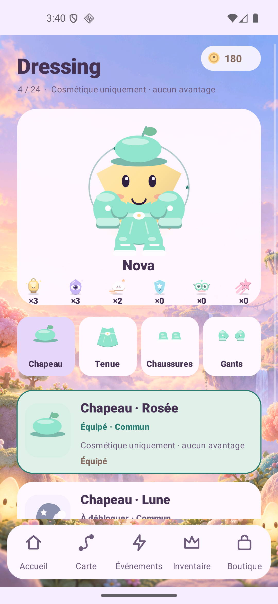

# Luma Drift documentation

## Current 1.8 candidate

[Release and exact APK/AAB hashes](RELEASE_1_8.md) · [V4 all-level rules](PROGRESSION_V4.md) · [Seven-lesson tutorial](TUTORIAL.md) · [UX and research](UX_1_8.md) · [Executed 1.8 evidence](validation/v1.8/README.md) · [Website 1.8](validation/site-v1.8/README.md). The 1.7 tables below are preserved background; 1.8 is the current gameplay/DA candidate. Google/friend/commercial acceptance is postponed while gameplay is prioritized.

**A little spark. A great escape.** Read the actual rule, inspect the exact delivered bytes, and distinguish implementation, installed acceptance and service rollout.

Current signed delivery: **[production 1.8.0-rc1 APK](../releases/luma-drift-1.8.0-rc1.apk)** · [Play AAB](../releases/luma-drift-1.8.0-rc1.aab) · [Exact hashes and release notes](RELEASE_1_8.md). Lab remains a separate `.sandbox` package. Source/package integrity, installed acceptance, Hosting delivery and real-provider qualification are separately recorded.

The current game has 1,000 new L Journey boards, 240 M Remix, T daily/weekly events, six preserved sealed-passage practice challenges, 24 companions, six themes, 18 bounded functional equipment items, 24 appearance-only wardrobe items and six powers. Seven interactive lessons teach the actual rules. The ten-biome map remains scrollable from 1 to 1,000. Progress, earned inventory and tutorial receipts remain local; Google identity does not provide gameplay cloud saves.

These authentic final Lab screenshots come from the passing 47-check menu run. They show a real guest with zero Journey clears, not the separate 100-level native playthrough. [Capture scope](validation/v1.8/SDK_UI_FINAL.md).

## Understand the new candidate

| Guide | What it answers |
| --- | --- |
| [1.8 release](RELEASE_1_8.md) | Exact APK/AAB, implemented scope and qualification limits |
| [V4 progression](PROGRESSION_V4.md) | Reauthored L/M/T boards, productive budgets, reversible gates and old-save compatibility |
| [Tutorial](TUTORIAL.md) | Seven real lessons, skip/resume/replay and one-time reward durability |
| [1.8 UX](UX_1_8.md) | Readability, gestures, motivation, reduced motion and bounded background guidance |
| [Independent engine audit](validation/v1.8/engine/README.md) | Every reachable state, exact productive cost and finite catalogue coverage |
| [Installed native tests](validation/v1.8/SDK_UI_FINAL.md) | 100 completed Journey boards, gestures, recovery, six languages, fresh arrival and audio |
| [Prior management diagnosis](LEVEL_MANAGEMENT_REVIEW.md) | Reproduced J7/J8 traps and the delivered 1.8 remedy |
| [Retained economy](ECONOMY_1_7.md) | Visit gifts, 24 wardrobe sources, quests, odds, duplicates and receipts |
| [Installation](RELEASE.md) | Channel separation, retained packages and signing |
| [Illustrated tour](VISUAL_GUIDE.md) | Native views, original art and local browser render scopes |

## Rules, route and possessions

| Guide | What it answers |
| --- | --- |
| [Gameplay](GAMEPLAY.md) | Direction/gate rules, actions, rewards and reward-free friend practice |
| [V3 progression](PROGRESSION_V3.md) | Frozen J/K content, sparse key lessons, authored waves and historical restoration |
| [Existing avatar equipment](AVATAR_EQUIPMENT.md) | 18 Head/Aura/Charm items and their bounded benefits; separate from the new cosmetic wardrobe |
| [Powers and recovery](MOVE_BUDGET_POWERUPS.md) | Six effects, confirmation, durable one-charge use and interrupted Flow |
| [Companions and events](COMPANIONS_EVENTS.md) | Original companion collection and local daily/weekly stages |
| [Level design](LEVEL_DESIGN.md) | Versioned layouts, workshop rules and preserved family identities |
| [Difficulty](DIFFICULTY.md) | Structural measurements and the boundary between a solver and human difficulty |

LumaCoins are earned and device-local. LumaGold is the separate account premium balance. The new earned capsule costs LumaCoins only; prepared paid cosmetic server draws remain disabled by default. A wardrobe item does not grant a puzzle advantage, while pre-existing functional equipment keeps its disclosed limits.

## One visual family

| Guide | What it answers |
| --- | --- |
| [Design system](DESIGN_SYSTEM.md) | Soft cream/lilac palette, readable rules, slot shapes, currency labels, motion and image provenance |
| [Art and audio](ART_AUDIO.md) | Native silhouettes and wardrobe, generated Dream Glade and retained Atlas, biome arrangements and playback evidence boundaries |
| [Brand kit](store/README.md) | Original promotional artwork, editable assets and historical export provenance |
| [Public pages](PUBLIC_PAGES.md) | FR/EN homepage, support/privacy/deletion routes and separate Hosting delivery |
| [Store copy](STORE_LISTING.md) | Current 1.8 draft and clearly preserved earlier copy; no submitted Play listing |

The previously published [website 1.6](validation/site-v1.6/README.md) has its own record of 18 local responsive states, real final-APK imagery, source hashes and Firebase completion. The [retained 1.5 site](validation/site-v1.5/README.md), original brand vectors and [Atlas pixel provenance](art/aurora-atlas-v1.json) remain distinct. Native screenshots do not independently establish a website revision or public-origin byte comparison.

## Accounts, social data and commercial gates

| Guide | What it answers |
| --- | --- |
| [Privacy inventory](PRIVACY.md) | Local saves, Google SDK flows, opt-in social data, exports and deletion |
| [Google sign-in](GOOGLE_SIGN_IN.md) | Optional identity, guest play, session states and absence of gameplay cloud saves |
| [Monetization setup](MONETIZATION_SETUP.md) | Test-ad and checkout gates, production/Lab separation |
| [Purchased wallet](WALLET_ANDROID.md) | Server-authoritative paid funds and account ownership recovery |
| [Owner onboarding](PRODUCTION_ONBOARDING.md) | Public IDs and remaining provider/account steps |
| [French deployment guide](DEPLOIEMENT_PAS_A_PAS.md) | Cloud Run/Hosting qualification and owner activation |
| [Server](../server/README.md) | Purchase verification, Firestore, prepared social/gift/cosmetic routes and closed premium default |

A configured service URL is not proof that new routes are deployed. The prepared friend feature requires scoped deployment and real two-account acceptance; map positions are opt-in snapshots, not trusted completion or cloud progression. Successful Android Google login, installed UMP acceptance/refusal, Play license-test purchase/refund/recovery, live ad eligibility and public-store approval retain separate gates. No revenue or retention result is inferred from a redesigned interface or synthetic transaction test.

## Build and decide what comes next

| Guide | What it answers |
| --- | --- |
| [Development](DEVELOPMENT.md) | Architecture, tools, signing and reproducible checks |
| [Roadmap](ROADMAP.md) | Device/player acceptance, service rollout and later commercial qualification |
| [Hit audit](HIT_AUDIT.md) | Unproven assumptions and an actual observation/cohort protocol |
| [Changelog](CHANGELOG.md) | Versioned implementation and delivery scope |
| [Notices](THIRD_PARTY_NOTICES.md) | SDK/Google mark and original source/art/audio provenance |
| [Research archive](RESEARCH.md) | Dated market, initial concept and licensing work |

Historical reports remain available: [1.7](RELEASE_1_7.md), [1.6](RELEASE_1_6.md), [1.5](RELEASE_1_5.md), [1.4](RELEASE_1_4.md), [1.3](VALIDATION_1_3.md), [1.2](RELEASE_1_2.md) and [1.1](RELEASE_1_1.md). Their packages, dates, synthetic profiles, screenshots and limits are not relabelled as 1.8 evidence. [VALIDATION.md](VALIDATION.md) is the preserved 1.5 acceptance record; new runs belong under their own version.

## Qualification sociale en attente

[Parcours guidé sur deux Android virtuels](QUALIFICATION_SOCIALE.md) : appareils préparés, connexion Google et vrais échanges encore en attente. La base de test est la production 1.7 préservée ; la nouvelle 1.8 est livrée séparément.
