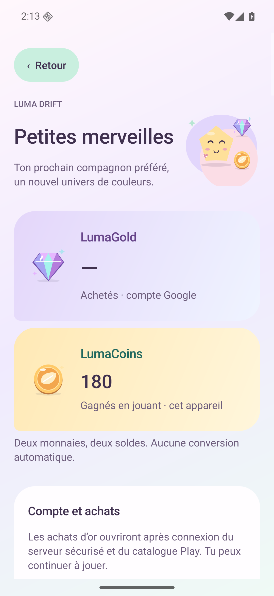

# Luma Drift 1.12 — a little atelier, clearer choices

Production **1.12.0-rc2**, isolated Lab **1.12.0-sandbox-rc2**, version code **13**. This release revises the native interface and fixes the earned-power purchase transaction. It does not change puzzle layouts, move allowances, prices, reward amounts or equipment effects.

## What changes for the player

Home and the shop show two labelled wallets. **LumaCoins** use an amber round token; **LumaGold** use a violet/cyan diamond. Earned coins belong to the local game. The account balance is either the last server-confirmed value for the active account or an explicit **not loaded** state, represented by a dash. Unknown is never a fabricated zero. A cached balance is display information and cannot authorize a purchase.

The shop becomes an atelier with an open illustrated hero, lighter surfaces, pill controls and three clear categories. Each power has a distinct original character illustration, a short useful effect, its actual stock/unlock and its earned-coin pack price. The same six illustrations appear in gameplay, inventory and rewards. Clothing is presented as a look to inspect; browsing does not buy or equip it.

Companion, theme, clothing, equipment, power and capsule details are now ordinary scrollable game pages. They retain navigation context and a visible Close action. A large preview, state, effect/source and explicit action share one page. Buying a character, theme or clothing item now leaves a separate **Equip** action. The actually applied look is still shown in the wardrobe. Essential account/payment/destructive confirmations are retained.

Capsule cost, category/per-item probabilities and duplicate compensation remain readable before opening. The existing receipt-bound draw is unchanged; its result is displayed on the item page. No premium draw, fake discount, manufactured stock shortage or new price adaptation is introduced. The existing progress-based earned-power price curve remains unchanged.

The account wallet Activity receives the same pastel palette, large separate currency amounts, original illustrations, provider-supplied real prices and clearer owned/disabled states. Rewarded-ad purposes retain their shorter dedicated flow and all consent/eligibility requirements. These source changes do not activate ads or payments.

## Cognitive goals and limits

The design supports recognition, choice and understandable feedback: a stable item silhouette, its effect/stock/price together, visible ownership, player-chosen collection goals and an immediate applied result. Reduced motion freezes decorative animation; meaning remains available in text and accessibility descriptions. The detail-page prose exposes effect, stock, ownership and probabilities as read-only semantic nodes.

[Primary research and platform guidance](research/ux-v112.md) explain these decisions. They support usability hypotheses, not a measured improvement in retention or a claim that this game is a hit. There are no new gameplay analytics, urgency timers or loss-pressure mechanisms in this release.

## Bugs found while testing

The old power purchase method ignored a failed `SharedPreferences.commit()`. A controlled failure could report success while the durable balance/stock remained unchanged; Android memory could temporarily show the debit/grant until a cold reconstruction. The corrected method submits the exact debit and stock grant through the existing tracked transaction boundary. Refused storage is surfaced through Retry; retry does not charge or grant a second time. [Reproduction and six-power tests](validation/v1.12/store/).

Item pages opened from an empty power during play now retain their return target, hide the root footer in that context, and restore the same run after Close/Back and Activity recreation. The measured height of long item pages is included in UI restoration so the scroll position is not first clamped against an unrelated default height.

## Qualification

[Executed records and exact candidate](validation/v1.12/README.md). Final Lab qualification passes **1,179 checks / 40 real Journey clears**, with **96 original PNGs + 19 labelled analysis crops**. It covers the seven-lesson tutorial, menus/gestures/recovery, a real empty-power return through Close/rotation/SystemBack, actual earned pack and appearance purchases, six shop locales, actual equipped art and a true cold process (PID 4704→6160). All 16 raster comparisons are independently recalculated; the original guest and rotation are restored. The exact production APK also passes its startup/audio and narrow earned-shop routes; the account-wallet UI passes an isolated six-language replay. Historical 1.11 results remain historical. RC1 is an intermediate qualification build, with its raw fixture failure, successful preview and local binary retention recorded separately.

| Executed scope | Result | Original PNGs |
| --- | --- | ---: |
| [Lab route + cold process](validation/v1.12/ui-bugs/ui-sdk-final-rc2-lab40/README.md) | 1,179 checks; 40 real clears; 16 independent art comparisons | 96, plus 19 labelled analysis crops |
| [Production startup/audio](validation/v1.12/ui-bugs/ui-sdk-final-rc2-production-startup/README.md) | 7 checks; actual digital playback advances and pauses/resumes | 1 |
| [Production earned shop](validation/v1.12/ui-bugs/ui-sdk-final-rc2-production-shop/README.md) | 35 checks; read-only browsing, exact earned debit/stock and navigation | 8 |
| [Production account-wallet UI](validation/v1.12/commerce-native/README.md) | 45 checks; 6 languages; unknown balance, disabled spending and unchanged opt-out | 36 |
| [Host art/store/copy](validation/v1.12/README.md) | 438 art, 1,670 focused power-transaction, 150 wallet/copy and 99 game-copy checks; retained regressions pass | Source models, not native captures |
| [Signed packages](validation/v1.12/binaries-rc2/binary-final-candidate.json) | Four signatures, official pinned bundletool, 16KiB ZIP/ELF; 107 frozen inputs; lint 0 errors/11 warnings per flavor | Package/source scope |

Each retained-profile run restores the original preference bytes. [Native scope and test identities](validation/v1.12/ui-bugs/SDK_UI_FINAL.md) and the account-wallet replay explicitly distinguish test packaging, installed acceptance and provider acceptance. The first Commerce attempt remains intermediate because its actual test-APK bytes were not retained; the isolated replay has verified, uniquely preserved test bytes. No result is relabelled or added twice to the final scope.

The website retains its separately recorded 1.10 deployment. No Play upload, live advertising eligibility or real-money purchase lifecycle is implied. Physical-phone, TalkBack-service and first-time-player comprehension remain separate acceptance. The known L22→L23 and Guardian 4→5 difficulty jumps are unchanged.

## Candidate files

| Channel | APK | AAB |
| --- | --- | --- |
| Production | [1.12.0-rc2](../releases/luma-drift-1.12.0-rc2.apk) | [1.12.0-rc2](../releases/luma-drift-1.12.0-rc2.aab) |
| Isolated Lab | [1.12.0-sandbox-rc2](../releases/luma-drift-1.12.0-sandbox-rc2.apk) | [1.12.0-sandbox-rc2](../releases/luma-drift-1.12.0-sandbox-rc2.aab) |

Install over the existing production app to retain local saves. The signing identity remains unchanged. Test ads are forced, the wallet checkout origin is empty and paid cosmetic draws are disabled. [Preserved 1.11](RELEASE_1_11.md).
