# Luma Drift — illustrated tour

## Final Lab 1.7: a longer route and a dressed companion

These unedited captures come from **Lab 1.7.0-sandbox / code 8**, exact APK `d7fea345…`, on the API-36 arm64 emulator with a 16KB-page kernel. The [passing native run](validation/v1.7/ui-sdk-final-menus2/host-report.json) records 38 assertions and 32 PNGs. It uses a guest qualification session without profile injection, spends actual local coins on its earned capsule, and restores the original preferences byte for byte afterward. They are Lab screenshots, not production or real-account acceptance.

The 24 wardrobe items are visual only. Hat, Outfit, Shoes and Gloves show their exact slot, owned/equipped/unowned state and real source. The existing 18 Head/Aura/Charm equipment items retain their separate bounded benefits. Daily rewards advance across seven claimed visits; absence does not reset them. Daily and weekly quests are separate. [Economy](ECONOMY_1_7.md) · [UX](UX_1_7.md).

### See the whole route

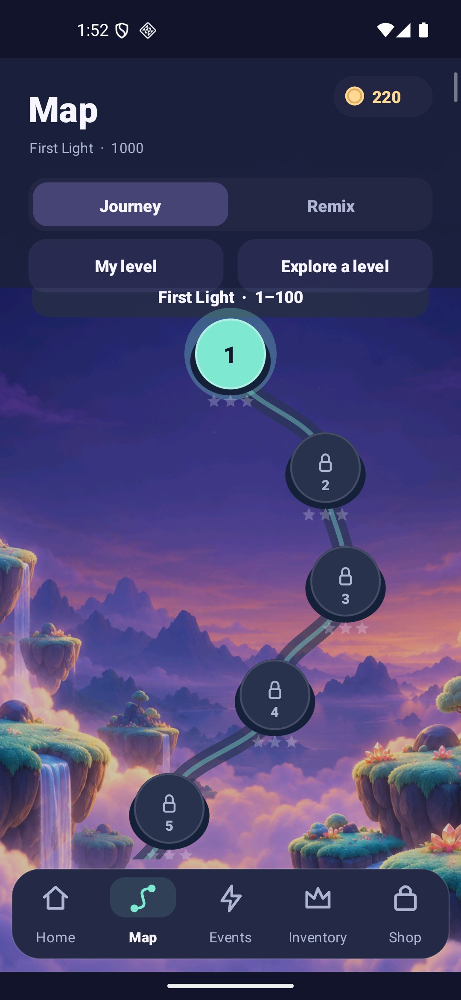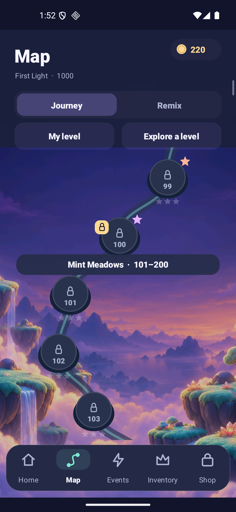

The native run jumps to 1, 13, 100, 101 and 1,000, and scrolls backward. Viewing a locked position does not unlock it. Ten hundred-level ranges change tint and original procedural music. Exact J13 diagnostics and safe hints have an independent [reachability report](validation/v1.7/board-audit.md); these map images alone do not demonstrate a complete playthrough or native J13 recovery.

### Two currencies and a closed account vault

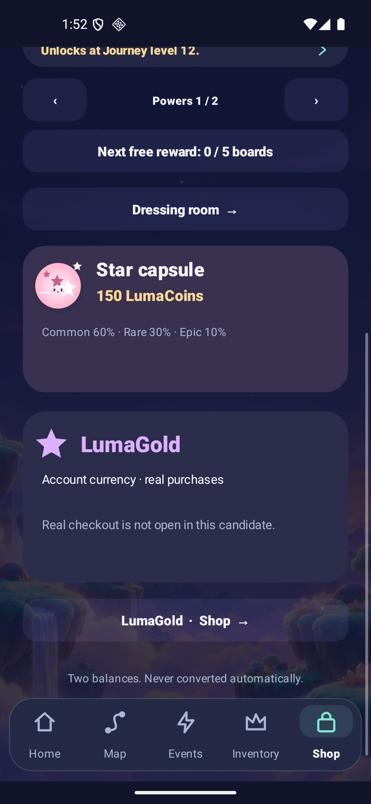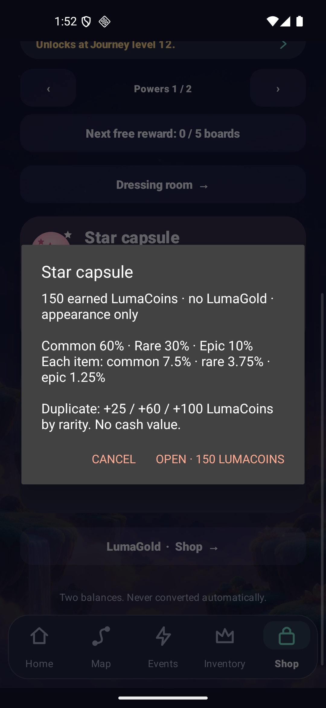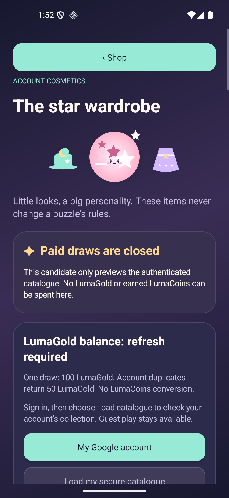

The earned capsule costs 150 LumaCoins. It discloses 60/30/10% category odds, 7.5/3.75/1.25% per item, and 25/60/100 duplicate coins before confirming. The native run verifies the exact debit and outcome; it does not spend LumaGold. The prepared account vault requires real authentication to load account ownership and conditional probabilities, and both draw gates remain false. Its future guarantee means account-new, which can already exist in the local wardrobe. No account or payment is invented in these guest captures.

The website copies eleven final-menu PNGs exactly. Its composition, browser checks and Hosting publication have separate evidence under `docs/validation/site-v1.7/`. Source/pilot images and earlier failed runs are not substituted for the passing final report. [Candidate and exact binaries](RELEASE_1_7.md).

## Preserved installed 1.6 presentation

The signed production 1.6.0-rc1 has a ten-level saga map, a briefing before a fresh attempt, a three-row inventory with ownership filters and explicit session states. Journey introduces keys and seals at level 12. The captures below are from the final installed production APK; Home resumes an existing preserved challenge. [Exact artifact and acceptance](RELEASE_1_6.md) · [UX contract](UX_1_6.md).

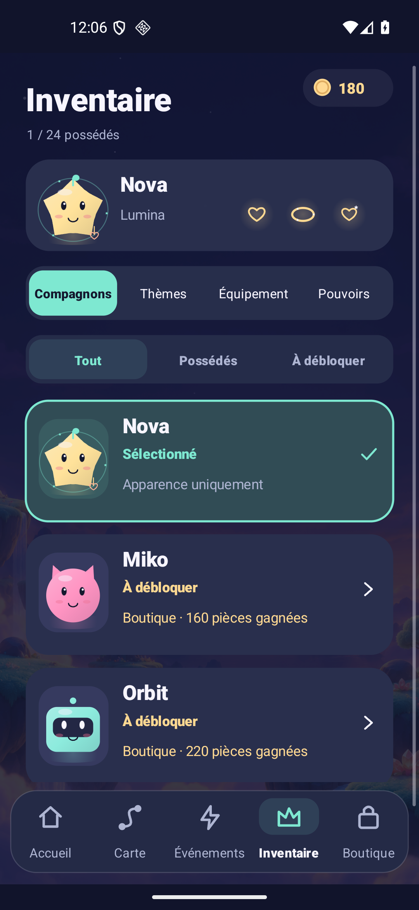

The matching website uses real 1.6 captures, the original Aurora Atlas environment and a separately labelled key/wall rule illustration. These local browser captures demonstrate its responsive composition; deployment has its own [delivery record](validation/site-v1.6/README.md).

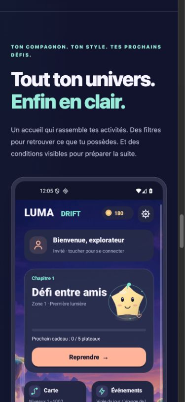

## Preserved 1.5 illustrated tour

The remaining images and descriptions retain their 1.5 scope.

These are installed Android captures of the identified 1.5 candidate, not mockups. They establish displayed behavior; physical-device and player acceptance remain separate. [Exact binary and tests](VALIDATION.md) · [Historical 1.1 tour](VISUAL_GUIDE_1_1.md).

The French lobby, profile, collection and shop captures below come from the final production APK (`33c4dbd6…`). The wall-before/open gameplay pair comes from the preceding full functional pass; only the exported-image renderer changed afterward. [Source comparison](validation/v1.5/binary-source-diff.json).

## Start from your avatar

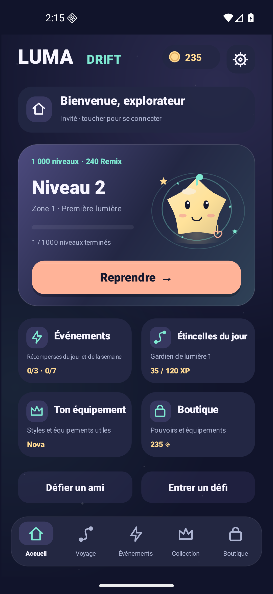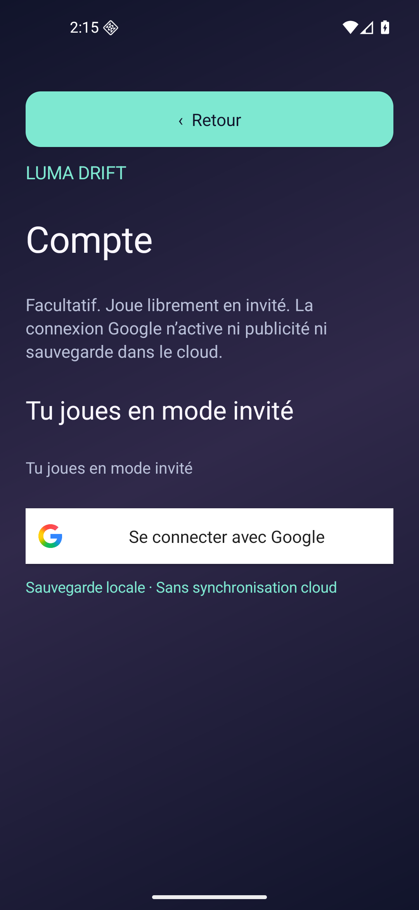

The profile card clearly identifies a guest or actual Google session. The central avatar shows equipped gear beside the next board. Play resumes an interrupted attempt; the four activity cards lead to events, missions, collection and shop. Google identity does not imply cloud-save support.

## Own, equip or unlock

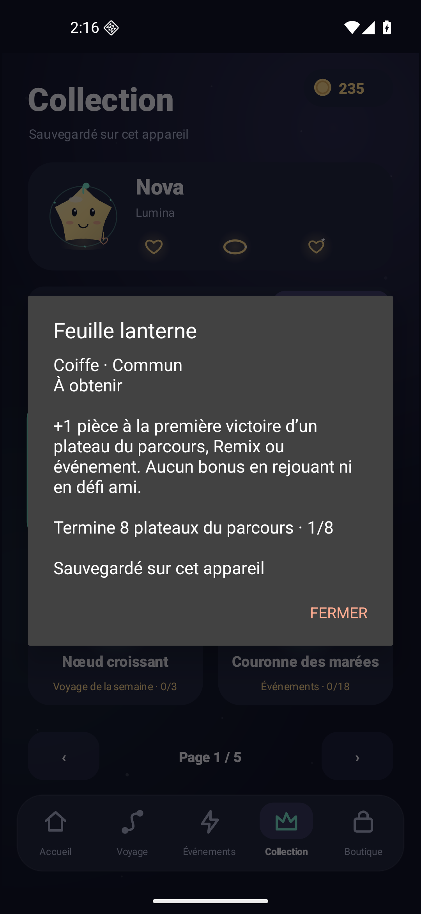

Three tabs separate companions, themes and functional equipment. The hero displays the current loadout. Status badges and an owned filter answer what is already available; a preview states the slot, rarity, effect and exact source. Acquisition through weekly/event milestones is permanent. [All 18 items](AVATAR_EQUIPMENT.md).

## Understand the price before spending

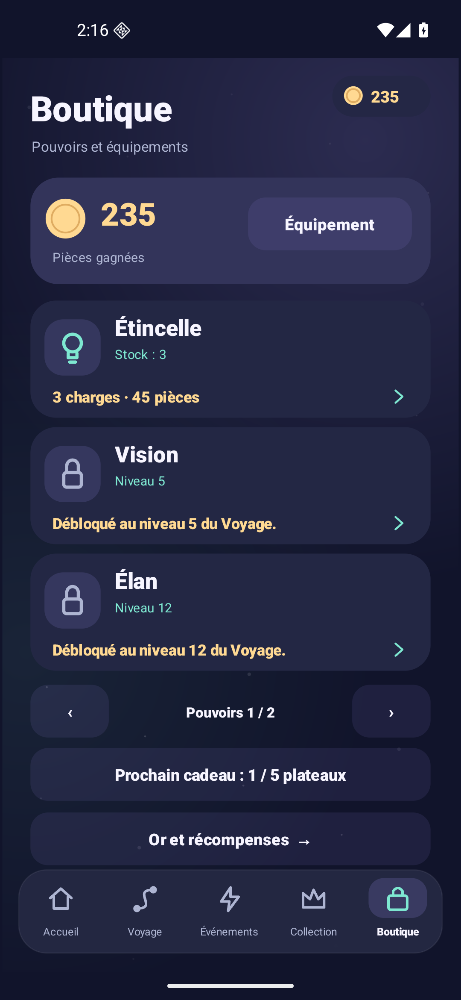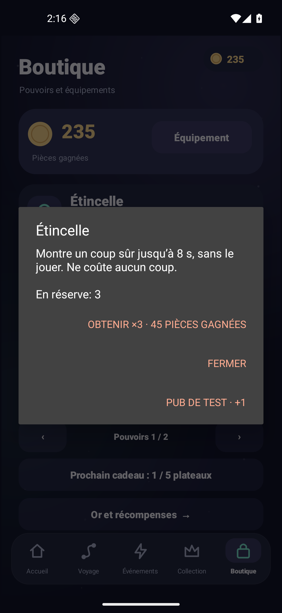

Stock and pack quantities are explicit. Opening/cancelling an offer spends nothing. Gameplay power activation separately confirms one charge, then shows the active effect; a running effect cannot consume another charge of the same power. Purchased-gold/account offers live in their separate, currently gated commerce screen.

## Release a key, open a passage

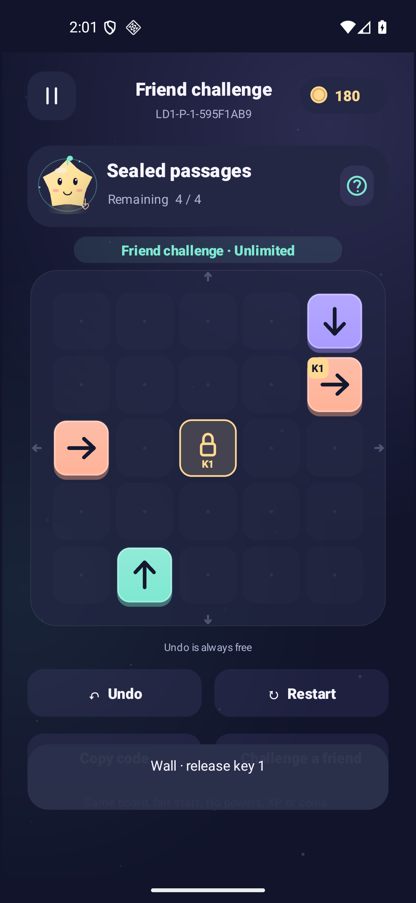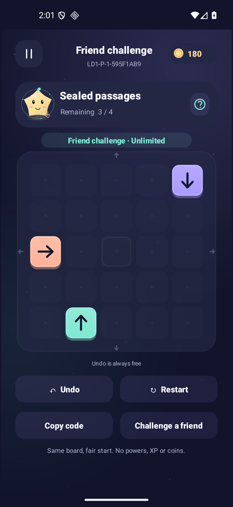

Matching key pieces dissolve fixed walls. Undo brings them back. Later prototypes mix this rule with gates, so the order of a key's exit can matter. The six P challenges are unlimited, reward-free practice. Journey instead uses 1,000 new fixed layouts and per-board action limits; 240 Remix provide paired gate-switch puzzles.

Open **Events → Sealed passages** to play P1–P6. The exported challenge card also includes matching walls and key badges:

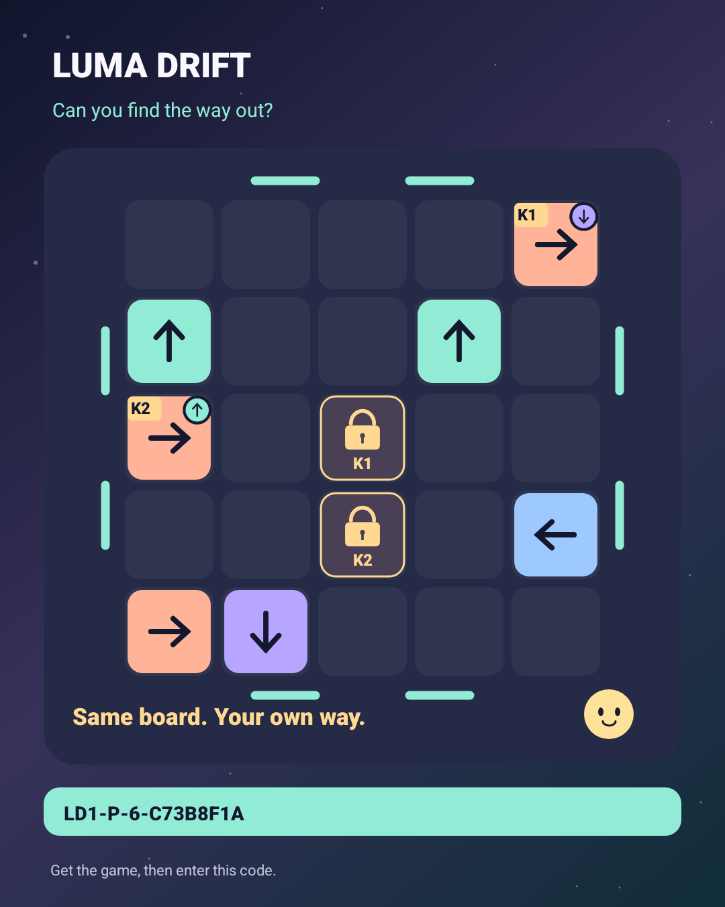

This PNG was generated on the final APK. The Android chooser was cancelled; no message was sent.

## Evidence and limits

Six-language and small-window UI reports identify exact package hashes, inspected states and original-setting restoration. Lab equipment/power screenshots may use the explicitly disclosed temporary test profile; those coins, ownership and unlocks are not presented as earned progression. Real provider login, live ads, purchases, physical touch/audio quality and retention remain separate qualification.

## Website and GitHub presentation

The 1.5 homepage uses the same night/pastel visual family, original companion vectors and clearly sourced game captures. [Design system](DESIGN_SYSTEM.md) explains palette, layout, language and image provenance. The public site is French/English; six-language support describes the Android game.

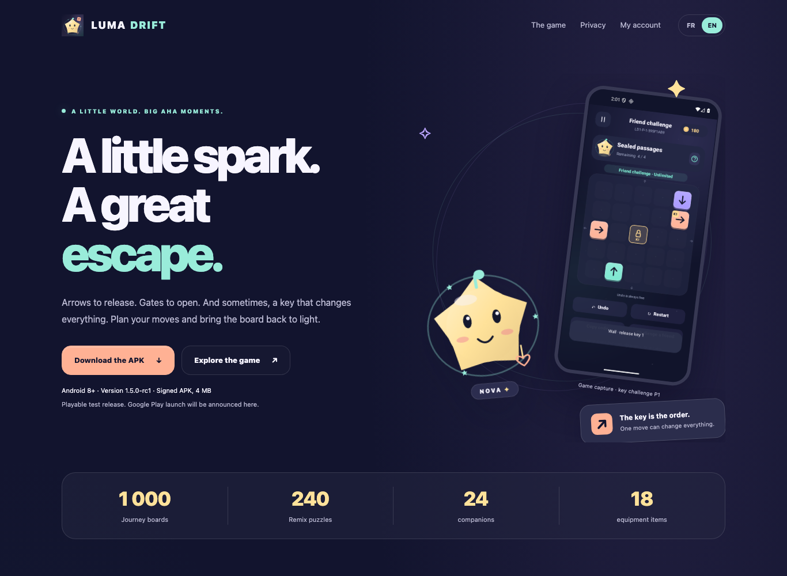

These are **local browser renders**, including original Nova vector art and the sourced game view; they are not screenshots of a confirmed deployed revision. [FR/EN responsive checks](validation/site-v1.5/browser-check.txt) passed on 18 local states, with synthetic-only deletion tests and no real sign-in.

Website captures belong in [`screenshots/site-v1.5/`](screenshots/site-v1.5/) and their checks/manifests in [`validation/site-v1.5/`](validation/site-v1.5/). Local webpage captures demonstrate the rendered source revision, not a deployed page or new Android behavior. The subsequent [Hosting delivery record](validation/site-v1.5/delivery.json) identifies the published revision and confirms the served payloads match these rendered sources. Existing Android images above keep their original final/predecessor labels. [Web evidence boundary](PUBLIC_PAGES.md#15-visual-refresh-and-new-evidence).
