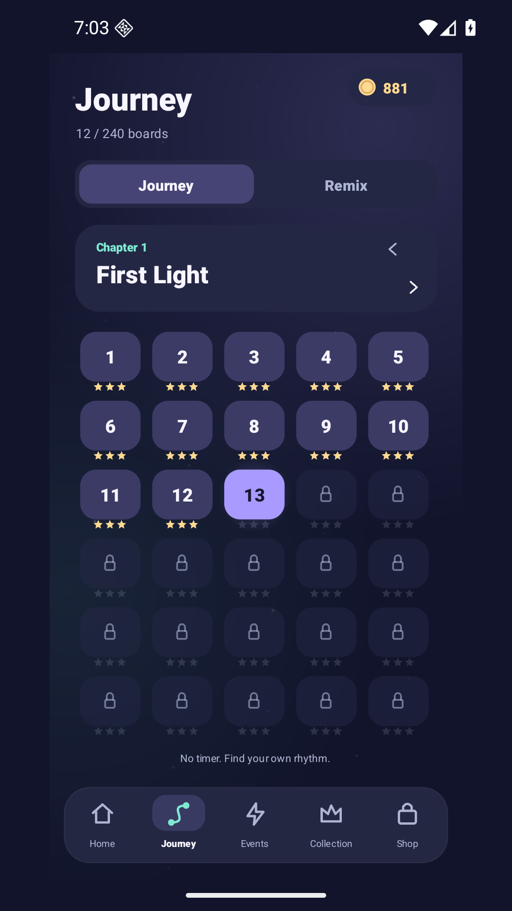
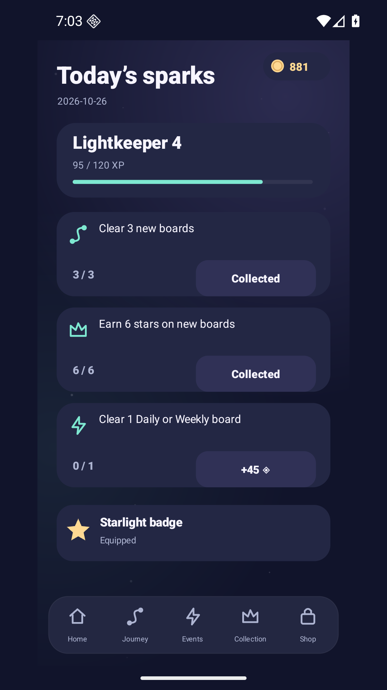
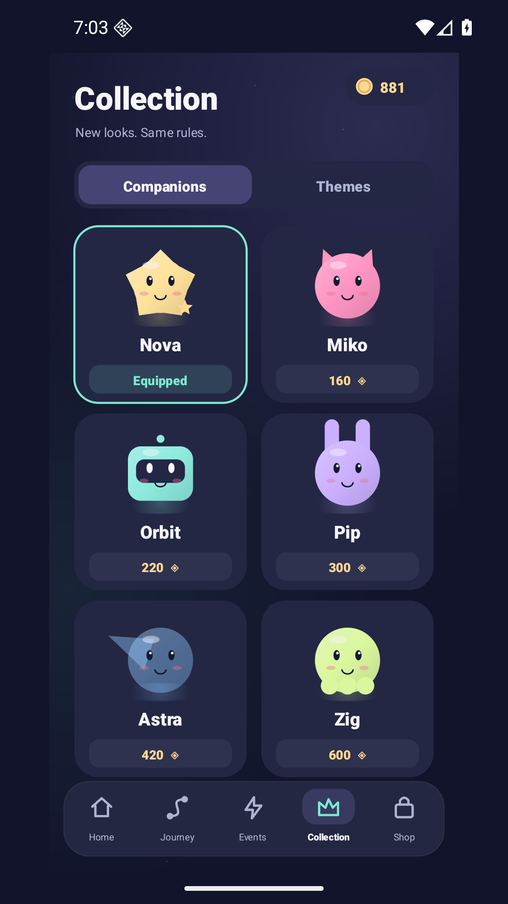
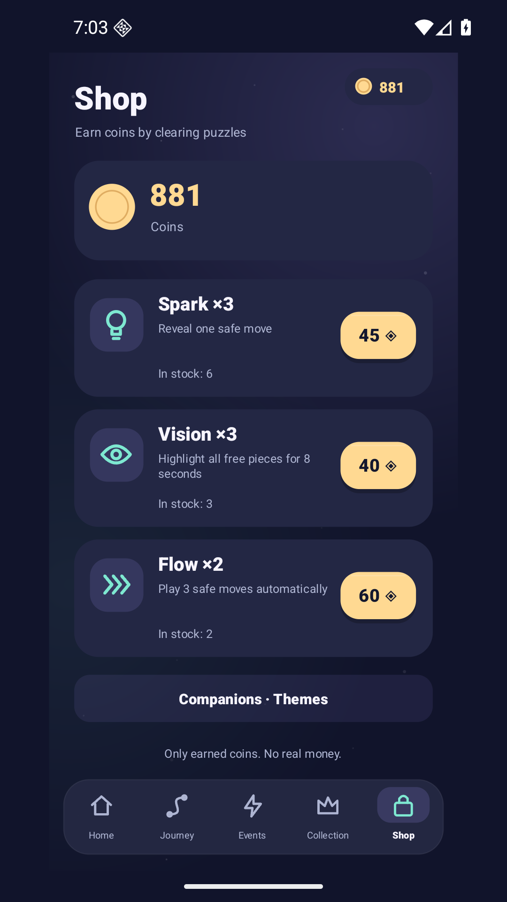
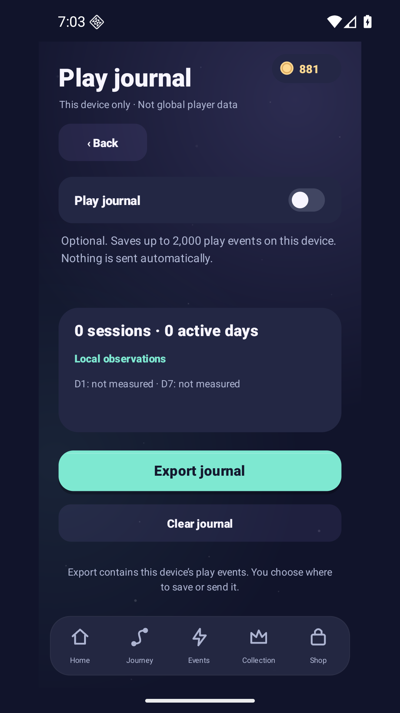

# Luma Drift — an illustrated tour

> Preserved 1.1 images and explanations. They are not relabelled as 1.5 captures. [Current illustrated tour](VISUAL_GUIDE.md) · [Shared visual direction](DESIGN_SYSTEM.md).

Version 1.1.0. Every phone image below is a **real 1080×1920 capture of the signed Android app**. The artwork in the brand kit is separate promotional art. These images explain the shipped behavior; they are not evidence of player retention.

## Start with one light

**Home** puts the current board first. The rank card shows first-clear XP and today's mission entry. The two challenge actions share a reproducible board or open a friend's code.

**On a board**, tap a light to send it in its arrow's direction. Another light can block the ray; a closed gate can block the exit. An impossible tap costs nothing. Early boards highlight a safe opening and show a short contextual rule. Full help stays available from the question mark. There is no countdown or energy meter.

## Gates make the order matter

A small arrow badge identifies the gate a switch toggles after leaving. **Remix adds paired badges**: both gates change on the same move. A selected switch previews the affected rails. Journey has 240 boards; finishing board 12 unlocks a separate 240-board Remix path. Both keep independent stars and unlocks.

Undo and restart are free. A locally solvable position can become stuck after a poor ordering choice; undo restores the previous gate state. Every published campaign and Remix board has a solver-verified complete solution. That check does not rate human difficulty or enjoyment.

## Earn a reason to return

Three missions reward new clears, stars on new clears and an event clear. Claiming a completed mission grants coins once. XP also comes from distinct first clears; replaying a cleared board does not farm it. Seven different clears unlock an optional cosmetic star badge. Days explored accumulate without a missed-day penalty.

Six companions and six themes can be previewed, bought with earned coins and equipped. They change appearance, not puzzle solutions. Daily and weekly puzzles are generated from the device calendar and remain available offline.

## Shop with game coins

**Spark** reveals a safe next piece. **Vision** highlights pieces with a currently clear exit; it does not promise every highlighted order will solve the board. **Flow** plays up to three solver-safe moves. Leaving play, backgrounding, opening help, restarting or undoing cancels queued Flow actions.

Powers are optional and affect the star score. The shop does not take real money. See [the exact prices and reward rules](GAMEPLAY.md).

## Share a fair puzzle

The share action creates an original card from the actual starting board, including its initial gates and exact C/R/E code. Android opens its share sheet; the player chooses the destination. A code can also be entered from Home. The custom `lumadrift://challenge/CODE` link opens an installed app; it is not an installation service or verified HTTPS App Link.

Friend mode has no powers, coins, XP, mission progress or campaign unlocks. Sharing records a handoff only when the optional journal is enabled; it cannot tell whether a message was sent or a friend installed the game.

## Learn locally, by choice

Settings → Local play journal is off by default. Opting in records a maximum of 2,000 events on that device, with timing, board identity and basic session observations. Export opens Android's share sheet for a JSON file. Nothing is sent automatically.

Clear removes observations and cached journal exports while preserving game progress. Copies already saved or sent elsewhere remain with their owners. Local D1/D7 observations describe one opt-in window, not global retention; missing data remains unknown. [Privacy details](PRIVACY.md).

## Read the evidence

[Release and installation](RELEASE.md) · [Executed checks and limits](VALIDATION.md) · [Changes](CHANGELOG.md) · [Next milestones](ROADMAP.md).
