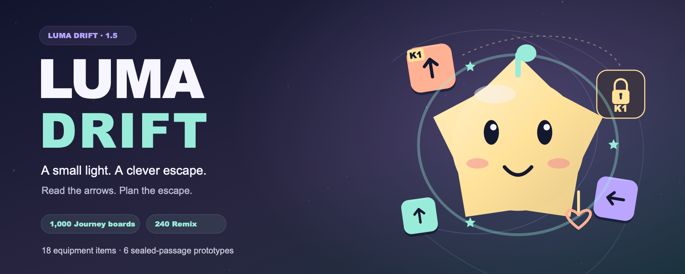

# Luma Drift · 1.5 brand kit



Original vector artwork extending the installed 1.5 interface: an indigo night, mint orbits, peach and lilac arrow pieces, Nova's warm gold silhouette, and the numbered keys and walls from Sealed passages. The shared line is **“A small light. A clever escape.”**

## Assets

| Asset | Editable source | Reviewed export | Intended use |
|---|---|---|---|
| Repository banner | [SVG](luma-drift-repo-banner.svg) | [PNG · 1600 × 640](luma-drift-repo-banner.png) | GitHub README; includes the exact 1,000 Journey / 240 Remix / 18 equipment / six prototype scope |
| Feature graphic | [SVG](luma-drift-feature.svg) | [RGB PNG · 1024 × 500](luma-drift-feature.png) | Proposed store feature and website preview |
| Icon | [SVG](luma-drift-icon.svg) | [RGBA PNG · 512 × 512](luma-drift-icon.png) | Proposed store icon; full square, no external mask or badge |
| Nova companion | [SVG](nova-companion.svg) | [Transparent PNG · 640 × 640](nova-companion.png) | Website illustration; Nova and the three starter equipment motifs, with no background |
| Brand scene | [SVG](brand-scene.svg) | [RGB PNG · 1440 × 720](brand-scene.png) | Wide illustration without visible text; arrows, a key, a wall and Nova |
| Small icon preview | — | [PNG · 64 × 64](luma-drift-icon-64-preview.png) | Visual inspection only; not a store upload |

[Exact dimensions, formats, byte sizes and SHA-256 hashes](assets.json) · [Executed checks and review](VALIDATION.md).

These are promotional illustrations. Actual installed interfaces and boards are documented in [1.5 screenshots](../screenshots/v1.5/) and [their versioned acceptance record](../validation/v1.5/ui-acceptance.md). The illustrations do not depict a complete playable board. The six Sealed passages remain prototypes, separate from the 1,000 Journey and 240 Remix boards.

## Shared palette and geometry

| Role | Color |
|---|---|
| Night indigo | `#12142E` |
| Card indigo | `#252944` |
| Mint | `#99ECDA` |
| Peach | `#FFB194` |
| Lilac | `#BAA5FF` |
| Ivory | `#F7F5FF` |
| Nova gold | `#FFE29A` |

This presentation palette harmonizes the default Lumina appearance for the website and repository; it does not change the Android theme. Nova's ten alternating-radius vertices, rounded body, eyes, blush and smile derive from the original `mascot()` in [LumaView.java](../../app/src/main/java/com/androidhit/lumadrift/LumaView.java). The mint bud, three-star orbit and hanging heart follow `drawLoadout()` with the three starter items. Character identity and base gold come from [Catalog.java](../../app/src/main/java/com/androidhit/lumadrift/data/Catalog.java).

Directional arrows, the K1 badge and the gold-outlined wall follow the installed [sealed challenge card](../screenshots/v1.5/sharing/sealed-p6-card.png). Their floating arrangement is a brand composition. No player count, ranking, rating, paid-offer value or store badge is added. Nova and the text-free scene can be reused across locales; the banner and feature use English copy.

## Reproduce

The generator uses Python 3's standard library. Export uses macOS AppKit and Swift. No browser, remote media service or bundled font is required.

```sh
python3 docs/store/generate_assets.py
CLANG_MODULE_CACHE_PATH=/private/tmp/luma-swift-cache swift docs/store/render_assets.swift
python3 docs/store/verify_assets.py
```

[`asset-specs.json`](asset-specs.json) carries the shared export dimensions and alpha requirements. [`generate_assets.py`](generate_assets.py) creates the SVGs; [`render_assets.swift`](render_assets.swift) exports PNGs and the 64-pixel icon preview. [`verify_assets.py`](verify_assets.py) checks local vector references, PNG structure/pixels, the visible gold Nova body, transparency, exact dimensions and the integrity manifest. Keep SVG references one level deep: AppKit's SVG loader does not reliably render nested `use` groups.

Text uses the local Arial Black / Arial families with sans-serif fallbacks. Other renderers or font versions can change letter spacing; the supplied PNGs are the reviewed exports. Sources and the original artwork follow the repository's [license](../../LICENSE).

## Store and production scope

The [Google Play preview-asset requirements](https://support.google.com/googleplay/android-developer/answer/9866151?hl=en), checked 27 October 2026, specify a 1024 × 500 feature graphic without alpha and a 512 × 512 PNG icon with alpha, at most 1024 KB. Those file properties are verified here. The proposed icon does not replace the app's launcher resource.

This kit does not establish listing approval or publication. Live advertising, Android identity and commercial checkout retain the qualification boundaries in the [project README](../../README.md#production-status) and [release documentation](../RELEASE_1_5.md). No APK was rebuilt for this kit, and no app or gameplay source was changed.
