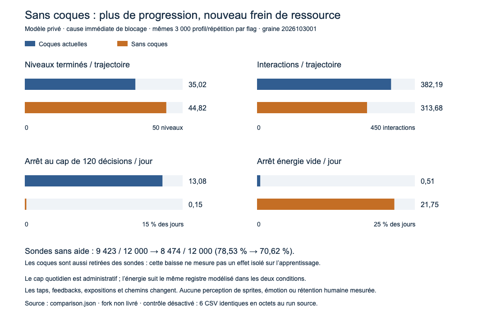

# Expérience privée : campagne avec ou sans coques

**La suppression des coques améliore fortement la progression de ces agents,
mais déplace le frein vers l'énergie et ne valide pas une meilleure maîtrise.**
Dans la condition avec cause immédiate de blocage, la moyenne passe de **35,020
à 44,823 niveaux par trajectoire**, à profils et graines identiques. Les sondes
sans aide réussissent moins souvent ; leur propre environnement a lui aussi
perdu les coques. Ce prototype de modèle n'est pas une modification livrée.

## Intervention et contrôles avant comparaison

Le moteur/app/scripts courants restent inchangés. Le répertoire `model/` contient
une copie privée des **51 inputs hashés** du run source, plus le stub `Color.java`
nécessaire à la compilation hors Android. Deux fichiers privés diffèrent :

- `Environment.java` : l'initialisation des coques devient vide seulement sous
  **`-Dcognitive.lab.experimentalNoShells=true`**. La branche `false` conserve
  exactement l'initialisation originale.
- `CognitiveLab122.java` : identifiant de fork et configuration JSON explicite,
  `experimentalFork.noShells`, portée et statut non livré. Aucun comportement de
  l'agent n'est changé dans ce fichier.

Les géométries `RelayCatalog`, `Board`, `MoveBudget`, économie, énergie, agent,
apprentissage, durée d'action, utilité et politiques d'aide sont identiques.
Le changement comprend les conséquences sur la séquence d'actions, la fatigue,
les expositions et les tirages indexés par cette séquence ; il ne se réduit pas
à soustraire cinq clics d'un parcours déjà fixé.
Il supprime aussi les feedbacks propres à ces taps : apprentissage de la règle
de coque et diminution de frustration de 0,012 par tap. C'est donc l'effet total
de cette intervention dans le modèle, à paramètres fixes, pas un effet isolé du
temps de préparation ni une validation de la simplification graphique.

**Gate obligatoire, passé avant d'activer l'expérience** : les **six CSV gzip du
fork `false` sont identiques à l'octet près** à ceux du nouveau run source
`2026103001`. `profiles.json` est également identique. Les deux runs utilisent
100 profils × 30 répétitions × sept conditions, graine **2026103001**.

Deux contrôles négatifs supplémentaires passent : les **209 495 lignes de
tentative U1–U10**, avant l'introduction des coques, sont identiques entre flags ;
les **deux CSV du chapitre tactique**, déjà sans coques, sont identiques entre
flags. Les **52 inputs originaux** et **43 fichiers Lab protégés** restent
identiques. Les deux exécutions se terminent avec code zéro, en 51,511 s et
42,938 s dans le runner, hors compilation.

| Exécution réellement effectuée | Coques actuelles | Sans coques |
| --- | ---: | ---: |
| Trajectoires campagne | 21 000 | 21 000 |
| Tentatives campagne | 766 177 | 936 862 |
| Événements de blocage exhaustifs | 383 611 | 412 003 |
| Journées configurées | 168 000 | 168 000 |
| Sondes sans aide | 84 000 | 84 000 |
| Parcours tactiques séparés | 54 000 | 54 000 |
| Plateaux tactiques commencés | 205 225 | 205 225 |

Il s'agit donc de **42 000 nouvelles trajectoires** et **1 703 039 tentatives de
campagne**, en plus du premier audit. Les répétitions ne sont pas des humains
indépendants. Les expériences campagne, transfert et chapitre gardent leurs
dénominateurs distincts.



## 1. Plus de progression, avec moins d'interactions

Le résultat apparaît dans les sept conditions :

| Condition, 3 000 trajectoires par flag | Moyenne de niveaux avec coques | Sans coques | Différence appariée |
| --- | ---: | ---: | ---: |
| Témoin sans cause explicite | 34,863 | 44,703 | +9,840 |
| Cause immédiate de blocage | 35,020 | 44,823 | +9,803 |
| Cause après répétition, expérimentale | 34,878 | 44,715 | +9,837 |
| Cue espacé, expérimental | 34,931 | 44,759 | +9,828 |
| Équipe information prêtée | 31,980 | 40,777 | +8,797 |
| Équipe exécution prêtée | 39,078 | 44,641 | +5,563 |
| Cue espacé + trio mixte prêté | 37,144 | 43,839 | +6,695 |

Dans la condition **cause immédiate**, les 100 profils progressent davantage en
moyenne sur leurs 30 répétitions. La différence appariée est **+9,803 niveaux**,
avec intervalle de rééchantillonnage des profils **[+9,103 ; +10,592]**. C'est une
sensibilité de la cohorte du modèle, pas un intervalle sur une population humaine.

La condition cause immédiate passe de **105 060 à 134 470 niveaux terminés**,
de **1 146 563 à 941 031 interactions**, de **673 077 à 852 803 sorties manuelles**,
avec zéro sortie automatisée dans les deux flags. Les taps de coque passent de
**386 436 à zéro**. Les 205 532 interactions totales évitées ne sont pas simplement
les 386 436 taps supprimés : les agents terminent aussi 29 410 niveaux de plus.

« Manuel » décrit l'exécution par tap et peut inclure le suivi d'un coach/Focus.
Les CSV complets comptent les observations de cue, pas le nombre exact de tous
les taps manuels ayant suivi un cue. Ce nombre ne doit pas être inventé à partir
des seules traces sélectionnées.

## 2. Le prochain frein est l'énergie

Toujours pour la cause immédiate, sur **24 000 journées configurées par flag** :

| Mesure | Avec coques | Sans coques |
| --- | ---: | ---: |
| Arrêt au cap administratif de 120 décisions | 3 140 / 24 000 (13,08 %) | 35 / 24 000 (0,15 %) |
| Arrêt énergie vide | 122 / 24 000 (0,51 %) | 5 220 / 24 000 (21,75 %) |
| Dépenses d'énergie cumulées | 78 550 | 106 241 |
| Undo exécutés | 21 540 | 20 054 |
| Coins payés pour Undo | 67 696 | 33 455 |

L'énergie, sa régénération et sa capacité sont inchangées. Les agents avancent
plus vite sous la même formule de durée, commencent davantage de plateaux puis
rencontrent plus souvent cette ressource. Ce résultat motive un essai de rythme
et de ressources ; il ne justifie pas, seul, un changement global de l'économie
native. Les durées simulées ne mesurent pas le temps ou la satisfaction humaine.

## 3. Les pics U43/U48 diminuent dans le modèle

Condition cause immédiate, même géométrie et même budget par niveau :

| Niveau | Épuisements / départs avec coques | Sans coques |
| --- | ---: | ---: |
| U43 | 446 / 1 390 (32,09 %) | 85 / 1 660 (5,12 %) |
| U48 | 290 / 859 (33,76 %) | 13 / 1 242 (1,05 %) |

Les arrivées changent et les retries restent au dénominateur. Parmi les mêmes
arrivées du témoin sans cause, limitées au premier essai commun, U43 passe de
**336/916** à **43/916** épuisements ; U48 de **217/554** à **3/554**. Cette sélection
ne supprime pas les différences de fatigue, d'expérience et de calendrier
antérieures au niveau. Elle ne prouve pas que la géométrie soit devenue lisible
à un humain.

Dans la condition cause immédiate, les épuisements enregistrés passent de
**1 144/108 482 départs** à **504/136 173**. La sensibilité aux labels d'horizon
déjà à budget zéro donne **1 155/108 482** contre **506/136 173** ; les labels bruts
restent intacts. Les coques ne dépensaient pas directement le budget ; l'effet
observé inclut les politiques et chemins de l'agent sous cette intervention.

## 4. Le mauvais dénominateur ferait annoncer plus d'erreurs

Cause immédiate : les blocages augmentent de **64 147 à 67 235**, tandis que les
sorties manuelles augmentent de **673 077 à 852 803**. Sur toutes les interactions,
le taux monte de **5,59 % à 7,14 %**, car les nombreux taps de coque ont disparu du
dénominateur. Sur sorties réellement réalisées + taps bloqués, il **baisse de
8,70 % à 7,31 %** : **64 147/737 224** contre **67 235/920 038**.

Les deux définitions restent accessibles dans `comparison.json`. La première
mesure le mélange d'interactions ; la seconde est un diagnostic de mécanique.
Aucune ne mesure une compréhension humaine. L'équipe information a de même
**512 puis 562** épuisements, mais **98 826 puis 124 493** départs : son taux par
départ baisse de **0,518 % à 0,451 %**. Le compte brut ne suffit pas à conclure à
une régression.

## 5. Le transfert ne permet pas d'affirmer une meilleure maîtrise

Les sondes désactivent toutes les aides et réinitialisent fatigue, frustration et
mémoire, en transplantant les états de règle finaux. **Le flag sans coques
s'applique aussi à leur environnement**, et pas seulement à l'entraînement :

| Régime d'entraînement, 12 000 sondes par flag | Sondes terminées avec coques | Sans coques |
| --- | ---: | ---: |
| Témoin | 9 419 / 12 000 | 8 489 / 12 000 |
| Cause immédiate | 9 423 / 12 000 | 8 474 / 12 000 |
| Après répétition | 9 422 / 12 000 | 8 492 / 12 000 |
| Cue espacé | 9 422 / 12 000 | 8 484 / 12 000 |
| Équipe information | 9 208 / 12 000 | 8 192 / 12 000 |
| Équipe exécution | 9 107 / 12 000 | 8 038 / 12 000 |
| Trio mixte | 9 152 / 12 000 | 8 143 / 12 000 |

La baisse est réelle dans cette comparaison, sans explication causale isolée des
composantes. Les expositions d'entraînement et la tâche évaluée diffèrent ; les
coques interceptent des taps avant une vraie sortie. Un plan croisé
entraînement avec/sans coque × sonde commune avec/sans coque serait nécessaire
pour distinguer apprentissage et effet de l'environnement de test. Ce plan n'a
pas été exécuté ici.

La moyenne interne `meanKnowledge` n'est pas interprétée comme un apprentissage
comparatif : la règle de coque retirée ne reçoit plus d'exposition et reste
pourtant l'un des cinq termes de cette moyenne. Les profils ne lisent ni images,
ni texte ; l'aide de cause conserve son hypothèse de reconnaissance parfaite
temporaire. Aucune conclusion sur la DA, l'émotion, le plaisir ou la rétention
humaine n'est tirée.

## Classification d'horizon conservée

Le défaut déjà documenté dans le premier audit est conservé dans ce fork : un
budget peut arriver à zéro lors du dernier coup, puis un arrêt quotidien/horizon
précéder sa classification en échec au début de la prochaine boucle.

| Condition | Échecs enregistrés avec/sans coques | Horizons déjà budget zéro avec/sans |
| --- | ---: | ---: |
| Témoin | 1 150 / 499 | 10 / 0 |
| Cause immédiate | 1 144 / 504 | 11 / 2 |
| Après répétition | 1 154 / 501 | 10 / 0 |
| Cue espacé | 1 163 / 496 | 9 / 2 |
| Équipe information | 512 / 562 | 2 / 2 |
| Équipe exécution | 894 / 354 | 4 / 1 |
| Trio mixte | 881 / 320 | 6 / 0 |

Les **52 puis sept** cas sont séparés des outcomes bruts dans les calculs.
Le reste des censures demeure une fin de fenêtre observée, pas un échec ni une
mesure de décrochage. Les formules de présence et de continuation restent des
hypothèses non calibrées.

## Reproduction et preuves

Le runner est volontairement protégé contre l'écrasement du fork et de ses
résultats. Pour rejouer, copier le protocole dans un nouveau dossier et choisir
de nouvelles sorties. Pour recalculer seulement les résultats existants :

```sh
python3 docs/validation/clarity-audit-2026-10-30/experiment-no-shell/compare.py
```

- [Protocole et hashes des inputs originaux/fork](protocol.json).
- [Patch exact privé](minimal-model.patch) et sources originales dans `originals/`.
- [Gate des six CSV et profils](disabled-replay-gate.json).
- [Commandes exactes et flag false](control-disabled-execution.json),
  [flag true](no-shell-enabled-execution.json), [compilation](compile-receipt.json).
- [Provenance témoin](control-disabled/provenance.json),
  [provenance sans coques](no-shell-enabled/provenance.json).
- [Comparaison exhaustive et dénominateurs](comparison.json), [calcul](compare.py).
- [Journal de procédure original](experiment-original.log),
  [journal d'analyse final](comparison-final-original.log).
- [Relecture indépendante du protocole](independent-protocol-review.json),
  limitée au protocole et au patch, sans recompilation ni recomptage indépendant.
- [Graphique SVG exportable](mechanical-comparison.svg), [générateur](plot.py).
  Le PNG a été inspecté après conversion locale avec `sips`.

Le premier essai du script de préparation a rencontré un chemin racine mal
indexé, avant toute copie/exécution du modèle ; son erreur est conservée dans
`setup-attempt-1-original.log`. Les deux runs présentés sont ensuite terminés
avec succès. Aucun build Android, déploiement, publication ni modification des
sources courantes n'a été effectué.
