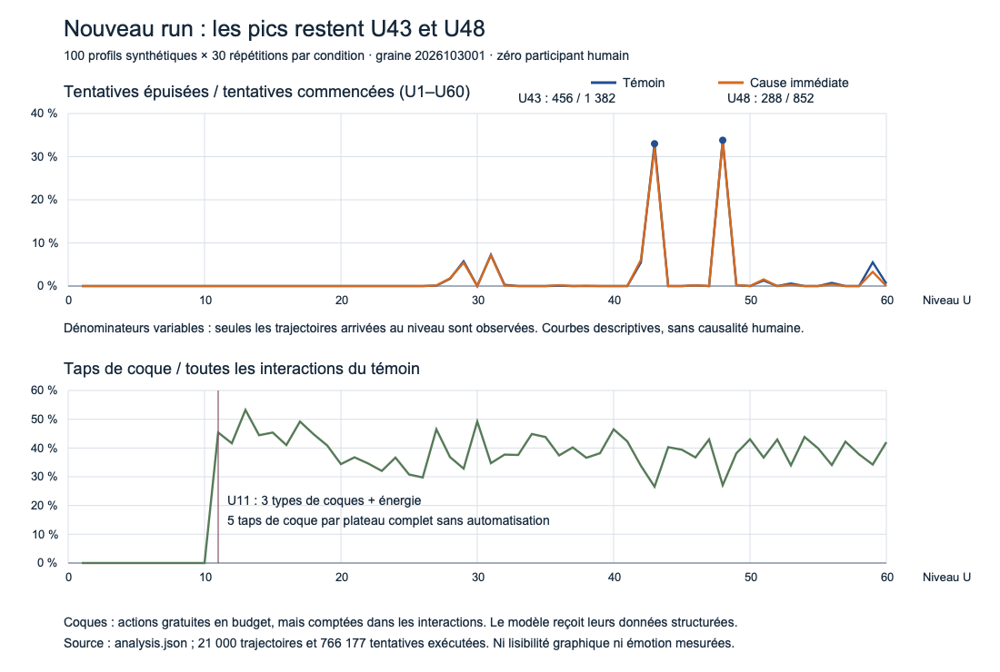

# Nouveau run de clarté et de progression — 30 octobre 2026

**21 000 trajectoires et 766 177 tentatives de campagne ont été réellement
exécutées sur le moteur courant**, avec une nouvelle graine. Les deux pics de
budget restent U43/U48. Les explications de blocage améliorent modestement les
actions du modèle ; les talents font avancer davantage sans établir une meilleure
maîtrise sans aide. Le run ne mesure ni lecture des sprites, ni compréhension
humaine, ni émotion.

## Exécution et provenance

- Commit source avant exécution : `557724f56e45aa8df1cfab629f20848e0f3c4fd0`.
- Graine **2026103001**, distincte du run publié `20261030`.
- 100 profils générés × 30 répétitions × 7 conditions = **21 000 trajectoires**,
  chacune limitée à huit jours modélisés.
- **766 177 tentatives de campagne**, **383 611 événements de blocage exhaustifs**,
  **168 000 journées configurées** ; les tentatives répétées restent comptées.
- Expériences distinctes : **84 000 sondes de transfert sans aide** et
  **54 000 parcours tactiques**, comprenant **205 225 plateaux effectivement
  commencés**. Ces dénominateurs ne sont pas fusionnés avec la campagne.
- Exécution du runner : **56,034 s**, hors compilation. Zéro humain.
- Les **51 empreintes source** du runner correspondent au checkout : 50 sources
  exécutables/modèle et le contexte UI `LumaView.java`, qui n'est pas compilé par
  ce runner. Les 13 fichiers produits vérifient leurs hashes et tailles.
- Les **43 fichiers préexistants** protégés — Lab public et `latest` de l'étude
  1.22 — restent identiques en octets. Aucun fichier Java, app, public, site ou
  archive n'a été modifié ; aucun build Android, déploiement ou push effectué.

La nouvelle graine rééchantillonne aussi les paramètres des profils. Il ne faut
donc pas traiter une différence avec la cohorte publiée comme un effet de
version. Les sept conditions du présent run utilisent les mêmes profils et des
entrées aléatoires appariées ; leurs chemins peuvent diverger.

```sh
bash scripts/run-cognitive-lab-v122.sh --profiles 100 --repetitions 30 \
  --seed 2026103001 \
  --output docs/validation/clarity-audit-2026-10-30/simulation/run-2026103001
python3 docs/validation/clarity-audit-2026-10-30/simulation/analyze.py
python3 docs/validation/clarity-audit-2026-10-30/simulation/plot.py
```

Ne pas rejouer cette commande dans le répertoire déjà gelé : choisir un nouveau
répertoire pour une autre exécution. Les calculs descriptifs sont reproductibles
par `analyze.py`, sans relancer les parties. Le premier passage de l'analyse a
rencontré `int.bit_count` absent sur Python 3.9 ; son journal d'erreur est conservé.
La correction porte uniquement sur l'analyse descriptive, pas sur le runner.

## 1. La difficulté n'est pas une pente régulière

Dans le témoin, **744/1 150 épuisements enregistrés (64,7 %)** se concentrent sur
deux niveaux. U43 et U48 ne représentent pourtant que **2 234/108 046 départs de
tentative (2,1 %)**. Les principaux pics sont :

| Niveau | Arrivées distinctes / 3 000 trajectoires | Épuisements / départs, retries inclus | Undo exécutés |
| --- | ---: | ---: | ---: |
| U28 | 2 101 / 3 000 | 36 / 2 137 (1,7 %) | 1 974 |
| U29 | 2 002 / 3 000 | 122 / 2 124 (5,7 %) | 2 763 |
| U31 | 1 818 / 3 000 | 142 / 1 959 (7,2 %) | 3 090 |
| U42 | 1 021 / 3 000 | 59 / 1 080 (5,5 %) | 1 619 |
| U43 | 936 / 3 000 | 456 / 1 382 (33,0 %) | 3 772 |
| U48 | 570 / 3 000 | 288 / 852 (33,8 %) | 2 256 |

Le résultat subsiste parmi les **premiers essais appariés**, limités aux mêmes
profil/répétition arrivant dans les deux conditions : U43, **334/901** épuisements
témoin contre **326/901** avec cause immédiate ; U48, **205/523** contre
**206/523**. Cette restriction conserve un biais de sélection des arrivées et
des histoires antérieures différentes ; ce n'est pas un essai humain randomisé.

U43/U48 consomment **6 028/21 287 Undo (28,3 %)** et **39 972/67 445 Coins payés
pour Undo (59,3 %)**. Les deux sont étiquetés `NORMAL / PRACTICE` par le catalogue,
avec sept pièces, trois actions de marge et un score structurel d'auteur de 44.
Ces étiquettes ne sont pas des mesures humaines de difficulté.



## 2. U11 ajoute des interactions avant d'ajouter une nouvelle décision

La séquence du contenu courant est : sorties U1–U4, obstacles U5–U8, clé/cadenas
U9–U12, relais U13–U16, ordre des relais U17–U20, relais + clé U21–U24, puis cumul
U25. À **U11**, alors que la leçon est encore `key`, les trois types de coque
apparaissent ensemble et la session-énergie commence à être dépensée.

`ElementalShell121` applique **ICE ×2, FIRE ×2 et WATER ×1** : cinq taps
supplémentaires pour vider les coques d'un plateau complet sans automatisation.
Leur opération est le même `tap` décrémentant une couche ; ce run ne contient
aucun contre ou combinaison feu/eau/glace. Leurs représentations graphiques ne
sont pas perçues par l'agent.

Dans le témoin, les taps de coque occupent **384 330/1 142 634 interactions
(33,6 %)** ; à U11, **14 819/32 658 (45,4 %)**. Ils ne dépensent pas le budget
d'actions du plateau. Ils occupent néanmoins une décision et du temps modélisé
et entrent dans la limite administrative de 120 décisions/jour. Aucun essai sans
coque n'a été exécuté ici : ces parts ne prouvent pas leur effet causal sur la
progression, le ressenti ou le temps réel d'un joueur.

La table des 400 premiers niveaux, avec pièces, clés, cadenas, relais, portes,
coques et métadonnées d'auteur, est incluse dans `analysis.json`. La couverture
réellement atteinte est U83 pour témoin/cause immédiate, jusqu'à U94 pour l'équipe
d'exécution ; U400 n'a pas été parcouru par ces trajectoires.

## 3. L'explication immédiate aide peu face à ces pics

Les **3 000 trajectoires par condition** donnent :

| Mesure | Témoin | Cause immédiate |
| --- | ---: | ---: |
| Niveaux terminés | 104 590 | 105 060 |
| Moyenne par trajectoire | 34,863 | 35,020 |
| Blocages | 65 456 | 64 147 |
| Répétitions de la même erreur, même état | 4 664 | 4 473 |
| Épuisements enregistrés | 1 150 | 1 144 |
| Taps / autres interactions totales | 1 142 634 | 1 146 563 |
| Sondes sans aucune aide terminées | 9 419 / 12 000 | 9 423 / 12 000 |

La différence moyenne appariée de niveaux est **+0,1567 par trajectoire** ;
l'intervalle de rééchantillonnage par profils du modèle est **[+0,0607 ; +0,2617]**.
Il décrit la sensibilité de cette cohorte synthétique. Sur 100 profils,
62 progressent davantage en moyenne, 36 moins, deux autant ; le taux de blocage
baisse pour 87 profils, monte pour 12, reste inchangé pour un.

Le modèle suppose pourtant une **reconnaissance parfaite temporaire de la règle
affichée** pendant le cue de 3,2 s. Le résultat ne mesure pas la lecture du texte
ou des sprites. Il permet de douter qu'ajouter du texte suffise à résoudre les
pièges de planification dans ce modèle ; il ne chiffre pas l'utilité humaine du
nouvel affichage.

## 4. Les blocages et les échecs ne disent pas la même chose

Le témoin comporte **26 322 blocages de porte**, **29 994 de chemin/pièce** et
**9 140 de cadenas**, sur **65 456** blocages. Les erreurs répétées à état/pièce/
cause identiques représentent **4 664/65 456 (7,1 %)**. Les taps rejetés sont
gratuits en budget ; les mauvaises sorties légales suivies d'Undo peuvent, elles,
consommer la marge sans produire beaucoup de taps bloqués. U48 ne présente que
534 blocages pour 2 256 Undo et 288 épuisements.

Le taux de blocage témoin vaut **65 456/1 142 634 = 5,73 %** si toutes les
interactions sont au dénominateur. Si l'on restreint aux sorties effectivement
réalisées et aux taps bloqués, il vaut **65 456/735 412 = 8,90 %**. Ce second ratio
est un diagnostic de mécanique, pas une correction du score publié : coques,
Undo, Focus et demandes de talent sont exclus de ce dénominateur. Aucun de ces
deux scores ne mesure la compréhension des règles.

## 5. Les aides d'exécution augmentent la progression assistée

| Condition, 3 000 trajectoires | Moyenne de niveaux | Sorties automatisées / toutes les sorties | Sondes terminées sans aide |
| --- | ---: | ---: | ---: |
| Témoin | 34,863 | 0 / 669 956 | 9 419 / 12 000 |
| Équipe information prêtée | 31,980 | 18 963 / 602 797 (3,1 %) | 9 208 / 12 000 |
| Équipe exécution prêtée | 39,078 | 260 485 / 775 248 (33,6 %) | 9 107 / 12 000 |
| Cue espacé + trio mixte prêté | 37,144 | 181 893 / 730 031 (24,9 %) | 9 152 / 12 000 |

Même l'équipe information peut gagner la résonance automatisée. **Manuel**
signifie exécuté par un tap : suivre un GUIDE/TRAIL reste un tap manuel assisté.
Il faut donc distinguer exécution manuelle, sortie automatisée et sonde sans
aucune aide. Les équipes sont entièrement prêtées pour l'expérience ; acquisition,
propriété, choix humain des talents et navigation ne sont pas simulés.

Dans le chapitre RELAYS séparé, à capacité native six et avec 3 000 parcours par
politique, les quatre plateaux sont terminés dans **1 727/3 000** parcours sans
talent, **1 634/3 000** avec dépenses précoces et **1 816/3 000** en réservant les
talents aux deux derniers plateaux. Les routes sont appariées. Le timing sous
cette politique automatique compte ; cela ne valide pas l'intérêt de cette
complexité pour un joueur.

## Arrêts, censures et limite de classification découverte

Dans le témoin, les 108 046 départs donnent **104 590 terminés**, **1 150
épuisements enregistrés** et **2 306 censures à l'horizon**. Les 24 000 raisons
d'arrêt quotidien comprennent 14 109 `utility_stop`, 3 133 caps administratifs,
3 447 indisponibilités exogènes, 2 709 refus par la formule de retour, 370 arrêts
d'utilité après le temps prévu, 120 énergies vides, 33 jours de trois épuisements
et 79 limites horaires. Ces coefficients et disponibilités sont déclarés, sans
calibration humaine. Les compteurs ne sont pas une mesure de décrochage réel.

Un défaut de bord du runner est conservé explicitement : **52/766 177 lignes**
sont étiquetées `horizon_censored` avec **budget restant zéro et pièces encore
présentes**. L'épuisement est vérifié au début de boucle ; un dernier coup peut
épuiser le budget puis rencontrer un arrêt quotidien avant cette vérification.
Au huitième jour, la fermeture générique conserve alors le label d'horizon.

| Condition | Labels d'épuisement bruts | Censures déjà à budget zéro | Sensibilité : somme |
| --- | ---: | ---: | ---: |
| Témoin | 1 150 | 10 | 1 160 |
| Cause immédiate | 1 144 | 11 | 1 155 |
| Après répétition | 1 154 | 10 | 1 164 |
| Cue espacé | 1 163 | 9 | 1 172 |
| Équipe information | 512 | 2 | 514 |
| Équipe exécution | 894 | 4 | 898 |
| Trio mixte | 881 | 6 | 887 |

Les fichiers bruts n'ont pas été relabellisés. `analysis.json` conserve les
outcomes exacts et ajoute `exhaustionSensitivityIncludingZeroBudgetAtHorizon`.
Avec cette sensibilité, U43/U48 représentent **752/1 160 (64,8 %)** des budgets
connus épuisés du témoin. Le constat reste le même. `analysis-validation.json`
porte le statut **PASS_WITH_LIMITATION**, avec les comptes et l'issue exacte.

## Ce que ce run permet de décider

Trois expériences de simplification sont justifiées, sans être déjà validées :

1. **Une seule coque ou aucune avant la maîtrise clé/relais**. Comparer les mêmes
   géométries et profils, en conservant budgets, disponibilités et aides ; mesurer
   interactions supplémentaires, taux de cap, erreurs de règle et sondes sans
   aide. Chez l'humain : faire expliquer ce qui protège une pièce et comment
   l'enlever avant tout enseignement verbal. Ne pas noter seulement la vitesse.
2. **Revoir les choix irréversibles de U29/U31/U43/U48**, puis tester une correction
   lisible au moment d'une sortie légale risquée, ou une autre géométrie à budget
   constant. Préspécifier épuisements par premier départ, Undo/Coins et réussite
   sans aide sur de nouvelles variantes. Une simple baisse des taps bloqués est
   insuffisante.
3. **Différer les talents et ne présenter qu'un rôle à la fois**. Comparer la
   progression assistée avec une reprise manuelle sur une géométrie nouvelle,
   conserver sorties automatisées et taps guidés séparés, mesurer les demandes
   refusées et la compréhension du coût/effet. Le chapitre reste un protocole
   séparé sans coques ni économie de campagne.

La DA, la distinction feu/glace, la surcharge de petites icônes et l'émotion
nécessitent l'audit visuel et des joueurs. Le modèle reçoit déjà les directions,
les coques et les clés sous forme structurée. Aucun résultat ci-dessus ne permet
de déclarer ces éléments compris, agréables ou identifiables à l'écran.

## Preuves

- [Données exactes, source et hashes](run-2026103001/provenance.json), SHA256
  `1fb11b1b6902c0f8647f30eca5c671ac3c7fafaab7e145a466a74503882efc40`.
- [Résumé du nouveau run](run-2026103001/summary.json) et
  [comparaisons appariées / transfert](run-2026103001/paired-comparisons.json).
- [Calculs descriptifs complets](analysis.json), [script](analyze.py),
  [validation et limite](analysis-validation.json).
- [Journal original d'exécution](run-original.log),
  [journal final d'analyse](analysis-boundary-audited-original.log).
- [État protégé avant exécution](source-state-before.json).
- [Graphique SVG exportable](difficulty-and-shell-burden.svg),
  [générateur](plot.py). PNG inspecté après conversion locale avec `sips`.
