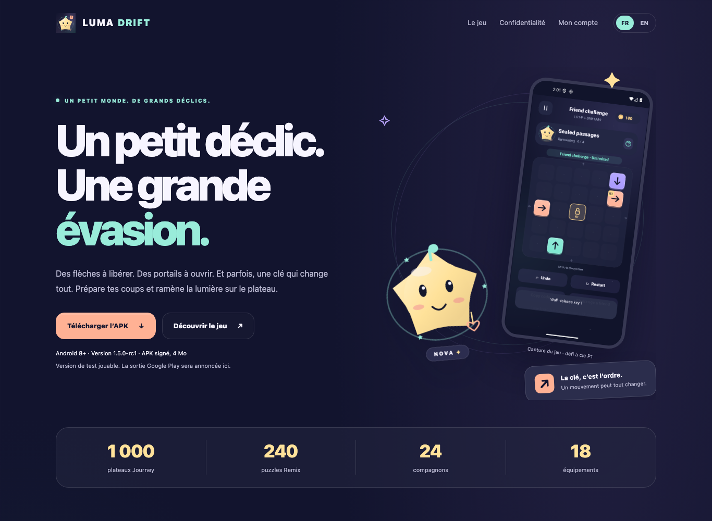
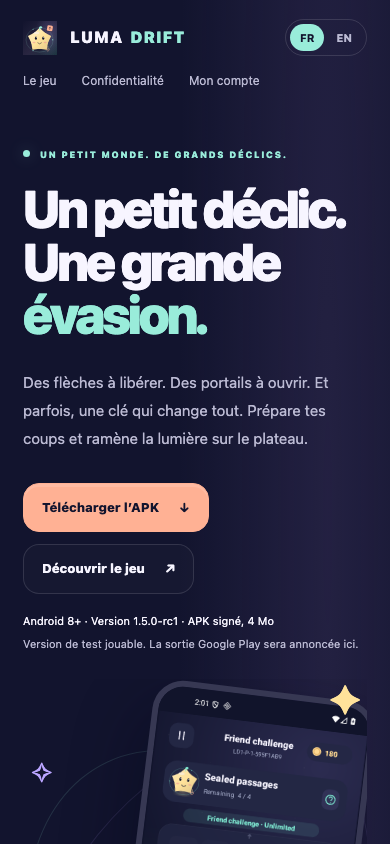

# Luma Drift 1.5 — site and repository visual refresh

27 October 2026. The public pages now share the game's indigo, mint, peach, lilac and Nova identity. The home page shows real Android captures, the 1,000 Journey / 240 Remix routes, six separate sealed-passage prototypes, equipment and direct signed-APK downloads. French and English share functional account/privacy navigation. Android code and release packages are unchanged.

## Executed local checks

- [Static checks](static-check.txt): three HTML pages, local targets and exact publisher configuration pass. Real commerce remains under qualification.
- [Browser checks](browser-check.txt): 18 FR/EN states across 320, 390 and 1366 pixels; no horizontal overflow, missing local resource, default external request or browser exception. Three gallery images follow the language and actually decode. Both APK actions reference the shipped file. Cross-page language selection, keyboard skip navigation and reduced-motion behavior pass.
- [Deletion-core regression](deletion-core.txt): 24 tests pass. The browser run additionally covers two missing-wallet states and synthetic sign-in/deletion, explicit checkbox, expired session, ambiguous response and cancel. Only three synthetic DELETE calls occur. No real Google sign-in or server deletion was attempted.
- [Source manifest](source-manifest.json): hashes and sizes of all 23 Hosting payloads, plus the Firebase configuration hash. HTML requests revalidate; shared CSS/JS/favicon references include a version query to avoid stale visual assets.
- [Asset provenance](source-assets.json): eight unedited game captures and four copies from the original vector brand kit. The older P1 capture retains its predecessor scope; final share rendering and EN/FR gallery captures retain theirs.
- [Original brand kit](../../store/README.md): editable SVGs, rendered PNGs, dimensions, hashes and independent checks.

The first local pilot exposed decorative orbit overflow at 320 pixels; it was fixed within the illustration component and the complete run passed afterward. An early immediate `decode()` assertion raced lazy-image loading; the driver now waits for a loaded image before decoding. [Pilot records](pilots/). These pilots do not override the final passing report.

## Visual review

16 actual local browser captures are under [site screenshots](../../screenshots/site-v1.5/). Representative views:

| Desktop | Mobile |
|---|---|
|  |  |

The desktop/mobile hero, rendered brand banner and desktop account page were inspected without blocking clipping or broken imagery. These are local renders; deployed delivery requires its separate result below. Bounds, keyboard and synthetic-flow checks do not establish complete screen-reader usability, native-speaker review or a real account transaction.

## Deployment

The existing Firebase site remains `luma-drift-production`, with stable URL <https://luma-drift-production.web.app/>. Cloud Shell authentication and read access to this exact site have been verified. The redesigned payload is prepared for publication; a Hosting update is not established by this source report. Root will record a successful deployment and public-payload comparison separately after it occurs.
