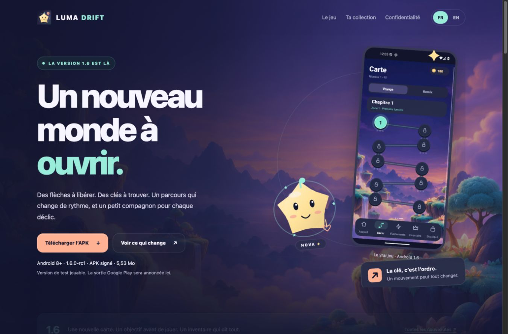
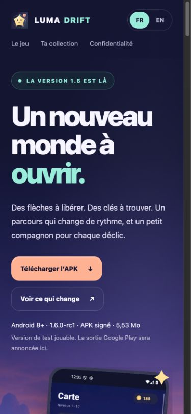

# Luma Drift 1.6 — public website refresh

27 October 2026. The website follows the Android 1.6 presentation: Aurora Atlas environment, ten-level map, prelevel objective, action limits, progressive keys and seals, six powers and readable ownership states. Both download actions target the signed `1.6.0-rc1` APK. French and English text, image sources, alternative text and page metadata change together.

## Exact scope

This change affects static pages, public assets, site checks and documentation only. Android code, signed APK/AAB bytes, backend configuration, provider settings and historical release evidence are unchanged. The public support address, identity/deletion flow and `preparation: true` remain configured as before. No Analytics SDK, remote fonts or autoplay audio were introduced.

The page states that the APK uses test ads, real checkout remains disabled and Google sign-in does not synchronize gameplay saves. It does not claim a Play launch, commerce qualification or retention results. Journey keys start at level 12; the six unlimited workshop challenges remain a separate Events activity.

## Executed checks

| Evidence | Result | Boundary |
|---|---|---|
| [Static checks](static-check.txt) and [structured assertions](static-check.json) | 3 HTML pages, 2,012 offline assertions, 66 local references, zero failures | Source/DOM/hash checks; no live network request |
| [Browser matrix](browser-check.json) | 18 states: 3 pages × FR/EN × 320/390/1366 px; one visible h1/main, correct language and no horizontal overflow or broken visible image | CUA in-app browser against loopback preview, not the public origin |
| Language and gallery interaction | EN button, cross-page privacy/deletion continuity and all five localized image placements loaded; mobile gallery checked | Real local UI actions; five placements use four distinct screenshot subjects |
| Deletion guard / keyboard | Confirmation initially unchecked, deletion disabled; keyboard focus visibly outlined | No Google sign-in and no real deletion executed |
| [Deletion-core regression](deletion-core-tests.txt) | 24 tests passed | URL/token/HTTP-error contracts, not provider execution |
| [Legacy static check](legacy-static-check.txt) | Three pages and 44 checked local references | Narrower earlier checker; source checker above is the current comprehensive record |

`node --check public/assets/site.js`, [browser-runner syntax](browser-runner-syntax.txt) and `git diff --check` passed. [Local document links](document-links.txt) also resolve. No browser console error was captured in the local run. Browser screenshots were visually inspected on desktop and at 320/390 pixels. The autonomous Playwright runner was not executed during this turn; CUA supplied the current browser observations. Reduced-motion CSS is retained, but an operating-system reduced-motion setting and complete screen-reader behavior were not separately exercised in this run.

The first gallery measurement occurred during smooth anchor scrolling, before lazy images loaded. After the actual scroll completed, all five EN image placements loaded; the final gallery record and saved screenshot reflect the settled state. This was not a failed production request.

## Art and screenshots

[Source manifest](source-manifest.json) identifies all 36 Hosting payloads and the Firebase configuration hash. [Asset provenance](source-assets.json) traces 26 visual files, including eleven byte-exact copies of final production Android 1.6 captures. Only the map, briefing, home and inventory subjects appear in the localized homepage. The home capture resumes a preserved challenge and must not be described as a fresh Journey attempt.

The original Nova/vector brand kit retains its 1.5 provenance. Aurora Atlas retains its [pixel-generation record](../../art/aurora-atlas-v1.json). The key/wall SVG is a new explanatory illustration, explicitly labelled as such; it is not an Android screenshot or a certified playable puzzle. CSS frames, cropping and surrounding artwork are website composition.

Actual local browser captures are under [site screenshots](../../screenshots/site-v1.6/):

| Desktop | Mobile |
|---|---|
|  |  |

[English gallery](../../screenshots/site-v1.6/collection-en-1366.png) · [French mobile collection](../../screenshots/site-v1.6/collection-fr-390.png) · [320-pixel preview](../../screenshots/site-v1.6/home-fr-320-hero.png).

## Delivery

**Published 27 October 2026 through the existing Firebase Hosting site `luma-drift-production`.** [Public site](https://luma-drift-production.web.app/) · [Delivery metadata](delivery.json) · [Observed Cloud Shell output](cloud-shell-deployment.txt) · [Actual deployment confirmation](../../screenshots/site-v1.6/firebase-deploy-complete.png).

Source commit: [446110346ed76c6303132d8d1b78620499f29dd9](https://github.com/nabz0r/AndroidHit/commit/446110346ed76c6303132d8d1b78620499f29dd9). Tree: `671e5f038b654fcfea3f6beae9bd965e2d789a3d`. The clean Cloud Shell checkout, all 36 public source payloads, source-manifest SHA-256 and Firebase configuration hash matched before deployment. Firebase CLI 15.33.0 reported upload complete, version finalized, release complete and Deploy complete for hosting only.

The [live-channel management metadata](firebase-live-release.json) identifies finalized version `b71320d62da02abb`, released at `2026-10-27T11:46:29.811Z`. No public-origin browser or HTTP probe was performed during this turn: served-byte equivalence and public response headers are not independently requalified. The screenshots above remain local browser previews. Earlier [1.5 delivery observations](../site-v1.5/README.md) retain their original revision and scope.

## Reproduce source checks

```sh
python3 scripts/check-site-v16.py
node --test public/tests/deletion-core.test.mjs
node public/tests/check-static.mjs
node --check public/assets/site.js
```

For rendering review, serve `public/` on loopback and navigate the three routes with FR/EN at 320, 390 and 1366 pixels using CUA. Avoid real account actions. Do not reinterpret a configured account button or a local synthetic response as a successful production authentication/deletion.
