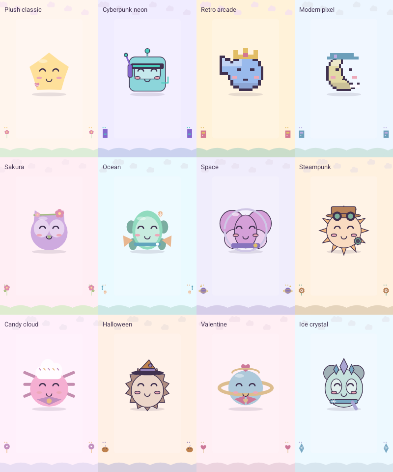

# Companion visual treatments — 1.9

The renderer composes **24 existing companion identities × 12 freely selectable visual treatments = 288 variants**. These are combinations of original code-drawn silhouettes, accessories and rendering rules, not a claim of 288 hand-painted images. Choosing a treatment does not grant ownership of a character or alter its price, equipment, powers, rewards or puzzle rules.

The three drawing families are soft plush vectors, fine comic outlines, and explicit rectangular pixel grids. Every treatment also changes geometry: headset/visor, block crown, pixel cap, flowers, fins and shell, space helmet, top hat and goggles, candy cap and bow, witch hat, heart halo, or crystal crown and scarf. The existing 24 companion IDs keep their own silhouettes. French, English, Spanish, German, Portuguese and Italian labels are in the immutable catalogue.

## Integration API

```java
AvatarStage stage = new AvatarStage(); // one instance per UI thread
stage.draw(canvas, character, x, y, radius, styleId,
        AvatarStage.Pose.HAPPY, frameTimeMillis, reduceMotion);
stage.drawBackdrop(canvas, width, height, styleId,
        actualCompletionFraction, frameTimeMillis, reduceMotion);
```

`AvatarStyles.DEFAULT_ID` is `plush_classic`; `AvatarStyles.find` safely falls back to that style for a missing or unsupported saved preference. `all()` is unmodifiable and each style is immutable. `variantId(character, styleId)` is a composite visual ID, never an ownership receipt.

`progress` must be the caller's **real completion fraction**, normalised to 0–1. The backdrop uses restrained near/far scenery at the top/bottom edges. Fixed landmark details change at actual completion deciles; they do not promise an unearned reward. Reduced-motion mode freezes time-driven bob, rotation and scenery, as well as progression-driven parallax. Its fixed semantic landmark can still report a newly completed decile.

The companion can extend up to approximately `1.65 × radius` around its centre; reserve that art area when laying out a card. Visual bob and tilt remain within that envelope. Neither API creates or moves a touch target. The backdrop's central reading area has a quiet light veil; the caller must still draw its existing opaque card/board surface over it. Pixel treatment is meant for companions and art, not small body text or controls.

The renderer reuses one Paint and one Path, and allocates no bitmap, shader, array or path during a drawing call. Pixel treatment uses more draw primitives than plush vectors. This is an allocation contract, **not** a measured frame-rate guarantee.

## Evidence

- [host-validation.json](host-validation.json): **7,249 checks**, all 288 variants and all five poses exercised using a recording Canvas double.
- [command-fingerprints.csv](command-fingerprints.csv): SHA-256 of drawing commands for every variant/pose. Tests also compare geometry while ignoring all colours: each style retains 24 distinct companion geometries and each companion has 12 distinct treatments. They verify reduced-motion determinism, fallback, labels, bounds guards and balanced Canvas saves/restores.
- Real SDK API compilation of Catalog, AvatarStyles and AvatarStage against Android 36 completed successfully. The host double does **not** rasterise pixels and does not validate the Android driver, the integrated screens, animation smoothness, human readability or appeal.

Reproduce host contracts with `bash docs/validation/v1.9/avatar/run-host.sh`. This builds in a temporary directory and changes no user save.

## Native PNG export — executed

The [native report](native-output/native-export.json) and [wrapper](native-wrapper.json) record a successful API-36 Android Canvas/Bitmap run on the separate Google Play QA emulator B. Fourteen original PNGs cover all **288 combinations**, all five poses and all twelve scenery treatments. The cyberpunk, modern-pixel, retro and backdrop contact sheets were visually inspected; their tiles and labels remain inside the image bounds.

These are **raster exports of renderer source bodies**, not screenshots of the integrated game or proof of animation performance. The signed application is unchanged. R8 removes/inlines catalogue helpers, so the test uses [three package-prefix-only copies](native-source-manifest.json), generated by [prepare-native.py](prepare-native.py); reversing the namespace replacement must recover each original source byte for byte. Actual app screens have separate native UI reports.

[AvatarAtlasInstrumentation.java](native/AvatarAtlasInstrumentation.java) starts no Activity and writes no preferences. It writes an isolated `avatar-v19/` art folder under the QA application's external-files directory. The first attempt could not write to the test-package external directory; the second exposed the R8 method removal. Both raw failed wrappers remain named as failures. Neither is reported as successful native acceptance.

```sh
python3 docs/validation/v1.9/avatar/prepare-native.py
./gradlew -I docs/validation/v1.9/avatar/native-export.gradle :app:assembleLabReleaseAndroidTest
# Install only this test APK on the chosen QA device, then use SDK instrumentation:
adb -s emulator-5584 shell am instrument -w -r \
  com.androidhit.lumadrift.sandbox.test/com.androidhit.lumadrift.qa.AvatarAtlasInstrumentation
```


