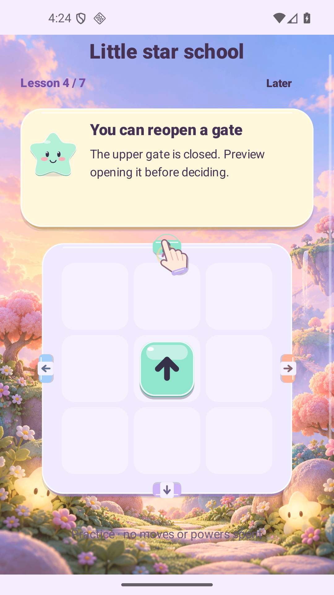

# Reproduced 1.8 tutorial gate gesture regression

The native SDK run deliberately tests the frozen, already installed Lab **1.8.0 / code 9** APK. Its SHA-256 is `f93467a11073a0f01c9b09ae6e73aebe211f700661a21c54097cebf1063a034d`, identical to the published 1.8 Lab artifact. No application APK was rebuilt or installed for this run; only the independent `qa.v19` test APK was built and installed.

The [raw native report](report.json) is **FAIL** at the intended assertion. The [host report](host-report.json) records `passed: false`, `expected_failure_observed: true` and `restored: true`. This is a reproduced pre-fix defect, not a release pass.

Through actual visible teaching controls the run reached lesson 4 at `T1|3|0|ACTIVE|`. The upper gate's native accessibility bounds were observed immediately before the gesture. The test sent a touchscreen DOWN 15 logical points below the gate center, six MOVE events to its center, then UP at its center, matching the hand coach's displayed motion. [The recorded event](gate-drift.json) contains the observed bounds, scale, coordinates, duration and unchanged before/after state. The required phase-1 preview did not open.



The owned QA emulator used API 36, arm64, actual 16 KiB pages. Its display was temporarily configured by `UiAutomation.executeShellCommand` to 1080×1920, making the portrait tutorial taller than the visible content. The 15-point vertical drift crossed the old scroll threshold and canceled the gate action. The old 1.8 harness used an accessibility click for this gate and therefore did not exercise this touch path.

All original preference files and bytes were backed up before the run and restored afterward. Original rotation settings and the 1080×2340 display configuration were also verified restored. No profile, stock, currency or progress was injected. The run never used account, ad or payment controls. PNGs are original SDK screenshot encodings without edits.

An earlier helper failure is preserved separately under `ui-baseline-lesson4-pilot1`: it tried a bottom skip button that was outside the compact viewport. That pilot did not reach the target assertion and is not treated as a reproduced game defect.

Reproduce with the frozen 1.8 Lab APK already installed on the designated QA emulator:

```sh
python3 scripts/v19-ui-test/run.py --allow-v18 --compact --cases gate-drift \
  --label NEW-BASELINE-LABEL --expected-apk releases/luma-drift-1.8.0-sandbox.apk
```

The wrapper refuses overwriting evidence, requires exact APK bytes and a guest-only QA profile, and treats the specific unchanged phase-0 failure as expected. A different failure cannot count as a reproduced regression.
