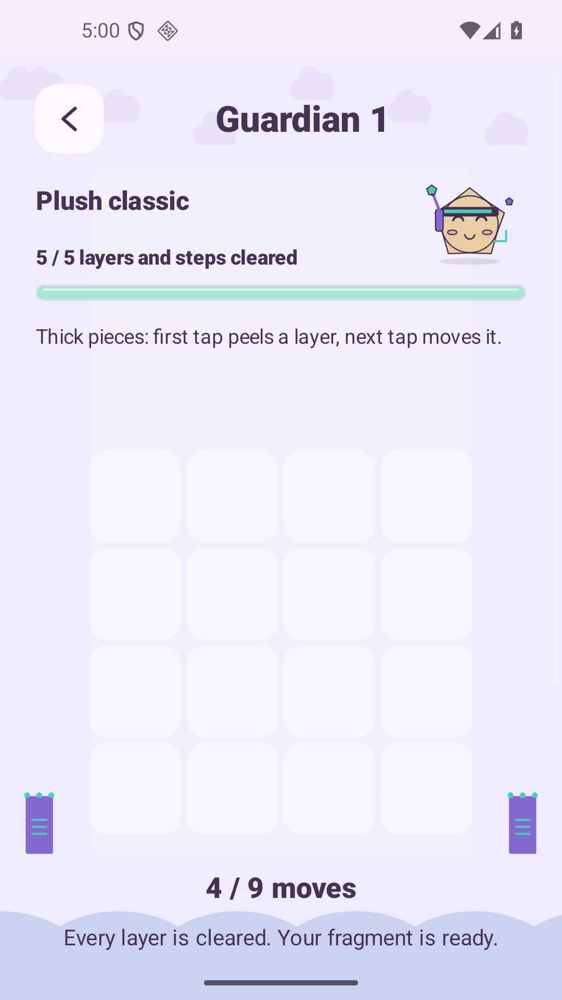

# Final3 first 100 native checks — raw late harness failure retained

This run uses the final3 Lab APK, SHA-256 `a16fbc03a75455805b7f3f491a8fc26cddc4e33637ec0b8bc1668700e83de36f`, on the owned API 36 / 16 KiB QA emulator at a temporarily compact 1080×1920 viewport. [The raw native report](report.json) remains **FAIL**, with 2,171 checks in total. [The host report](host-report.json) verifies exact installed bytes and exact restoration of original private preference files, display size and rotation.

## What passed before the late failure

- All seven tutorial lessons, the real 15-point gate gesture, preview rotation and skip/resume, two physical confirmation taps recording one opening, wrong/correct-direction native drags, and the unique welcome reward.
- Journey 1 through 100, each played through actual native piece taps and typed gate openings. Every level has its clear, visible 3-star grade and certified-budget checks passed. All action previews use actual touches on Confirm; the first also uses actual Cancel, verifies no history/budget change and reopens the preview. No scroll workaround hides the fixed modal placement.
- Free Undo at zero actions, an actual gate hint charge with repeat-tap protection, the actual three-action Flow sequence, the five-clear gift on Rewards, all six explicit power sample grants and the twelve free styles with saved ownership/style checks.
- Guardian 1's real layer peel, free Undo/refund and completed action history, including visible 5/5 work after leaving/reopening.

[The source-bound individual Journey JSON](journey-100-individual.json) and [CSV](journey-100-individual.csv) extract **300 actual passed assertions**, three per level 1–100, while retaining `source_suite_passed:false`. Each record preserves its exact native message and the raw report hash. Reproduce extraction with `python3 scripts/v19-ui-test/extract-journey-report.py --label final3-full100 --through 100`.

## Why the raw suite stopped

The last check combined two conditions: exact completed guardian save restored, and its reward button already visible without scrolling. The guardian was correctly restored as solved; the screenshot shows 5/5 work. Its reward button sits lower in a normal scrollable guardian page. The old combined assertion failed because it did not scroll before checking the button.

The application was not changed for this harness correction. The follow-up `ui-sdk-final3-menus` run on the same APK separates exact-state validation from a real normal page scroll to its reward button. It legitimately replays 50 Journey levels to unlock Guardian 5, rather than injecting progress or editing a profile. Guardian 5, reward claims and remaining language checks must be assessed from that separate report; this raw failure is not relabeled as an overall pass.

The exact runner source used for this run is preserved in [runner-source.java.txt](runner-source.java.txt). All PNGs are original SDK screenshots. These are deterministic app-interaction checks, not measured human enjoyment or demographic retention.

Redundant superseded-candidate PNGs are curated out of the Git payload; original hashes and the retained failure/preview/100-clear illustrations are listed in the [curation manifest](../pilot-screenshot-curation.json). Selected FINAL4 captures are separate.
